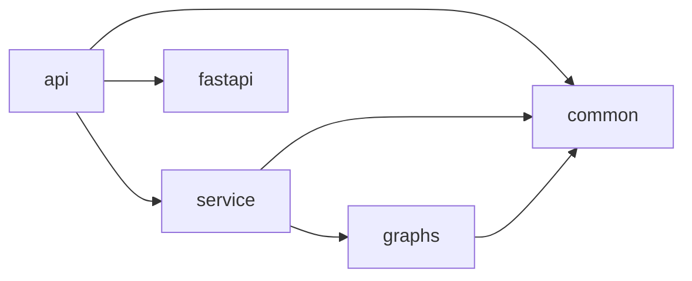

# 后端地图（调研起点）

`AGENTS.md`「架构约束」是唯一规则来源；本文件只是**调研索引**：先知道该读哪几个文件，
再去读它们核实到行号，别拿本文件当证据。所有路径相对仓库根，`backend/` 是 `sys.path` 根
（import 写 `from common.xxx import ...`，不带 `backend.` 前缀）。

## 1. 分层与依赖



| 层 | 目录 | 职责 | 允许依赖 |
| --- | --- | --- | --- |
| HTTP | `backend/api/` | 路由、DTO 信封、SSE 传输、启动自检 | service、common、fastapi |
| 编排 | `backend/service/` | 把图或仓储包装成业务能力，异常翻译 | graphs、common |
| 图 | `backend/graphs/` | LangGraph 节点与状态机 | common |
| 共享 | `backend/common/` | 配置、日志、模型、客户端、事件、仓储、schema、工具 | 内部按 tier |

`common` 内部 tier：`0 utils/prompt/schema` < `1 config` < `2 logging/model` < `3 client/events` < `4 store`；
只允许高 tier 依赖低 tier，**同 tier 的不同子包禁止互相 import**。校验：`tools/check_layers.py`。

## 2. 关键锚点

| 文件 | 职责 | 关键符号 |
| --- | --- | --- |
| `backend/api/main.py` | FastAPI 应用、全部业务路由、上传落盘 | `router = APIRouter(prefix="/api")`（L89）、`/health`（L114）、`lifespan`（启动自检 + 清扫） |
| `backend/api/schemas.py` | HTTP 信封 DTO（请求/响应组合） | `UploadResponse`、`QueryRequest`、`DocsListResponse` |
| `backend/api/sse.py` | SSE 传输适配 | `sse_stream`（L27）——全仓唯一在事件链路 import fastapi 的文件 |
| `backend/api/startup_checks.py` | 启动自检 | 外部服务连通性、单 worker 警告 |
| `backend/service/query_service.py` | 查询编排 | `arun_query`：`TASK_MANAGER.set_status` + `EVENT_BUS.push` 收口 |
| `backend/service/import_service.py` | 导入编排 | `arun_import` |
| `backend/service/docs_service.py` | 文档列表/详情/删除 | `count_docs`(L35) / `list_docs`(L40) / `get_doc_detail`(L66) / `delete_doc`(L74)，领域异常 → HTTP 语义 |
| `backend/graphs/*_graph/` | 图状态机 | `query_graph_state.py` / `import_graph_state.py` + `nodes/` |
| `backend/common/schema/doc.py` | 领域模型 | `DocItem` / `DocDetail` / `DocChunk`（tier 0，跨层共用） |
| `backend/common/config/app_config.py` | 运行时参数 | `APP_CONFIG`（分块、召回、RRF、TTL、上传上限、`files_proxy_prefix`…） |
| `backend/common/config/env_config.py` | 环境变量 | `ENV_CONFIG`：`log` / `mineru` / `minio` / `milvus` / `mongodb` / `dashscope` |
| `backend/common/config/path_config.py` | 路径 | `PROJECT_ROOT`、`TMP_DIR`、`UPLOAD_TMP_DIR` |
| `backend/common/model/registry.py` | 模型角色绑定 | `LLM` / `VLM` / `EMBEDDING` / `RERANKER` |
| `backend/common/model/qwen3_vl_plus.py` | VLM 封装（`ChatOpenAI` 子类） | `usage_metadata` 只在 `__main__` 示例里读过（L75、L121，`__main__` 从 L48 起），**生产链路未采集**；要本地估算 token 用 `backend/common/utils/tokenizer.py:62` 的 `compute_token` |
| `backend/common/client/milvus_client.py` | Milvus 客户端 | `MilvusDocsField`(L19)、`prepare_docs_collection`(L525)、`prepare_chunks_collection`(L613)、`query_docs_page`(L459)、`count_docs`(L485) |
| `backend/common/client/minio_client.py` | MinIO 客户端 | `upload_file`(L165)、`get_object_stream`(L188)、`doc_artifact_prefix`(L97) |
| `backend/common/client/mongodb_client.py` | MongoDB 客户端 | `MiniRagMongoClient`（惰性连接，`check_health` 才 ping） |
| `backend/common/events/event_bus.py` | SSE 通道（进程内） | `SSEEvent`(L16)：`ready/progress/fork/child-progress/delta/final/error/__close__` |
| `backend/common/events/task_manager.py` | 任务状态机（进程内） | `TASK_MANAGER`、`TaskStatus`(L18) |
| `backend/common/events/tracing.py` | 节点装饰器 | `trace_node`(L148) / `node_log` / `step_log` |
| `backend/common/store/__init__.py` | 仓储单例出口 | `CHAT_HISTORY_MANAGER`（Mongo）、`DOCUMENT_REPO`（MinIO + Milvus） |
| `backend/common/utils/` | 纯工具 | `brief` / `net`(probe_tcp) / `tokenizer` / `markdown_splitter` / `markdown_image` |
| `frontend/src/lib/api/` | 前端契约同步点 | `client.ts`（`API_BASE` L22、`request` L40）、`chat.ts`、`docs.ts`、`upload.ts` |
| `tools/` | 非生产脚本 | `check_layout.py`、`check_layers.py`、`reset_db.py`、`make_env_example.py` |

## 3. 改动类型 → 先读什么 → 常见落点

| 改动类型 | 先读 | 常见落点 |
| --- | --- | --- |
| 新增 HTTP 端点 | `api/main.py`（挂载方式）、`api/schemas.py`、`service/` 同类服务 | `api/main.py` 加 `@router.get/post`；信封加到 `api/schemas.py`；业务写进 `service/<x>_service.py` |
| 新增响应字段 / DTO | `common/schema/` 与 `api/schemas.py` 的分工 | 领域形状进 `common/schema/` 并在 `__init__.py` 导出；只属于 HTTP 的信封留 `api/schemas.py` |
| 新增持久化表（Mongo） | `client/mongodb_client.py`、`store/chat_history.py`（单例 + 建索引写法） | `store/<x>.py` 新 manager，建索引在 `__init__`（幂等），单例从 `store/__init__.py` 导出 |
| Milvus 字段 / 集合变更 | `client/milvus_client.py`（`MilvusDocsField` / `MilvusChunksField` / `prepare_*_collection`） | 字段常量 + `TypedDict` + `prepare_*_collection` 同步；**集合只在不存在时创建，改 schema 必须 drop 重建**（`tools/reset_db.py`） |
| 新增对象存储制品 | `client/minio_client.py`（`upload_file` / `doc_artifact_prefix` / `clear_doc_artifacts`） | 前缀常量走 `ENV_CONFIG.minio.*_dir`；入库链接用相对代理路径 `/api/files/<object>` |
| 新增外部服务客户端 | `client/` 既有客户端、`config/env_config.py`、`.env.example` | 客户端封装 + `check_health`；新环境变量进 `env_config` 并同步 `.env.example`（`tools/make_env_example.py`） |
| 新增 SSE 事件 / 实时推送 | `events/event_bus.py`（`SSEEvent`）、`events/task_manager.py`、`api/sse.py`、`service/*` 的收口写法 | 新事件常量 + 通道 `create` / `push` / `close`；**只有 api 层能碰 fastapi** |
| 新增 / 改图节点 | `graphs/<g>/<g>_state.py`、`<g>.py`、`nodes/` | state 加 TypedDict 字段 → 节点函数（`trace_node` 装饰）→ 注册边；节点只依赖 common |
| 用量 / 指标采集（token、耗时、调用次数） | `model/*`（T2）、`client/*`（T3）、`store/*`（T4）、`tools/check_layers.py` | 采集点在 T2/T3，写入必须在 T4：**在 T0（`schema/`）定协议，T4（`store/`）实现，由 service 构造后注入**；封装里直接 import `store` 必触发分层校验。LLM/VLM 是 LangChain 模型（可走 callback 或 `usage_metadata`），Embedding/Reranker 是 dashscope 原生对象，只能显式传 sink 参数 |
| 新增配置项 | `config/app_config.py` 和 `env_config.py` 的分工 | 运行时参数 → `app_config`；外部服务/密钥/地址 → `env_config`；路径 → `path_config` |
| 前端契约同步 | `frontend/src/lib/api/*.ts`、`frontend/src/types/` | 新端点加封装函数与类型；字段名与后端 JSON 完全一致 |
| 上传 / 导入链路 | `api/main.py` 上传段、`service/import_service.py`、`graphs/import_graph/` | 注意 `max_upload_bytes`（10 MiB，超限 413）与 `TASK_MANAGER.fork` 的 md 子任务模型 |

## 4. 既有模式速查（照抄，不要新造）

- **单例出口**：单例在模块底部定义，只在 `common/<pkg>/__init__.py` re-export，业务侧 `from common.<pkg> import XXX`；`api` 层不 `new`。
- **SSE 收口**：`EVENT_BUS.create(id)` → `push(id, SSEEvent.X, data)` → `push(id, SSEEvent.CLOSE, {})`；失败路径也要关流。
- **任务状态**：`TASK_MANAGER.set_status` 记整体状态，`add_running/add_done/add_failed` 记节点；`trace_node(need_push=True)` 才推快照。
- **异常翻译**：仓储/服务抛领域异常（如 `DocumentNotFoundError`），api 层译成 `HTTPException(404, detail=...)`。
- **资源代理路径**：入库存 `/api/files/<object>`，读回用 `APP_CONFIG.files_proxy_prefix` 去前缀换对象名。
- **ID 精度**：Milvus auto_id 是 INT64，接口层 `str(id)`，入参 `int(doc_id)` 且非法值 404。
- **分页**：`offset` + `limit`（1~100）+ `total`（`count_docs`）。
- **配置三档**：`app_config` 运行时 / `env_config` 外部服务 / `path_config` 路径。

## 5. 校验与命令

```bash
.venv/bin/ruff check . && .venv/bin/ruff format --check .   # pre-commit 等价
.venv/bin/python tools/check_layout.py                      # README 目录契约
.venv/bin/python tools/check_layers.py                      # 分层依赖 / common tier
.venv/bin/python tools/check_layers.py --list               # 打印每个模块的层级归属
.venv/bin/pytest -q                                         # 单测
.venv/bin/python tools/reset_db.py                          # 清库 + 重建集合/桶（会删数据）
uvicorn --app-dir backend api.main:app --reload             # 后端 :8000
```

方案阶段只需保证「基线是绿的」；代码改动落地后必须全部通过（AGENTS.md「代码验证」）。
注意 `tests/` 目前只有 `conftest.py` 与 `fixtures/`、没有用例，`pytest -q` 空跑也会通过——不能拿它当「新逻辑已被测」的证据。

## 6. 坑（先写进方案，别等实现时踩）

1. **Milvus 没有 schema 迁移**：集合已存在就跳过创建，加/改字段只能 drop 重建，存量数据随之清空。
2. **单 worker 事实**：`TASK_MANAGER` / `EVENT_BUS` 是进程内状态（TTL 兜底 30 分钟），不跨进程、不跨重启；需要这类能力就得显式提出替换存储。
3. **INT64 → JS**：`469734951640943804` 超过 `Number.MAX_SAFE_INTEGER`，任何 JSON 里透传数字都会静默丢精度。
4. **顶层目录契约**：新增顶层目录必须同步 `README.md` 的结构树与「目录约定」表，否则 `check_layout.py` 直接失败。
5. **上传上限**：`max_upload_bytes` 10 MiB，超限 413 并删除半截文件；方案里涉及上传要做单文件大小假设。
6. **dev / prod 地址差异**：dev 前端直连 `:8000`（CORS 放开），prod 走 nginx `/api/` 反代；接口路径一律带 `/api` 前缀两端才一致。
7. **环境变量模板**：`env_config` 加字段后跑 `python tools/make_env_example.py` 同步 `.env.example`，否则部署侧拿不到文档。
8. **导入链路的分叉模型**：zip 按 md 扇出子任务（`TASK_MANAGER.fork` / `child-progress`），改导入链路要考虑父/子任务命名空间。
9. **模型调用点分散**：LLM 在 `graphs/*/nodes/`；Embedding 实际在 `client/milvus_client.py`（L149、L186，检索内部），不在节点里；VLM/Reranker 在 `model/` 封装内。先 `grep -rn "LLM\.\|VLM\.\|EMBEDDING\.\|RERANKER\." backend` 摸清落点，再说「统一在某处计量」。
10. **线程池打断上下文**：`ThreadPoolExecutor` 两处（`node_document_embedding.py:182`、`node_md_img.py:202`），`contextvars` 类隐式传参会漏计，横切上下文只能显式透传。
11. **仓储既有风格是吞异常**：`store/chat_history.py:30-37`、`:83-85` 出错返回 `0` / `[]`。照抄会让「读失败」静默变成 0 值，与 demo 的 error 态冲突——新代码要显式抛领域异常，由 api 译成错误码。
12. **流式 usage 不一定有**：全仓唯一 `stream` 调用点在 `node_answer_output.py:43`，而 `DeepSeekFlash` 总是显式传 `base_url`（`deepseek_flash.py:19`、`:38`），langchain_openai 自动开启 `stream_usage` 的条件不成立 → 需显式 `stream_usage=True` 并实测，别假定有。
13. **多 worker 只告警不拦截**：`startup_checks.warn_multi_worker` 是 WARN，别把正确性建立在进程内累加上（能落库就落库）。
