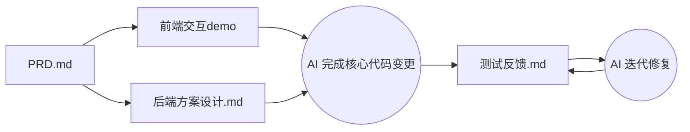
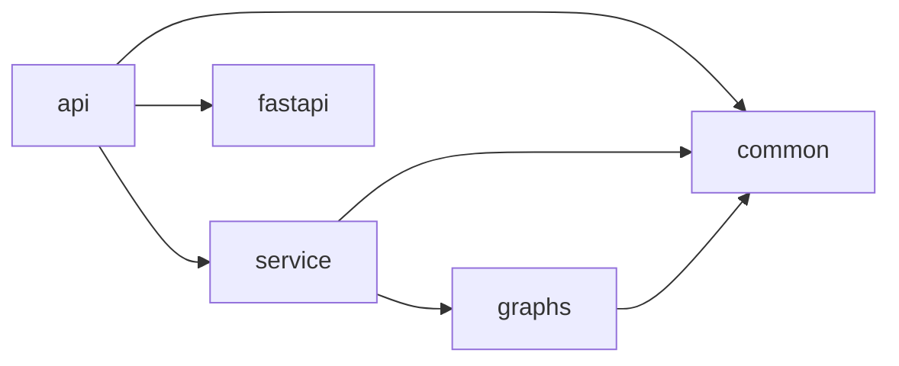

# AGENTS.md

面向所有 AI 编码助手（Claude Code / Codex / Cursor / DSH …）的仓库约定。
**本文件是唯一来源**，各工具的私有配置目录不再单独维护规则。

## 代码验证

- 直接运行目标脚本，或启动服务观察日志（loguru）。
- 临时验证脚本请放 `var/tmp/`（已 gitignore）或用 `uv run python -c '...'`。
- 代码改动必须能通过 pre-commit，过不了就不算完成。手动等价命令：

```shell
.venv/bin/ruff check . && .venv/bin/ruff format --check .
.venv/bin/python tools/check_layout.py     # 目录契约
.venv/bin/python tools/check_layers.py     # 分层依赖
.venv/bin/pytest -q                        # 单测
```

## 关于 Git

- 任何**只读**命令都可以执行：`git status`、`git log`、`git diff`、`git show` 等。
- **不要做任何改变状态的操作**，包括但不限于 `git add`、`git commit`、`git push`、
  `git checkout --`、`git restore`、`git reset`。
- AI 生成代码留在工作区，由人类提交暂存区、提交 commit、以及推送。
  - 人类提交暂存区：认可阶段修改，仍需进一步调整。
  - 人类提交 commit：认可对应任务完成。

## 需求开发 SOP

- AI 与人类通过文档和 commit 协同完成需求。工作流如下:



各个文档需要 AI 完成的内容如下：

### 1. PRD

需要 AI 把后续补充的要求，追加到文档末的评审纪要章节。

### 2. 前端交互demo

根据项目当前状态与需求描述，生成一个交互原型页面，呈现页面布局、动画效果、交互逻辑。

### 后端方案设计.md

根据需求生成给人类阅读审批的方案设计文档。信息精简，尽量突出核心改动和设计思路。

需要有的章节：

1. 架构调整：目录结构、模块划分、依赖关系等的调整。
2. 文件修改清单。
3. 内部重要变更：
   1. schema 的引入和修改
   2. 全局实例的引入和修改

4. 对外重要变更：
   1. 外部服务的 export、import。包括本地封装的客户端。
   2. 数据库、缓存、队列等的引入和修改

5. 验收条件：由 AI 来率先提出验收标准，人类可在 PRD 补充章节中完善。

### 4. 测试反馈.md

AI 阅读文档中尚未回归的测试问题或修改建议，生成代码改动，自测，并更新对应问题的修改结果。

## 架构约束

- 由 `tools/check_layers.py` 检查层级关系，正常改动须遵守，架构调整须同步更新检查脚本。
- `if __name__ == "__main__":` 块不参与校验。

### 一级模块

一级模块模块仅允许按照下图所示的依赖方向进行直接依赖：



### `common` 内部依赖规则

- 核心原则：只允许高 tier 依赖低 tier
- 同 tier 的不同模块 / 子包之间**禁止**互相依赖；同一子包内部自由。

| tier       | 模块                           | 允许 import       |
| ---------- | ------------------------------ | ----------------- |
| **0** 基础 | `utils/`、`prompt/`、`schema/` | 仅标准库 / 第三方 |
| **1** 配置 | `config/`                      | tier 0            |
| **2** 设施 | `logging.py`、`model/`         | tier 0,1          |
| **3** 资源 | `client/`、`events/`           | tier 0,1,2        |
| **4** 聚合 | `store/`                       | tier 0,1,2,3      |

模块职责：

| 模块         | 职责                                    |
| ------------ | --------------------------------------- |
| `schema/`    | 定义全局数据结构约定                    |
| `utils/`     | 提供通用工具函数                        |
| `prompt/`    | 管理提示词及相关功能                    |
| `config/`    | 管理应用配置、环境变量及路径配置        |
| `logging.py` | 提供日志功能                            |
| `model/`     | 封装外部模型调用，如 LLM、VLM、Reranker |
| `client/`    | 封装外部服务客户端，如 Milvus、MinIO    |
| `events/`    | 提供事件处理功能，如 SSE 订阅与推送     |
| `store/`     | 提供数据存储功能                        |

`config/` 内部配置划分：

- `app_config`：应用运行时参数。
- `env_config`：环境变量及外部服务参数，如 API Key。
- `path_config`：路径相关参数。

---

## 注释原则

- 关键 schema 提供示例数据实例。
- 注释尽量不引入文档和需求的内容，保持对代码本身的说明。
- 不生成文件头部的注释。
