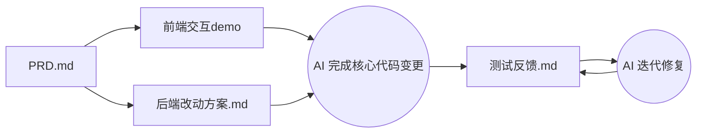

# AGENTS.md

面向所有 AI 编码助手（Claude Code / Codex / Cursor / DSH …）的仓库约定。
**本文件是唯一来源**，各工具的私有配置目录不再单独维护规则。

## 代码验证

- 直接运行目标脚本，或启动服务观察日志（loguru）。
- 临时验证脚本请放 `var/tmp/`（已 gitignore）或用 `uv run python -c '...'`。
- 代码改动必须能通过 pre-commit，过不了就不算完成。手动等价命令：

```shell
.venv/bin/ruff check . && .venv/bin/ruff format --check .
.venv/bin/python tools/check_layout.py     # 目录契约
.venv/bin/python tools/check_layers.py     # 分层依赖
.venv/bin/pytest -q                        # unit + contract（无 key / 无 infra）
.venv/bin/pytest -m integration            # 真 Mongo/MinIO/Milvus（按需）
RUN_LIVE_TESTS=1 .venv/bin/pytest -m live  # 真模型/真 key（手动）
```

## 关于 Git

- 任何**只读**命令都可以执行：`git status`、`git log`、`git diff`、`git show` 等。
- AI 可以自行 `git add` 与 `git commit`：一个任务（或阶段）完成并自测通过后，
  用清晰的 commit message 提交对应改动。
  - 提交前先 `git status` 检查工作区：除本次任务的改动外不得有其他未提交文件，
    否则停止提交并提示人类及时 commit。
  - AI 提交的 commit，message 中需附上生成此次提交的提示词（原始需求/指令）。
- 以下操作仍由人类执行：
  - `git push` 及远端相关操作；
  - 回退类操作：`git checkout --`、`git restore`、`git reset` 等。

## 需求开发 SOP

- AI 与人类通过文档和 commit 协同完成需求。工作流如下:



各个文档需要 AI 完成的内容如下：

### 1. PRD

需要 AI 把后续补充的要求，追加到文档末的评审纪要章节。

### 2. 前端交互demo

根据项目当前状态与需求描述，生成一个交互原型页面，呈现页面布局、动画效果、交互逻辑。

### 后端改动方案.md

根据需求生成给人类阅读审批的方案设计文档。信息精简，尽量突出核心改动和设计思路。

需要有的章节：

1. 架构调整：目录结构、模块划分、依赖关系等的调整。
2. 文件修改清单。
3. 内部重要变更：
   1. schema 的引入和修改
   2. 全局实例的引入和修改

4. 对外重要变更：
   1. 外部服务的 export、import。包括本地封装的客户端。
   2. 数据库、缓存、队列等的引入和修改

5. 验收条件：由 AI 来率先提出验收标准，人类可在 PRD 补充章节中完善。

### 4. 测试反馈.md

AI 阅读文档中尚未回归的测试问题或修改建议，生成代码改动，自测，并更新对应问题的修改结果。

## 历史文档

- `docs/feat/**` 是历史快照，正文里的 `src/`、`web/` 指当时的目录，当前对应 `backend/`、`frontend/`。
- 读历史文档先做路径映射；判断代码现状以仓库为准，不要因旧路径不存在就判断功能不存在。
- 新文档必须用 `backend/`、`frontend/`；不要批量改写历史文档。
- 先读 `docs/feat/README.md` 的状态表，只对「当前有效」的文档按方案施工。
- 找当前实现：只在 `backend/`、`frontend/` 内搜索；`docs/feat/` 只用于查历史决策。

## 架构约束

- 架构说明（分层方向、`common` tier、模块职责、请求与任务链路）统一在
  [docs/architecture.md](docs/architecture.md)，本文件不再重复。
- 由 `tools/check_layers.py` 检查层级关系，正常改动须遵守，架构调整须同步更新检查脚本。
- `if __name__ == "__main__":` 块不参与校验。

### 单例访问约定（测试可替）

- 外部依赖单例一律经**访问器**获取：`common.model.get_llm()`、`common.client.get_milvus_client()`、`common.store.get_document_repo()`；模块底部禁止实例化。
- 消费侧必须**模块命名空间调用**：`from common import client, model, store` 后调用 `model.get_llm()`；禁止 `from common.model import get_llm` 后裸调用（函数对象被绑定进消费模块，测试无法替换）。
- service 边界同理：`from service import query_service` 后调用 `query_service.arun_query()`。
- 只有 `EVENT_BUS` / `TASK_MANAGER`（纯内存、构造无副作用）保留模块级单例；测试用 `clear_all()` 隔离。

### 测试约定

- 入口文档：`docs/manual/backend-testing.md`；默认 `pytest -q` 只跑 unit + contract，无 key、无外部服务。
- 用例命名 `test_<域>__<场景>__<期望>`，docstring 用 Given/When/Then；断言消息写清「期望 vs 实际」。
- 只测契约与不变式，不测日志文案、私有步骤调用次数、prompt 快照、真实模型输出。
- 新增行为先写测试跑红再实现；每个 bug 补一条回归用例；不改测试来适配实现。
- 替换外部依赖用 `tests/support/seams.py::patch_accessors` 或 FastAPI `dependency_overrides`，禁止在默认套件连真实服务。

---

## 注释原则

- 关键 schema 提供示例数据实例。
- 注释尽量不引入文档和需求的内容，保持对代码本身的说明。
- 不要生成文件开头的注释。
