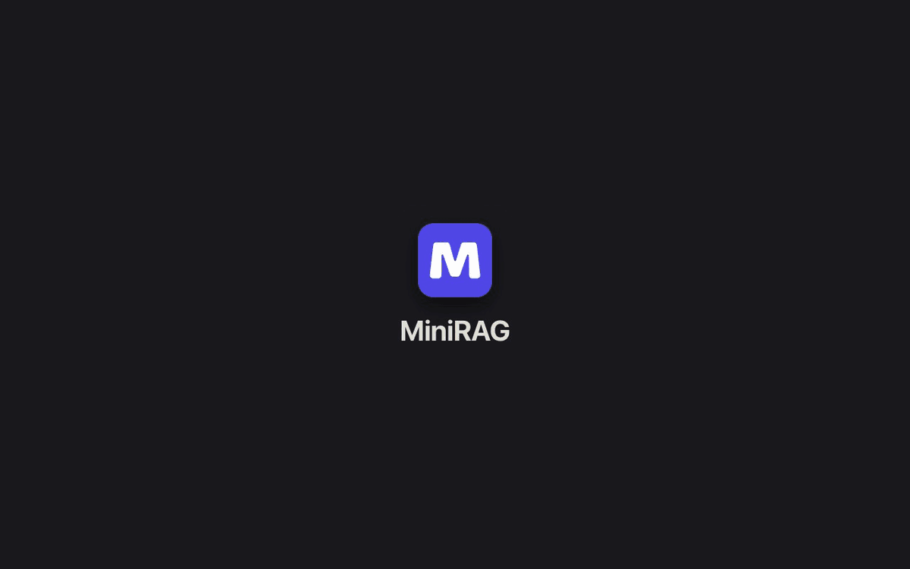
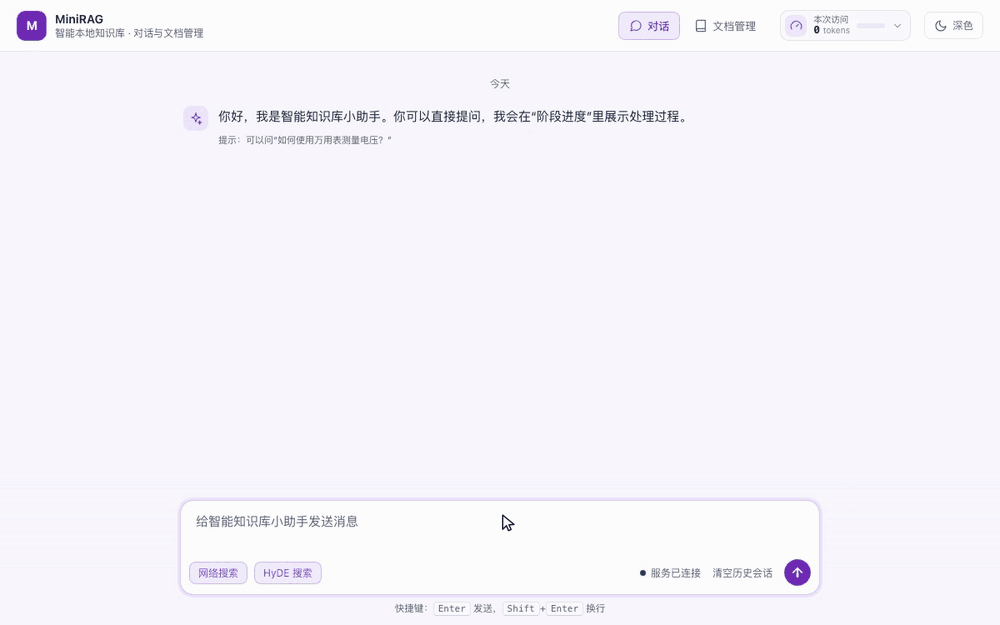
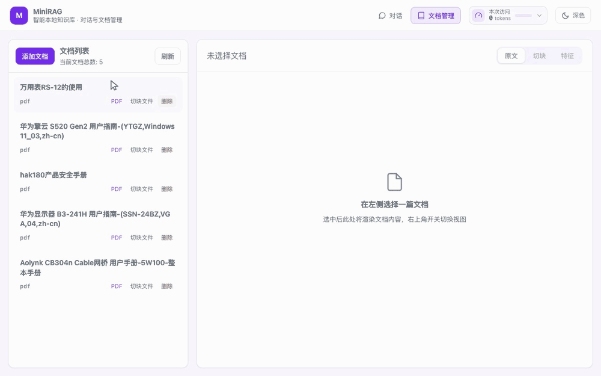

<div align="center">


# MiniRAG

**把一堆文档，变成可以追问的资料库。**

Self-hosted. Hybrid retrieval. Streaming answers. One workspace for all your documents.

[](pyproject.toml) [](backend/api/main.py) [](backend/graphs)
<br />
[](frontend/package.json) [](docs/architecture.md) [](docs/web-deploy.md)

[快速开始](#快速开始) | [系统架构](docs/architecture.md) | [部署手册](docs/setup.md) | [实测演示](#演示)

</div>

上传 PDF / Markdown，自动解析、切分、向量化；提问时走多路召回与精排，
答案通过 SSE 逐字流式返回。后端、前端与存储都能本地一键部署，模型经 DashScope / MinerU 接入。



## 功能

- **文档导入**：PDF（MinerU 转 Markdown）、Markdown、Markdown 压缩包；
  自动下载外链图片、按标题递归切分、向量化入库，导入进度实时推送。
- **混合检索**：查询改写 + 向量召回 + HyDE 假设答案召回，RRF 融合后 Reranker 精排。
- **流式问答**：答案逐 token 推送到前端，支持多轮会话与历史回溯。
- **兜底策略**：文库没有命中时，可启用联网搜索或通识回答。
- **文档与用量管理**：文档列表 / 预览 / 删除，按会话统计 Token 消耗。
- **过程可视**：LangGraph 节点级进度、事件与追溯信息通过 SSE 推给页面。

## 处理流程

导入与查询是两张独立的 LangGraph 图：


节点、状态字段与分叉规则见 [assets/workflow-graph/README.md](assets/workflow-graph/README.md)，
分层与存储设计见 [docs/architecture.md](docs/architecture.md)。

## 演示

全流程演示（深色模式）：ZIP 导入 → 导入任务状态 → Token 统计 → 文档预览 → 图文问答 → 查询任务状态 → 查询 Token 消耗。
动态 demo 源文件：[assets/showcase/overview-demo.html](assets/showcase/overview-demo.html)



<details>
<summary>查询演示</summary>



</details>

<details>
<summary>文档导入演示</summary>



</details>

## 快速开始

前置：Docker / Docker Compose v2、Python 3.12+，以及 `.env` 里的模型配置
（`DASHSCOPE_API_KEY` 用于问答 / Embedding / Rerank / VLM，`MINERU_API_KEY` 用于 PDF 解析，
联网兜底另需 `DASHSCOPE_WEB_SEARCH_MCP_URL`）。

```shell
cp .env.example .env             # 填入模型与外部服务配置
python minirag.py env_check      # 检查系统 / .env / Docker / 网络 / 端口 / 磁盘
python minirag.py env_prepare    # 安装依赖并拉取镜像（国内可加 --mirror cn）
python minirag.py deploy         # 构建并依次拉起 infra → backend → frontend
```

启动后访问 <http://localhost:8080>。`python minirag.py reset --dry-run` 可以先看清理范围。

本地开发：

```shell
uv sync
uvicorn --app-dir backend api.main:app --reload    # 后端 :8000
cd frontend && npm ci && npm run dev               # 前端 :5173，/api 代理到 :8000
cd frontend && npm run storybook                   # 组件工作台 :6006
```

部署参数、国内镜像源与手动 compose 方式见 [docs/setup.md](docs/setup.md)、
[docs/web-deploy.md](docs/web-deploy.md)；CI/CD 见 [docs/notes/ci-cd.md](docs/notes/ci-cd.md)。

## 技术栈

| 层   | 选型                                                                                       |
| ---- | ------------------------------------------------------------------------------------------ |
| 后端 | Python 3.12 · FastAPI · LangGraph · Pydantic · uv                                          |
| 前端 | React 19 · Vite 6 · TypeScript · Zustand · Storybook · Playwright                          |
| 存储 | Milvus（docs / chunks 混合向量）· MinIO（原文与制品）· MongoDB（会话 / 计量）              |
| 模型 | DeepSeek（DashScope 兼容模式，回答）· Qwen（Embedding / Rerank / VLM）· MinerU（PDF 解析） |
| 部署 | Docker Compose（nginx 反代 + 单 worker FastAPI）                                           |

## 文档

| 想了解                       | 看这里                                                                    |
| ---------------------------- | ------------------------------------------------------------------------- |
| 分层、主链路、存储与外部依赖 | [docs/architecture.md](docs/architecture.md)                              |
| 环境检查、一键部署、镜像源   | [docs/setup.md](docs/setup.md) · [docs/web-deploy.md](docs/web-deploy.md) |
| 后端测试分层与写法           | [docs/manual/backend-testing.md](docs/manual/backend-testing.md)          |
| 端到端测试（Playwright）     | [docs/manual/e2e-testing.md](docs/manual/e2e-testing.md)                  |
| 自动部署与回滚               | [docs/notes/ci-cd.md](docs/notes/ci-cd.md)                                |
| 需求过程与历史决策           | [docs/feat/README.md](docs/feat/README.md)                                |
| 架构图 / 流程图的源文件      | [assets/architecture/README.md](assets/architecture/README.md)            |

## 已知限制

**只支持单 worker**：任务进度（`TASK_MANAGER`）与 SSE 通道（`EVENT_BUS`）都是进程内状态，
多 worker 下各进程独立，进度会推到没有订阅者的进程。后端启动时会检测
`WEB_CONCURRENCY` / `UVICORN_WORKERS` 并 WARN。

进程内状态有 30 分钟 TTL 兜底（任务无更新 / 通道无读写即清扫）。横向扩展需要把两者
换成 Redis 等外部存储，接口已按可替换设计。

## 参与开发

- 仓库约定（代码验证、Git、需求 SOP）见 [AGENTS.md](AGENTS.md)。
- 需求按 `PRD → 交互 demo → 后端改动方案 → 动工 → 测试反馈` 推进，
  对应 skill 位于 `.agents/skills/`。
- 提交前必须通过 pre-commit：`ruff`、`check_layout`、`check_layers`、`pytest`。
