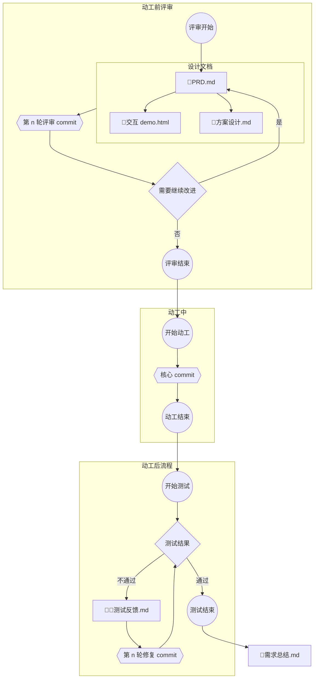

# 需求 SOP 设想

## 主流程



## 各文档说明

### 1. PRD

> 👤 人类编写

需求文档，需求开启的标志，描述需求背景、目的、要怎么做，追踪每一轮评审的纪要。

需要有的章节：

- 现状：锁定注意力，关注当下有问题的地方，同时也相当于归档这个需求做之前是什么样的。
- 目标（正）：要做成什么样，借鉴什么？具体的需求描述。
- 约束（反）：不要去做成什么样。
- 评审纪要：每一轮评审的补充要求，写在这里。

### 2. 交互 demo.html

> 🤖 AI 生成

因为是 Web 应用，AI 非常擅长根据项目临时抄写一个静态页面，呈现页面布局、动画效果、交互逻辑。

所以可以生成一个 demo 页面进行预览。

预览过程，可以用 DevTool 捕捉关键视图元素，用更精准的语言给 AI 描述问题。

基于一个 demo baseline，跟 AI 交流 UI 要求，会更有效率，更高效迭代。

### 3. 方案设计.md

> 🤖 AI 生成

方案设计存在的意义，是在具体的代码改动出来之前，先预览改动的大致思路。

review 文档，而非直接 review 代码 commit，

理想情况，第一次 core commit 就能达到目标，避免纯 Vibe Coding，越改越乱。

需要有的章节：

- 数据结构：重要数据结构的引入和修改，包括但不限于：
  - schemas 的引入和修改
  - 全局实例的引入和修改
  - 数据库、缓存、队列等的引入和修改
  - 对外、跨模块接口的引入和修改
  - 配置文件的引入和修改
- 架构调整：目录结构、模块划分、依赖关系等的调整。
- 文件修改清单：
  - 新增
  - 删除
  - 重命名
  - 修改
- 验收条件：由 AI 来率先提出验收标准，人类可在 PRD 补充章节中完善。

### 4. 测试反馈.md

> 👤🤖 人类与 AI 协作生成

一个章节一个问题，每个问题包括：

- md 标题：👤 问题的简要描述。
- 描述：👤 问题的详细描述，包括出现的场景和影响。
- 修改建议：👤 对问题的修改建议，包括可能的解决方案和注意事项。
- 修改反馈：🤖 问题修改的反馈，附上 fix commit 号

### 5. 需求总结.md

> 🤖 AI 生成

- 前后对比：总结需求变更前后的差异，便于追踪和回顾。
- commit 范围：记录与需求相关的 commit 范围，便于追踪代码变更。
- 实际架构变化。
- 实际修改文件。

## 关键提示词：

1. PRD -> demo.html

```text
请根据 <PRD.md> 的内容，生成 demo.html，展示页面布局、动画效果和交互逻辑。
```

2. PRD -> 方案设计.md

```text
请根据 <PRD.md> 的内容，设计方案，输出到<方案设计.md>。
```

3. 迭代设计文档

```
当前方案设计.md、demo.html 我已提交 commit，有一些新的补充需求，已更新到 prd（暂未提交，在 git 暂存区），
请根据补充内容更新方案设计.md 和 demo.html。
```

4. 动工

```text
当前设计文档已完成评审，准备开始动工，请根据方案设计.md 和 demo.html 进行开发。
```

5. 测试反馈

```text
测试发现问题，已记录在测试反馈.md 中（暂未提交，在 git 暂存区），请根据测试反馈进行修复，并更新相关问题的测试反馈。
```

6. 需求完结

```text
需求已完成，请按相关要求对需求进行归档，输出 <需求总结.md>。
```
