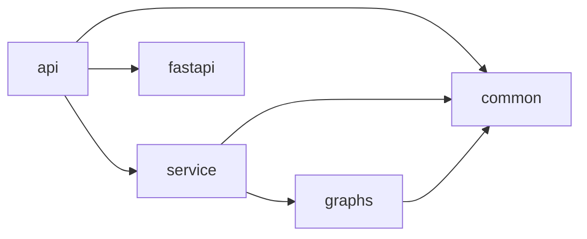

# MiniRAG 架构

> 这里保存当前架构的唯一说明。代码是事实来源：
> 分层由 `tools/check_layers.py` 校验，顶层目录布局由 `tools/check_layout.py` 的 `LAYOUT` 校验。
> 需求过程与历史决策在 `docs/feat/`，不放架构结论。

## 1. 运行形态

```text
浏览器 (React SPA)
   │ HTTP
   ▼
nginx :8080          静态资源 + /api 反代
   │
   ▼
FastAPI :8000        backend/api: 路由 / DTO / SSE 传输 / 启动自检
   │ 调用
   ▼
service              backend/service: 文档 / 导入 / 查询的业务编排
   │ 调用
   ▼
LangGraph 图         backend/graphs: import_graph / query_graph
   │ 经访问器
   ▼
common               backend/common: 配置 / 模型 / 客户端 / 事件 / 存储
   │
   ▼
Milvus · MinIO · MongoDB · 外部模型与检索服务
```

- 部署时只暴露 nginx；本地开发前端 :5173 由 Vite 代理 `/api` 到 :8000。
- 后端**只支持单 worker**：任务进度与 SSE 通道都是进程内状态（见 §4.3）。

## 2. 目录结构

```text
backend/                 Python 源码根，以 backend/ 为 sys.path 根
├── api/                 HTTP 层：main.py 路由 / schemas.py DTO / sse.py / startup_checks.py
├── service/             编排层：docs_service / import_service / query_service
├── graphs/              LangGraph 图
│   ├── import_graph/    导入图 + state + nodes/
│   └── query_graph/     查询图 + state + nodes/
└── common/              唯一共享层（tier 见 §3.2）
frontend/                Vite + React（结构见 §6）
docker/                  compose.{infra,backend,frontend}.yaml + 两个 Dockerfile
docs/                    架构、部署、测试与需求文档（feat/ 是历史快照）
tests/                   unit / contract / integration / live + fixtures
tools/                   维护脚本：check_layout / check_layers / reset_db 等
assets/                  架构图、流程图、演示 GIF
evals/                   RAG 评估问题集与报告
var/                     运行时产物（gitignore）
```

顶层目录是否入库的契约写在 `tools/check_layout.py` 的 `LAYOUT`，此处只是说明。

## 3. 后端分层

### 3.1 一级模块

只允许向下依赖；跨层反向 import 由 `check_layers.py` 拦截。



| 层        | 职责                                                       | 允许 import                    |
| --------- | ---------------------------------------------------------- | ------------------------------ |
| `api/`    | HTTP 入口：路由、请求/响应 DTO、SSE 传输、启动自检         | `api` `service` `graphs` `common`，以及 fastapi / starlette |
| `service/`| 业务编排：把图包装成服务，管理任务、会话与 Token 计量      | `service` `graphs` `common`    |
| `graphs/` | 图定义：state、节点、条件边；只依赖 `common` 的访问器      | `graphs` `common`              |
| `common/` | 唯一共享层：配置、模型、外部客户端、事件、存储             | `common`                       |

只有 `api/` 可以 import fastapi / starlette；Web 框架不进 service 与 graphs。

### 3.2 `common` 内部 tier

只允许高 tier 依赖低 tier；**同 tier 的不同子包之间禁止互相依赖**（同一子包内部自由）。

| tier       | 模块                           | 允许 import       |
| ---------- | ------------------------------ | ----------------- |
| **0** 基础 | `utils/`、`prompt/`、`schema/` | 仅标准库 / 第三方 |
| **1** 配置 | `config/`                      | tier 0            |
| **2** 设施 | `logging.py`、`model/`         | tier 0,1          |
| **3** 资源 | `client/`、`events/`           | tier 0,1,2        |
| **4** 聚合 | `store/`                       | tier 0,1,2,3      |

| 模块         | 职责                                    |
| ------------ | --------------------------------------- |
| `schema/`    | 定义全局数据结构约定                    |
| `utils/`     | 提供通用工具函数                        |
| `prompt/`    | 管理提示词及相关功能                    |
| `config/`    | 管理应用配置、环境变量及路径配置        |
| `logging.py` | 提供日志功能                            |
| `model/`     | 封装外部模型调用，如 LLM、VLM、Reranker |
| `client/`    | 封装外部服务客户端，如 Milvus、MinIO    |
| `events/`    | 提供事件处理功能，如 SSE 订阅与推送     |
| `store/`     | 提供数据存储功能                        |

`config/` 内部划分：`app_config`（运行时参数）、`env_config`（环境变量与外部服务）、`path_config`（路径）。

外部依赖一律经**访问器**获取（`model.get_llm()`、`client.get_milvus_client()`、`store.get_document_repo()`），
以便测试替换；具体写法与测试替身约定见 `AGENTS.md`「单例访问约定」。

## 4. 请求与任务链路

### 4.1 文档导入

1. `POST /api/upload`：文件落盘，创建任务，返回 202 + `task_id`。
2. `import_service.arun_import` 在后台跑 `import_graph`：
   `node_entry` 按 `origin_file_type` 分叉 →
   PDF（MinerU 转 Markdown）/ 独立 Markdown（下载并重写图片）/ Markdown 压缩包（解压、防 zip-slip）→
   `md_tail` 子图：图片识别与替换 → 按标题递归切分 → 向量化写库。
3. 进度经 `TASK_MANAGER` + `EVENT_BUS` 从 `GET /api/upload/sse/{task_id}` 流出。

### 4.2 查询

1. `POST /api/query` → `query_service.arun_query` → `query_graph`。
2. `node_intent_recognize` 识别意图并改写 query，条件扇出到三路召回：
   向量召回（必选）、HyDE 假设答案召回、联网搜索（后两者按开关）。
3. 文库两路经 RRF 融合后与联网结果一起精排，`node_answer_output` 生成答案。
4. 答案不写回 state，只经 `GET /api/query/sse/{session_id}` 推 `DELTA` / `FINAL`，并落库会话历史与 Token 计量。

### 4.3 运行态

- `TASK_MANAGER`（任务进度）与 `EVENT_BUS`（SSE 通道）是进程内单例，多 worker 下各自独立，
  进度会推到没有订阅者的进程，因此只支持单 worker；启动时检测 `WEB_CONCURRENCY` / `UVICORN_WORKERS` 并 WARN。
- 两者有 30 分钟 TTL 兜底（任务无更新 / 通道无读写即清扫），接口按可替换设计，
  横向扩展需换成 Redis 等外部存储。

## 5. 存储与外部依赖

| 组件        | 用途                                       | 接入位置                     |
| ----------- | ------------------------------------------ | ---------------------------- |
| Milvus      | `docs` / `chunks` 两个集合，混合向量检索   | `common/client/milvus_client.py` |
| MinIO       | Markdown 原文、图片、chunks 制品           | `common/client/minio_client.py`  |
| MongoDB     | 会话历史、Token 计量                       | `common/client/mongodb_client.py` |
| DeepSeek    | 答案生成 LLM                               | `common/model/deepseek_flash.py` |
| DashScope   | Embedding / Reranker / VLM（Qwen 系列）    | `common/model/qwen_*.py`     |
| MinerU      | PDF → Markdown                             | `common/client/mineru_client.py` |
| Web Search  | 无命中时的联网兜底（MCP）                  | `common/client/web_search.py` |

## 6. 前端

```text
frontend/src/
├── components/   UI 组件（chat / docs / icons / layout / markdown / ui）
├── pages/        ChatPage / DocumentPage（接线 + 页面私有视觉状态）
├── store/        chatStore / docsStore / tokenUsageStore / preferenceStore
├── lib/          api（client + chat + docs + upload）/ cache / sse
├── hooks/        useApiHealth / useImageUrl / useScrollRestore
├── types/        app / chat / docs 类型契约
├── utils/        纯函数
└── styles/       tokens → base → layout → ui → chat → docs 的层叠顺序
```

- 没有 react-router：`App.tsx` 用 `PageKey` 状态切换，两个页面用 `<Activity>` 双保活；
  SSE 上移到 store，页面隐藏不断流。
- 主题与偏好走 `preferenceStore`（localStorage 同步水合，首帧无闪烁）。
- 组件展示与调试由 Storybook 承接（`frontend/src/stories/`）。

## 7. 约束与校验

| 约束                     | 可执行校验                          | 改哪里                        |
| ------------------------ | ----------------------------------- | ----------------------------- |
| 一级模块依赖方向         | `python tools/check_layers.py`      | 代码                        |
| `common` 子包 tier       | 同上（`--list` 可看归属）           | 新增子包时 `COMMON_TIERS`     |
| 顶层目录入库布局         | `python tools/check_layout.py`      | 新增顶层目录时 `LAYOUT`       |

架构调整必须同步更新检查脚本，否则 pre-commit 与 CI 都会失败。

## 8. 图示

- `assets/architecture/`：组件级交互架构图（HTML）与静态 SVG，重新生成见该目录 README。
- `assets/workflow-graph/`：导入 / 查询两张流程图的 HTML、动画 SVG，以及节点级说明。
- `docs/manual/`：后端测试与端到端测试的入口文档。
