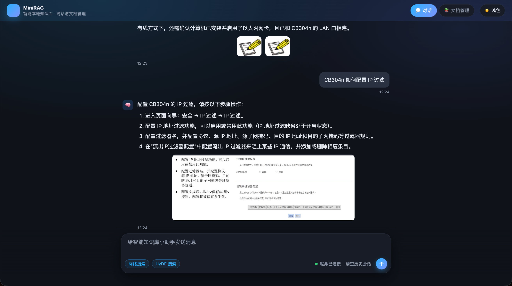
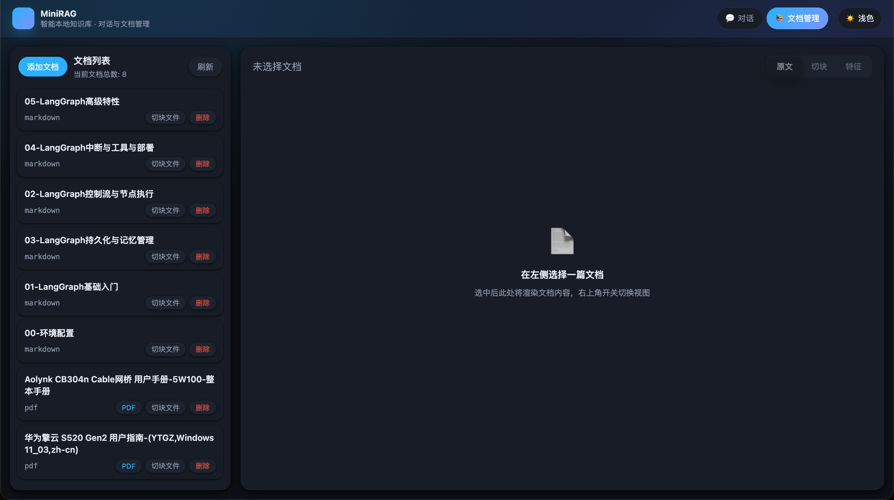

# Session-MVVM PRD V0

## 现状

目前的页面有两个 Tab，分别是“会话列表”和“会话详情”。

切换 Tab 后，页面会重新渲染。

从会话页切走后，再进入会话页，图片需要重新请求，原先的会话 cursor 也丢失了，会自动跳转到会话末尾。

从文档管理页切走后，再进入文档管理页，会像第一次打开一样，右边是缺省页，非常不方便两个 Tab 来回切换的交互场景，比如对照文档问问题。

更严重的是，切换页面后，一些 processing 的任务会在前端丢失跟踪。

|                                  |                                  |
| -------------------------------- | -------------------------------- |
|  |  |

## 需求

我们需要一个类似 "ViewModel" 的机制来管理:

- 页面状态
- 缓存网络请求得到的数据(图片、markdown 文档等)

目前技术选型不确定，需要调研相关方式，例如：

1. 前端成熟框架。
2. 浏览器本地存储，例如 Cookie 机制、localStorage、IndexedDB 等
3. 其他可能的方案

理想中，明确需要保存的数据包括但不限于:

- 会话页:
  - 会话 cursor
  - 图片缓存 (可设置为 session global)

- 文档管理页:
  - 文档列表 cursor
  - 导入页面状态
  - 预览区当前模式
  - 预览区 cursor
  - 预览区图片缓存 (可设置为 session global)
  - 预览区通过 /api/docs/detail 获取的详细文档数据

- 未来很有可能要进一步支持的（不在本需求内，但要框架预留）:
  - tokens 消耗 (session global)
  - 任务运行状态，如查询与上传 (session global)

在 V0 阶段，我们需要结合项目自身情况，调查不同方案的可行性和优劣，最终确定适合的实现方式。
