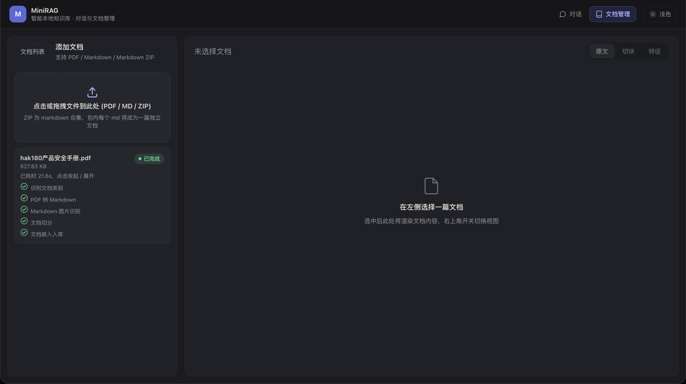

# 🎯 任务管理升级 PRD

## 现状

我们关注长时任务状态栏的展示和交互体验

| 查询任务                                  | 导入任务                                   |
| ----------------------------------------- | ------------------------------------------ |
|  |  |

有以下几个问题可以优化：

1. 查询任务不要跟随消息，应该固定在查询输入框上方，方便用户随时查看任务状态。
2. 任务状态跟踪信息太过简略，部分耗时步骤，用户仍无法清楚了解任务的进展情况。
3. 长时间任务没有提供中止操作，用户无法主动终止任务。

## 目标

1. 查询任务状态栏固定在查询输入框上方，用户可以随时查看任务状态。
2. 提供详细的任务状态跟踪信息，让用户清楚了解任务的进展情况。
3. 支持长时间任务的中止操作，用户可以主动终止任务。

## 需求节奏

整体需求节奏为三个 Phase，下文会有详细规划：
以同一套文档进行追踪

- 方案设计：动工前的确认和规划
- 方案实现：已有代码commit，根据实际施工情况如实汇报。
- 方案总结：前后对比，关键改动总结。

每个 Phase 在文档中独立，未开始的 Phase 空出位置直接留白。

产出：

方案设计.md[P1] -> 方案实现.md[P1] -> 方案设计.md[P2] -> 方案实现.md[P2] -> 方案设计.md[P3] -> 方案实现.md[P3] -> 方案总结.md

### Phase 1 - 查询任务状态栏固定

方案设计需确定：

- 无需改变核心视图组建，只是将查询任务状态栏固定在查询输入框上方。
- 方案设计中说明会动到的文件。
- 输出修改后的 demo.html。

### Phase 2 - 提供详细的任务状态跟踪信息，优化任务展示

### Phase 3 - 支持长时间任务的中止操作
