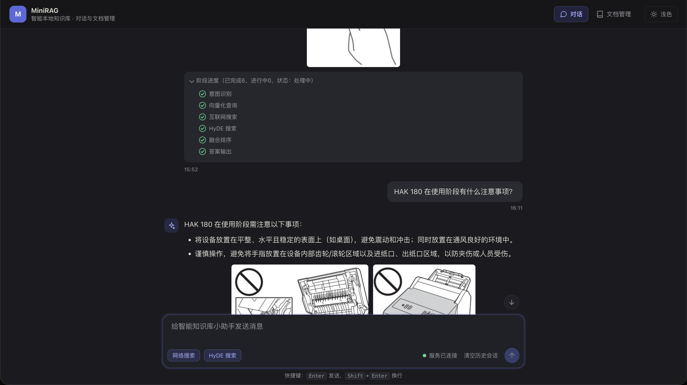

# 🎯 任务管理升级 PRD

## 现状

我们关注长时任务状态栏的展示和交互体验

| 查询任务                                  | 导入任务                                   |
| ----------------------------------------- | ------------------------------------------ |
|  |  |

有以下几个问题可以优化：

1. 查询任务不要跟随消息，应该固定在查询输入框上方，方便用户随时查看任务状态。
2. 任务状态跟踪信息太过简略，部分耗时步骤，用户仍无法清楚了解任务的进展情况。
3. 长时间任务没有提供中止操作，用户无法主动终止任务。

## 目标

1. 查询任务状态栏固定在查询输入框上方，用户可以随时查看任务状态。
2. 提供详细的任务状态跟踪信息，让用户清楚了解任务的进展情况。
3. 支持长时间任务的中止操作，用户可以主动终止任务。

## 需求节奏

整体需求节奏为两个 Phase，下文会有详细规划；每个 Phase 使用独立文档追踪：

- 方案设计：动工前的确认和规划
- 方案实现：已有代码commit，根据实际施工情况如实汇报。
- 方案总结：前后对比，关键改动总结。

方案设计按 Phase 拆分（方案设计P1 / 方案设计P2 …）；暂缓的 Phase 保留研究稿并标注状态。

产出：

方案设计P1.md -> 方案实现.md[P1] -> 方案设计P2.md[暂缓·待调研] -> 方案实现.md[P2] -> 方案总结.md

### Phase 1 - 查询任务状态栏固定

方案设计需确定：

- 无需改变核心视图组建，只是将查询任务状态栏固定在查询输入框上方。
- 方案设计中说明会动到的文件。
- 输出修改后的 demo.html。
- 查询页面仅保留一个任务状态卡片，即查询输入框上方的任务状态卡片。消息区域的任务状态卡片移除。
- 查询任务卡片显示最后一次查询任务的状态信息，新的查询启动自动被顶替。
- 查询任务卡片与输入框在垂直方向中线对齐，稍窄于查询输入框，窄到不影响吸底按钮的出现。

> 产出：[方案设计P1.md](方案设计P1.md) · [demo.html](demo.html)

### Phase 2 - 支持长时间任务的中止操作

- 查询任务任务进行中时，发送按钮变为停止按钮，点击停止按钮即可中止任务。
- 导入任务进行中时，在任务状态卡片中提供中止按钮，用户可以主动终止导入任务。
- 导入任务中止后，数据库写入、Minio上传需要状态回退。

> **状态：⏸ 暂缓（待进一步调研）**。中止机制与中止后的信息获取仍需专项调研；现有 [方案设计P2.md](方案设计P2.md) 仅作研究稿，不作为开工依据。
>
> 产出：[方案设计P2.md](方案设计P2.md)（研究稿）
