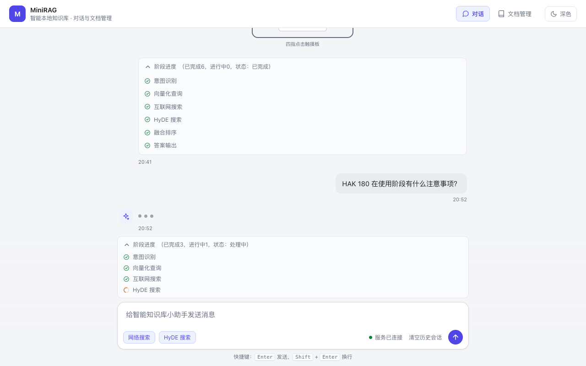
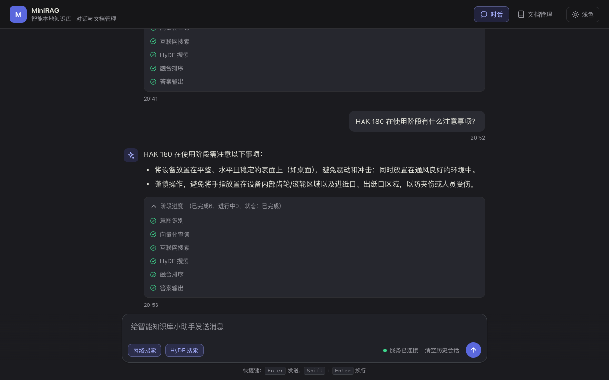
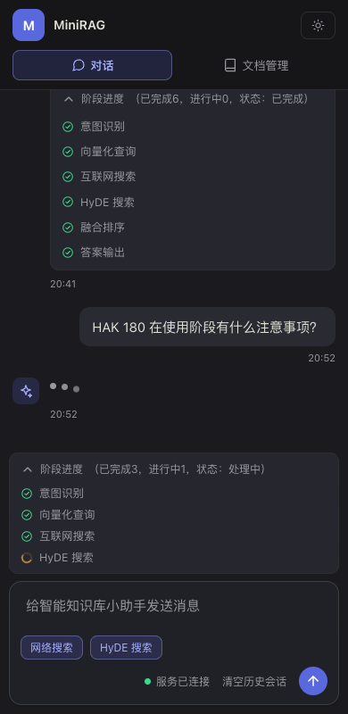

# 任务管理升级 · 方案设计

> **当前阶段**：Phase 1 方案设计（待评审）
>
> **本阶段范围**：只调整「查询任务状态栏」的挂载位置与生命周期；导入任务、步骤详情、任务中止分别在 Phase 2 / Phase 3 规划。
>
> **原型**：[demo.html](demo.html)（自包含，可直接打开）
>
> **文档约定**：本文按 Phase 增量维护。P1 完成后依次产出 `方案实现.md[P1]`；P2 / P3 的方案设计继续写入本文对应章节，未开始的 Phase 留白。

## 文档追踪

| 阶段 | 方案设计 | 方案实现 | 原型 | 状态 |
| --- | --- | --- | --- | --- |
| Phase 1 · 查询任务状态栏固定 | 本文 §Phase 1 | 待开始 | [demo.html](demo.html) | **设计待评审** |
| Phase 2 · 详细状态跟踪与展示优化 | 留白 | 留白 | 留白 | 未开始 |
| Phase 3 · 长时间任务中止 | 留白 | 留白 | 留白 | 未开始 |
| 方案总结 | — | — | — | 未开始 |

---

# Phase 1 - 查询任务状态栏固定

## 1. 现状


### 1.1 当前数据链路

```text
用户发送
  └─ chatStore.send
       ├─ POST /api/query ──────────────────────────▶ 后端启动查询
       └─ GET  /api/query/sse/{session_id}
             ├─ progress  ──▶ ChatMessage.progress ──▶ MessageBubble <details class="progress">
             ├─ delta     ──▶ ChatMessage.text（流式答案）
             ├─ final     ──▶ ChatMessage.text + sending=false
             └─ __close__ ──▶ 关闭 EventSource
```

### 1.2 问题

| # | 问题 | 影响 |
| --- | --- | --- |
| 1 | 进度卡片挂在 bot 消息体内，随消息滚动 | 用户上翻阅读历史时，看不到当前任务状态 |
| 2 | 答案在卡片上方流式增长，卡片被持续向下推 | 任务状态「跟着消息跑」，长回答时尤其明显 |
| 3 | 输入卡悬浮在消息上层，卡片滚到其背后会被遮挡 | 最需要确认进度时，状态反而不可见 |
| 4 | 后端不推送终态 `status`（`COMPLETE` 在 `__close__` 之后设置且不推送） | 已在消息里的历史卡片长期显示「状态：处理中」，与「已完成 6 / 6」自相矛盾 |
| 5 | 进度随消息存于展示态，任务生命周期没有被单独表达 | 后续要做步骤耗时、任务中止时，没有可挂载的任务对象 |

> 问题 4 是现状截图里就能看到的显示偏差。P1 在「终态回写消息」时顺手把客户端状态归一为 `completed / failed`；后端补推终态留给 P2 的采集改造。

## 2. 目标与范围

### 2.1 本阶段目标

**把「当前查询任务」从消息体内提出来，固定渲染在查询输入框正上方；任务结束后再一次性交还消息内的历史卡片。**

- 任务运行期间：状态栏固定在输入框上方，不随消息滚动，切 Tab 回来仍在；
- 状态栏内容（摘要 + 步骤列表）复用现有进度卡片，不重做视觉；
- 任务结束：状态栏卸载，进度卡片回到对应 bot 消息，消息历史与现状一致；
- 同一时刻只渲染一份进度，杜绝「固定栏 + 消息内」重复。

### 2.2 不做（留给后续 Phase）

| 事项 | 去向 |
| --- | --- |
| 步骤耗时、当前步骤详情、更丰富的进度展示 | Phase 2 |
| 导入任务状态栏的形态调整 | Phase 2 / 待定 |
| 中止按钮、后端取消能力 | Phase 3 |
| 后端补推终态 / 每步时间戳 | Phase 2（与详细进度一起改） |
| 历史卡片里的进度持久化（刷新后仍可回看） | 不在 P1，现状刷新后历史卡片本就消失 |

### 2.3 验收口径

| ID | 场景 | 期望 |
| --- | --- | --- |
| P1-A1 | 运行中滚动消息区到任意位置 | 状态栏始终可见，位置不变 |
| P1-A2 | 状态栏与输入卡 | 同宽、同轴居中，间距 8px，不与输入卡重叠 |
| P1-A3 | 消息区底部留白 | 最后一条消息可完整滚动到状态栏上方，不被遮挡 |
| P1-A4 | 运行中 | bot 消息内不出现进度卡片；进度只在固定栏更新 |
| P1-A5 | 完成瞬间 | 固定栏卸载；对应 bot 消息内出现同一份进度，摘要为「已完成 N，进行中 0，状态：已完成」 |
| P1-A6 | SSE 中断 / HTTP 失败 | 固定栏卸载；错误文本保留；已有进度以「失败」状态回写消息 |
| P1-A7 | 运行中切到文档管理再切回 | 状态栏与最新进度仍在（store 级状态，不随页面隐藏销毁） |
| P1-A8 | 「回到底部」按钮 | 仍位于状态栏上方，不与其重叠；可正常点击贴底 |
| P1-A9 | 空闲（无任务） | 输入卡位置、尺寸与改造前一致；无残留占位 |
| P1-A10 | 主题 / 窄屏 / 动效偏好 | Light / Dark 正常；390 / 780 / 1280 宽无横向滚动；`prefers-reduced-motion` 下无入场动画 |

## 3. 方案总览

### 3.1 一句话

**运行态上移、渲染单实例、终态回写**：把「当前查询任务」从 `ChatMessage.progress` 提为 `chatStore.queryTask`，运行期间只渲染固定在输入卡上方的任务栏；收到 `__close__` 时，把同一份进度写回对应 bot 消息并清空任务，固定栏卸载、历史卡片出现。

### 3.2 布局变化

```text
改造前（进度卡片在消息内）                 改造后（运行中，进度卡片固定在输入卡上方）

消息区（滚动）                             消息区（滚动）
  ...                                        ...
  [bot 回答 + 阶段进度卡片]  ← 随消息滚动     [用户消息]
                                             [bot 打字 / 流式回答]

输入卡（悬浮）                              ▲ 回到底部（按需出现）
                                            ┌────────────────────────┐
                                            │ 阶段进度（固定任务栏）  │ ← 新增挂载点
                                            └────────────────────────┘
                                            ┌────────────────────────┐
                                            │ 输入卡（悬浮）          │
                                            └────────────────────────┘
```

DOM 结构（改动集中在 `.composer-anchor` 内部）：

```text
.composer-wrap
└─ .composer-anchor            ← 新增 flex column；高度测量对象
   ├─ .scroll-to-bottom        ← 原样，仍绝对定位在 anchor 上方
   ├─ .task-bar                ← 新增：仅 queryTask 存在时挂载
   │  └─ details.progress      ← 复用现有进度卡片（StatusLog）
   └─ .composer                ← 原样
```

### 3.3 渲染归属

| 数据 | 位置 | 生命周期 |
| --- | --- | --- |
| 运行中的进度 | `chatStore.queryTask.progress` | 发送时创建；`__close__` / error 时清空 |
| 历史进度 | `ChatMessage.progress` | 仅在终态写入一次；进入消息历史 |
| 渲染容器 | 运行中 → `.task-bar`；终态 → `MessageBubble` | 同一时刻只存在一份 |

> `queryTask` 是内存运行态，不持久化；刷新页面后运行中的任务栏消失，行为与现状一致（进度本就不在后端历史里）。

## 4. 关键设计

### 4.1 状态归属：放 store，而不是页面派生

**选择**：在 `chatStore` 增加 `queryTask: QueryTaskView | null`，由 `send` 创建、SSE 回调更新、终态清空。

```ts
// types/chat.ts
export interface QueryTaskView {
  /** 关联的 bot 消息：终态把进度回写到该消息 */
  messageId: string;
  progress: ProgressView;
}
```

**为什么不从 `messages` 派生（`sending + 最后一条 bot 消息`）**：

1. 运行期间进度仍会写在消息里，固定栏与消息内必须二选一渲染，要么重复、要么给 `MessageBubble` 加抑制 prop；
2. 终态交接需要「先记下进度、再清任务、再渲染消息」的顺序控制，页面派生会把时序散在页面层；
3. 切 Tab 时页面被 `<Activity>` 隐藏、effect 被销毁，但 store 不受影响；任务生命周期天然属于会话级 store；
4. Phase 3 的中止需要持有「当前任务」句柄（任务 id / SSE 句柄 / 取消动作），store 级任务是必要前置。

**为什么不是把进度卡片做成 `position: sticky/fixed`**：卡片在消息流内部，脱离消息 DOM 会破坏 `details` 的上下文与历史记录；且「固定在输入框上方」本质是挂载点变化，不是 CSS 定位技巧。

### 4.2 单实例渲染与终态交接

- 运行中：`queryTask` 有值，`MessageBubble` 收到的 `message.progress` 为 `null`，消息内不渲染卡片；
- 终态：先把 `queryTask.progress` 以终态 status 写进对应 `message.progress`，再清空 `queryTask`；React 同一次更新内完成「固定栏卸载 + 消息卡片挂载」，用户看到的是状态栏消失、卡片出现在回答下方；
- 交接后的历史卡片仍由现有 `MessageBubble` 渲染，DOM、类名、展开态与现状一致。

```text
运行中                                   终态交接（同一次 store 更新）
task-bar ── QueryTaskBar ── StatusLog    bot 消息 ── MessageBubble
   ↑ 唯一进度来源                             ↑ 唯一进度来源
message.progress = null                    task-bar 卸载
                                           message.progress = 最终快照
```

**完成态不常驻**：任务结束后状态栏立即卸载。理由：答案与历史卡片已经承担结果展示；常驻会永久占据输入区上方空间，且与 Phase 2 的「详情」定位冲突。若评审希望「完成态停留 2 秒再消失」，会引入计时器与交接时序，建议放到 Phase 2 一起设计。

### 4.3 终态信号：以 `__close__` 为准

后端事件顺序（`node_answer_output` + `query_service`）：

```text
delta（流式答案，多次）
  → final（完整答案）
  → progress（答案输出 done —— 由 trace_node 的 finally 推送）
  → __close__
```

因此：

- **不能在 `final` 时清任务**：会漏掉最后一条「答案输出 done」，历史卡片会少一个完成步骤；
- **不能以 `progress.status === "completed"` 为终态**：`query_service` 在 `__close__` 之后才 `set_task_status(COMPLETE)`，且不推送，前端永远收不到；
- **以 `__close__` 收尾**：此时 `queryTask.progress` 已是最新快照；写入消息时把 status 归一为 `completed`（客户端显示修正）；
- **异常路径**：服务端 `error` 事件 → 以 `failed` 收尾并写入已有进度；`postQuery` 在 SSE 之前就失败 → 不写进度（消息走 `error` 分支），直接丢弃任务；EventSource 断连 → 以 `failed` 收尾（若已收到 `final`，按 `completed` 收尾，避免误报失败）。

> 客户端归一状态只在「回写消息」这一次发生；运行中的固定栏仍显示服务端原始 status，不伪造进度。
> 即使将来后端补推 `status=completed`，P1 也不以它清任务；统一等 `__close__`，避免与最后一条 progress 抢时序。

### 4.4 布局、高度与滚动

| 项 | 方案 |
| --- | --- |
| 挂载点 | `ChatComposer` 新增 `statusSlot?: ReactNode`，渲染在 `.composer-anchor` 内、`.composer` 之前 |
| 对齐 | `statusSlot` 宽度 100%，与输入卡共用 `.composer-anchor` 的 768px 上限与居中轴 |
| 间距 | `.task-bar { margin-bottom: 8px }`，与输入卡保持 8px 间隔 |
| 高度测量 | `ChatComposer` 的 `ResizeObserver` 从 `.composer` 改到 `.composer-anchor`（任务栏 + 输入卡整体），继续复用 `onHeightChange` |
| 底部留白 | `ChatPage` 现有逻辑 `chat.paddingBottom = h + 28`，任务栏出现/展开/收起时自动同步，最后一条消息不被遮挡 |
| 贴底跟随 | 高度变化 → `keepBottom()`（原有逻辑）→ 贴底时跟到最新；用户上翻时不动 |
| 回到底部按钮 | 保持 `bottom: calc(100% + 10px)`；anchor 变高后自动落在任务栏上方，无需新定位 |
| 遮罩 | `.composer-wrap::before` 由固定 140px 改为 `max(140px, 100%)`，覆盖任务栏 + 输入卡（纯视觉，不影响布局） |
| 限高 | 任务栏内步骤列表 `max-height: min(200px, 30vh)`，内部滚动；窄屏 `26vh` |
| 窄屏 | 沿用 720px 断点；任务栏与输入卡同宽（10px 边距），无横向溢出 |

> 这里的「固定」不是 CSS `position: fixed`：任务栏挂在 `.composer-wrap` 停靠层内，和输入卡一起浮在 `.chat` 滚动区之上，因此不随消息滚动，也不受滚动容器 / transform 的定位影响。

```css
/* chat.css 关键新增（沿用现有令牌，无新颜色） */
.composer-anchor {
  display: flex;
  flex-direction: column;
}

.task-bar {
  position: relative;
  width: 100%;
  margin-bottom: 8px;
  pointer-events: auto;      /* .composer-wrap 是 pointer-events: none */
  animation: task-bar-in .16s ease-out;
}

.task-bar details.progress {
  margin: 0;                 /* 抵消消息卡片的 margin-top: 10px */
}

.task-bar details.progress ul {
  max-height: min(200px, 30vh);
  overflow-y: auto;
}

.composer-wrap::before {
  height: max(140px, 100%);
}

@keyframes task-bar-in {
  from { opacity: 0; transform: translateY(4px); }
  to   { opacity: 1; transform: none; }
}

@media (max-width: 720px) {
  .task-bar details.progress ul { max-height: 26vh; }
}

@media (prefers-reduced-motion: reduce) {
  .task-bar { animation: none; }
}
```

**空闲时零影响**：`statusSlot` 为 `null` 时 `.task-bar` 不渲染，anchor 内只有输入卡；anchor 的 box 与改造前一致。`max(140px, 100%)` 只让装饰遮罩在无任务时高约 6px，不影响布局与可读性。

### 4.5 组件复用

- **`StatusLog` 不动**：仍负责 `<details>` + 状态行列表，固定栏与消息卡片共用；
- **抽出 `QueryProgress`**：把 `MessageBubble` 内的 `ProgressDetails`（摘要文案 + done/running → `StatusLogLine`）提取为共享组件，固定栏与历史卡片渲染结果完全一致；
- **新增 `QueryTaskBar`**：只负责固定栏容器与无障碍语义，内部就是 `<QueryProgress>`；Phase 2 的富信息可以在这里加头部，不影响消息卡片。

```tsx
// 新增 QueryProgress.tsx（内容自 MessageBubble.ProgressDetails 原样平移）
export function QueryProgress({ progress }: { progress: ProgressView }) {
  const status = PROGRESS_STATUS_LABELS[progress.status] || progress.status || "unknown";
  const lines: StatusLogLine[] = [
    ...progress.done.map((text) => ({ kind: "done" as const, text })),
    ...progress.running.map((text) => ({ kind: "running" as const, text })),
  ];
  return (
    <StatusLog
      className="progress"
      open
      summary={`阶段进度（已完成${progress.done.length}，进行中${progress.running.length}，状态：${status}）`}
      lines={lines}
    />
  );
}

// 新增 QueryTaskBar.tsx
export function QueryTaskBar({ task }: { task: QueryTaskView }) {
  return (
    <div
      className="task-bar"
      role="status"
      aria-live="polite"
      aria-atomic="false"
      aria-label="查询任务状态"
    >
      <QueryProgress progress={task.progress} />
    </div>
  );
}
```

**「不改变核心视图组件」的落实**：`StatusLog`、`StatusIcon`、消息卡片 DOM / 类名 / 样式全部不动；`MessageBubble` 仅把内部适配函数替换为共享组件（渲染结果一致）；新增的只有一个容器组件和一个适配组件。

### 4.6 交互与无障碍

| 项 | 约定 |
| --- | --- |
| 展开 / 收起 | 沿用原生 `<details>`；用户收起后不被后续进度更新强制展开（React 仅在 `open` prop 变化时写属性）；收起状态只在本次任务内有效，新任务重新展开（与现状卡片一致） |
| 默认态 | 与现状一致：展开；Phase 2 若改默认收起，只改 `QueryProgress` 的 `open` 传参 |
| 焦点 | 状态栏出现/更新不抢焦点；输入框保持焦点，不影响继续输入 |
| 读屏 | 容器 `role="status" aria-live="polite" aria-atomic="false" aria-label="查询任务状态"`：只播报变化文本，避免每次更新把整张卡片重读一遍；步骤图标 `aria-hidden`，状态由文字承载 |
| 键盘 | `summary` 原生可聚焦、可回车展开；无新增自定义键盘交互 |
| 动效 | 仅入场 160ms 淡入上移；`prefers-reduced-motion` 关闭；无退场动画（终态直接交接） |
| 状态语义 | 进行中 `warning` 旋转图标、完成 `success` 勾选，与现状一致；不新增颜色 |

## 5. 状态机与 store 改造

### 5.1 状态机

```text
         send                    progress
  idle ─────────▶ running ─────────────────▶ running
                   │  ▲                        │
                   │  └────────────────────────┘
                   │
                   ├─ final ───────────────▶ finishing（隐式态：bar 保留，等最后一条 progress）
                   │                              │ __close__
                   │                              ▼
                   │                         idle + 历史卡片（completed）
                   │
                   ├─ error / 断连 ────────▶ idle + 历史卡片（failed）+ 错误文本
                   │
                   └─ postQuery 失败 ──────▶ idle + 错误消息（无进度卡片）

  running/finishing ── clearHistory ──▶ idle（bar 卸载；SSE 现状不变，P3 再接中止）
```

> `finishing` 不需要新增 store 字段：它是「`final` 已到、`queryTask` 仍存在」的隐式阶段；`__close__` 到达即收尾。

### 5.2 迁移表

| 当前 | 事件 | 处理 | 下一状态 | UI |
| --- | --- | --- | --- | --- |
| idle | `send` | POST；创建 bot 消息（`progress:null`）+ `queryTask`（`pending`）；`sending=true` | running | 任务栏挂载，消息显示打字点 |
| running | `progress` | 仅更新 `queryTask.progress`；不写消息 | running | 任务栏更新；消息区不变 |
| running | `delta` | 写消息文本（现有逻辑） | running | 答案流式增长 |
| running | `final` | 写完整答案、`typing=false`、`streaming=false`、`sending=false` | finishing | 任务栏仍显示最后一帧 |
| finishing | `progress` | 更新 `queryTask.progress`（捕获「答案输出 done」） | finishing | 任务栏更新 |
| finishing | `__close__` | 以 `completed` 回写 `message.progress`；清 `queryTask`；关流 | idle | 任务栏卸载，消息内卡片出现 |
| running | `error` | 错误文本；以 `failed` 回写已有进度；清任务；`sending=false`；关流 | idle | 任务栏卸载，消息内失败卡片 + 错误 |
| finishing | `error` / 断连 | 已有完整答案，按 `completed` 收尾；`sending=false`；关流 | idle | 任务栏卸载，消息内卡片保持 completed |
| running | 无 `final` 的 `__close__` | 按 completed 收尾，`typing=false`（兜底） | idle | 消息显示完成/占位，任务栏卸载 |
| idle | `postQuery` 抛错 | 不写进度；消息 `error`；清任务 | idle | 无任务栏，错误消息 |
| 任意 | `clearHistory` | 清 `queryTask`（不新增中止逻辑） | idle | 任务栏卸载；SSE 行为保持现状 |

### 5.3 store 改造要点（伪代码）

```ts
// store 内部：两条路径共用，且都按 messageId 校验，旧 SSE 不会污染新任务
const patchTask = (messageId: string, progress: ProgressView) =>
  set((s) => s.queryTask?.messageId === messageId
    ? { queryTask: { ...s.queryTask, progress } }
    : {});

const finalizeTask = (messageId: string, status: "completed" | "failed") =>
  set((s) => {
    const t = s.queryTask;
    if (!t || t.messageId !== messageId) return {};
    return {
      queryTask: null,
      messages: patchMessage(s.messages, messageId, {
        progress: { ...t.progress, status },
      }),
    };
  });

send: async (text) => {
  // 极端情况：上一任务的 __close__ 还没到，先归档旧任务，避免被新任务覆盖
  const prev = get().queryTask;
  if (prev) finalizeTask(prev.messageId, "completed");

  const botId = makeId("bot");
  const botMsg = { /* typing:true, progress:null, ... */ };
  const task: QueryTaskView = {
    messageId: botId,
    progress: { done: [], running: [], status: "pending" },
  };
  set((s) => ({ messages: [...s.messages, userMsg, botMsg], queryTask: task }));

  const patchBot = (patch: Partial<ChatMessage>) => /* 现有实现 */;
  let finalReceived = false;

  // onProgress: patchTask(botId, { done, running, status })
  // onFinal:    finalReceived = true;
  //             patchBot({ text, typing:false, streaming:false });
  //             set({ sending:false });
  // onServerClose:
  //   const isCurrent = get().queryTask?.messageId === botId;
  //   finalizeTask(botId, "completed");        // 先写回，再卸载固定栏
  //   patchBot({ typing:false, streaming:false });
  //   if (isCurrent) set({ sending:false });   // 兜底：final 丢失时不锁死输入
  // onError:
  //   patchBot({ text: withError, typing:false, streaming:false });
  //   finalizeTask(botId, finalReceived ? "completed" : "failed");
  //   set({ sending:false });
  // catch:
  //   patchBot({ progress:null, error });
  //   set((s) => s.queryTask?.messageId === botId ? { queryTask:null } : {});
}
```

- `queryTask` 不写入 `messages`，也不持久化；
- 终态回写消息时使用任务的 `messageId`，不依赖「最后一条消息」的推断；
- `finalizeTask` / `patchTask` 都校验 `messageId`，避免旧 SSE 的迟到事件影响新任务；
- `sending` 语义保持不变（输入禁用、贴底逻辑仍由它驱动）；`onServerClose` 仅在当前任务仍是自己时才兜底复位；
- 同时删除 `onProgress` 中 `status === "completed"` 的提前 `sending=false` 分支：现状不会触发，终态统一由 `__close__` / `error` 处理。

## 6. 会动到的文件

| 文件 | 改动 | 风险 |
| --- | --- | --- |
| `web/src/types/chat.ts` | 新增 `QueryTaskView { messageId, progress }` | 低 |
| `web/src/store/chatStore.ts` | 新增 `queryTask`；`send` 创建任务；progress 只更新任务；`final/error/close/catch` 收尾回写；`clearHistory` 清任务 | **中**：终态时序是核心 |
| `web/src/components/chat/QueryProgress.tsx` | **新增**：从 `MessageBubble.ProgressDetails` 抽出的共享进度卡片适配层 | 低 |
| `web/src/components/chat/QueryTaskBar.tsx` | **新增**：固定任务栏容器（`role=status` + `task-bar`），内部复用 `StatusLog` | 低 |
| `web/src/components/chat/MessageBubble.tsx` | 删除本地 `ProgressDetails`，改用 `<QueryProgress>`；渲染结果不变 | 低 |
| `web/src/components/chat/ChatComposer.tsx` | 新增 `statusSlot`，渲染在 `.composer` 前；高度测量对象改为 `.composer-anchor` | 低 |
| `web/src/pages/ChatPage.tsx` | 订阅 `queryTask`，作为 `statusSlot` 传入；滚动逻辑不变 | 低 |
| `web/src/styles/chat.css` | `.composer-anchor` flex 化；`.task-bar` 容器/动效/限高；遮罩高度；窄屏与 reduced-motion | 低 |
| `docs/feat/任务管理升级/方案设计.md` | 本文 | — |
| `docs/feat/任务管理升级/demo.html` | 修改后的交互原型 | — |
| `docs/feat/任务管理升级/images/p1-*.png` | 方案截图（运行中 / 完成交接 / 窄屏） | — |

**明确不动**：

- `web/src/components/ui/StatusLog.tsx`、`StatusIcon.tsx`（视觉与 DOM 完全复用）；
- `web/src/lib/sse.ts`、`web/src/lib/api/*`（事件与请求封装不变）；
- `web/src/types/app.ts`（`ProgressView` 已够用）；
- `web/src/lib/constants.ts`（阶段文案映射不变）；
- `web/src/pages/ImportPage.tsx`、`web/src/store/docsStore.ts`（导入任务不在 P1）；
- 后端 `src/**`（P1 纯前端；终态补推留给 P2）。

## 7. 落地步骤

1. **类型 + store**：加 `QueryTaskView`/`queryTask`；把 progress 写入从消息迁到任务；在 `final/error/close/catch` 做终态回写与清空。先用真实查询观察 console：任务创建、progress 更新、close 交接的顺序。
2. **抽出 `QueryProgress`**：`MessageBubble` 切换到共享组件，确认历史卡片（含流式结束后的卡片）与改造前一致。
3. **输入区接线**：`ChatComposer` 加 `statusSlot` + anchor 测量；`ChatPage` 传入 `<QueryTaskBar>`。先验证无任务时输入卡位置与改造前一模一样。
4. **样式**：`.task-bar`、anchor flex、遮罩高度、限高与响应式；验证任务栏出现/收起时贴底跟随与底部留白。
5. **回归**：完成、失败、SSE 断连、切 Tab、清空历史、上翻滚动、回到底部、Light/Dark、390/780/1280、reduced-motion。
6. **文档**：如实现与设计有偏差，在 `方案实现.md[P1]` 如实记录；同步更新本设计与 demo（若需要）。

验证手段遵循仓库约定：不新增单元测试，直接跑 `npm run dev` 观察页面与 console；`npx tsc --noEmit`、`npm run build` 兜底。

## 8. 边界与风险

| 风险 / 边界 | 处理 |
| --- | --- |
| `__close__` 丢失导致任务栏不消失 | EventSource error 兜底收尾；下一次发送前归档旧任务；彻底解决依赖 P3 的后端取消/看门狗 |
| 运行中清空历史 | 清 `queryTask`，任务栏消失；SSE 仍会跑完（现状），`sending` 由 `final` / `error` 复位（清空历史不新增中止语义）；P3 再补真正中止 |
| 刷新页面 | 运行态丢失（本就不持久化）；历史卡片仍无进度（现状，P2 再考虑） |
| 固定栏占用消息空间 | 展开内容与现状一致，可手动收起；列表 30vh 上限内滚；不改变输入卡 50% 高度上限 |
| 极短视口 | 任务栏列表 30vh + 输入卡 50% 页高 + 遮罩，双重上限收敛；极端小屏下消息区会明显变窄，但不会重叠、仍可滚动 |
| 终态卡片状态 | 客户端归一为 `completed/failed`，修正「处理中」残留；后端补推留 P2 |
| 失败时残余 running 行 | P1 维持现有渲染（该步骤可能显示旋转图标）；失败步骤的图标语义随 P2 的详情设计一起处理 |
| 页面隐藏（Activity） | 任务状态在 store，返回时按最新进度渲染；`ChatPage` 的 effect 重建后高度测量/贴底照常 |
| 旧 SSE 迟到事件 | `finalizeTask` / `patchTask` 校验 `messageId`，不会污染新任务 |

## 9. 验收清单

- [ ] P1-A1 运行中滚动任意位置，状态栏位置不变、始终可见
- [ ] P1-A2 状态栏与输入卡同宽同轴、间距 8px；与「回到底部」按钮不重叠
- [ ] P1-A3 最后一条消息可完整滚动到状态栏上方（JS padding = dock height + 28）
- [ ] P1-A4 运行中 bot 消息内无进度卡片，只有打字点 / 流式答案
- [ ] P1-A5 完成时状态栏卸载、消息内出现 N/N「已完成」卡片，无重复、无「处理中」
- [ ] P1-A6 SSE / HTTP 失败后状态栏卸载，错误与失败进度保留
- [ ] P1-A7 切到文档管理再切回，运行中的任务栏与进度仍在
- [ ] P1-A8 原生 details 可鼠标/键盘展开收起；收起后不被进度更新强制展开
- [ ] P1-A9 无任务时输入卡位置、尺寸与改造前一致，无占位残留
- [ ] P1-A10 Light/Dark、390/780/1280 无横向滚动；reduced-motion 无动画；console 无报错
- [ ] `npx tsc --noEmit` 与 `npm run build` 通过
- [ ] `demo.html` 的「模拟完成 / 重新演示」与文档描述一致

## 10. 原型说明

[demo.html](demo.html) 基于 `docs/feat/页面美化/chatpage.html` 修改，自包含、不依赖后端，按本文的 DOM / CSS / 生命周期实现：

- 默认处于「运行中（已完成 3，进行中 1）」；每 1.8s 推进一步，可点「模拟完成」直接看交接；
- 「重新演示」回到运行中；右上角可切换 Light / Dark；滚动消息区可验证任务栏固定与回到底部按钮的位置；
- URL 参数（便于截图 / 评审）：`?clean=1` 隐藏演示控件，`?static=1` 关闭自动推进，`?theme=light|dark` 固定主题，`?state=done` 直接展示完成交接态；
- 演示控件不属于产品 UI；真实实现中该位置由 `QueryTaskBar` 占据。

### 10.1 运行中（Dark，上翻到顶部）


### 10.2 运行中（Light）



### 10.3 完成交接（Dark）



### 10.4 窄屏 390



---

# Phase 2 - 提供详细的任务状态跟踪信息，优化任务展示

> 未开始，留白。

# Phase 3 - 支持长时间任务的中止操作

> 未开始，留白。
