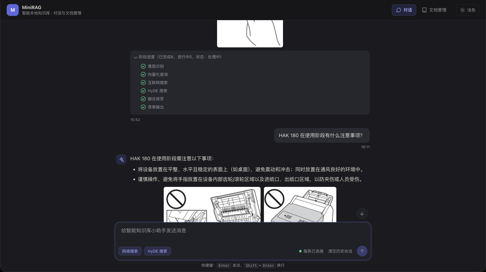
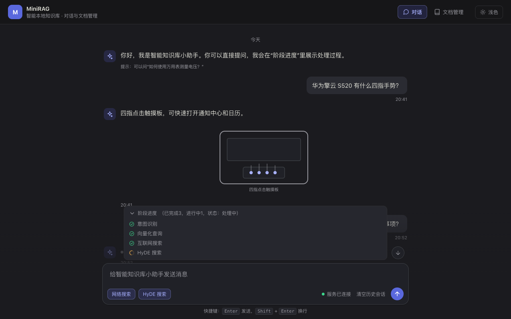
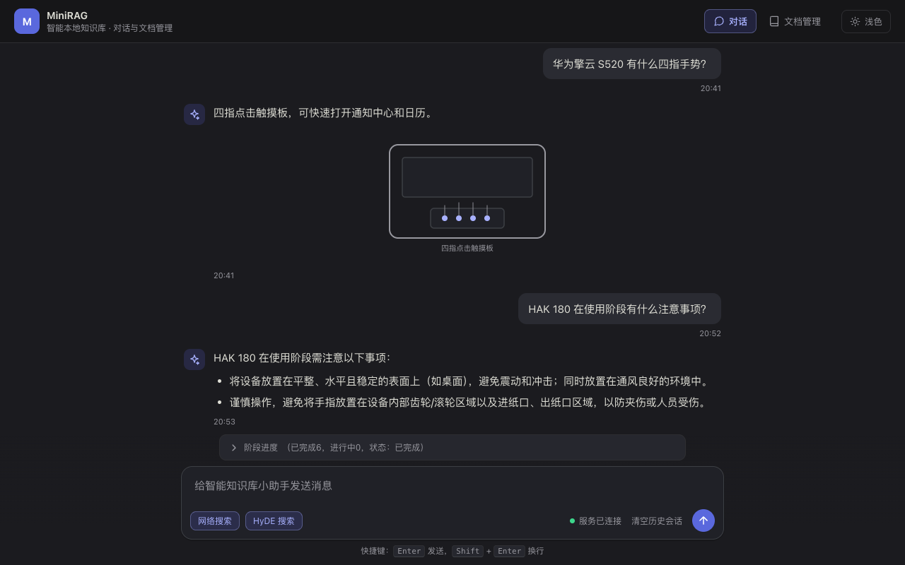

# 任务管理升级 · 方案设计

> **当前阶段**：Phase 1 方案设计（R1 + R2 调整，已纳入 PRD R1 反馈与本轮 R2 三点调整）
>
> **本阶段范围**：只调整「查询任务状态卡片」的位置、唯一性与生命周期；导入任务、步骤详情、任务中止分别在 Phase 2 / Phase 3 规划。
>
> **原型**：[demo.html](demo.html)（自包含，可直接打开）
>
> **文档约定**：本文按 Phase 增量维护。P1 完成后依次产出 `方案实现.md[P1]`；P2 / P3 的方案设计继续写入本文对应章节，未开始的 Phase 留白。

## 文档追踪

| 阶段 | 方案设计 | 方案实现 | 原型 | 状态 |
| --- | --- | --- | --- | --- |
| Phase 1 · 查询任务状态卡片固定 | 本文 §Phase 1 | 待开始 | [demo.html](demo.html) | **R2 设计待评审** |
| Phase 2 · 详细状态跟踪与展示优化 | 留白 | 留白 | 留白 | 未开始 |
| Phase 3 · 长时间任务中止 | 留白 | 留白 | 留白 | 未开始 |
| 方案总结 | — | — | — | 未开始 |

## R1 反馈落实

| 编号 | PRD R1 反馈 | 本方案落实 | 位置 |
| --- | --- | --- | --- |
| R1-1 | 查询页面仅保留一个任务状态卡片，即输入框上方的卡片；消息区域的任务状态卡片移除 | 进度数据统一收敛到 `chatStore.queryTask`；删除 `ChatMessage.progress`，`MessageBubble` 不再渲染任何进度；页面上只有 `.task-bar` 一张卡片 | §3、§4.2、§6 |
| R1-2 | 卡片显示最后一次查询任务的状态；新查询启动自动顶替 | 任务卡片常驻：`completed` / `failed` 后不清空；新 `send` 原地替换 `queryTask`，卡片内容按 `task.id` 重置 | §4.2、§5 |
| R1-3 | 卡片与输入框在垂直方向中线对齐；稍窄于输入框；窄到不影响吸底按钮 | 卡片与输入框共用垂直中线；吸底按钮移入 `.composer-dock`，固定在输入框右上角；宽度按 R2-3 进一步收紧到 `calc(100% - 108px)` | §4.4、§10 |

## R2 反馈落实

| 编号 | 本轮反馈 | 本方案落实 | 位置 |
| --- | --- | --- | --- |
| R2-1 | 吸底后点击任务卡片展开，不必将消息列表整体上抬 | 卡片保留在停靠区（留白仍包含卡片高度），但**手动展开/收起只更新留白，不触发贴底**；只有输入卡自身高度变化才跟随贴底。完成/失败时卡片自动收起为摘要行，并在原本贴底时跟到答案；用户再手动展开时不抬升列表 | §4.4、§4.6、§5 |
| R2-2 | 展开和收起的箭头方向反了 | 统一为收起 `>`（右）、展开 `v`（下），沿用现有 `details.progress` 的箭头约定，不复用预览页的 down/up 方向 | §4.6、§10 |
| R2-3 | 卡片再窄一点；卡片最右侧到按钮最左侧的距离 = 按钮最右侧到输入框最右侧的距离 | 卡片宽度改为 `calc(100% - 108px)`（左右各内缩 54px）；按钮右侧偏移 11px、宽 32px（左缘距输入框右缘 43px）；卡片右缘到按钮左缘 = 54 - 43 = **11px**，与按钮右缘到输入框右缘的 **11px** 相等 | §4.4、§10 |

---

# Phase 1 - 查询任务状态卡片固定

## 1. 现状



### 1.1 当前数据链路

```text
用户发送
  └─ chatStore.send
       ├─ POST /api/query ──────────────────────────▶ 后端启动查询
       └─ GET  /api/query/sse/{session_id}
             ├─ progress  ──▶ ChatMessage.progress ──▶ MessageBubble <details class="progress">
             ├─ delta     ──▶ ChatMessage.text（流式答案）
             ├─ final     ──▶ ChatMessage.text + sending=false
             └─ __close__ ──▶ 关闭 EventSource
```

### 1.2 问题

| # | 问题 | 影响 |
| --- | --- | --- |
| 1 | 进度卡片挂在 bot 消息体内，随消息滚动 | 用户上翻阅读历史时，看不到当前任务状态 |
| 2 | 答案在卡片上方流式增长，卡片被持续向下推 | 任务状态「跟着消息跑」，长回答时尤其明显 |
| 3 | 输入卡悬浮在消息上层，卡片滚到其背后会被遮挡 | 最需要确认进度时，状态反而不可见 |
| 4 | 后端不推送终态 `status`（`COMPLETE` 在 `__close__` 之后设置且不推送） | 已完成的任务在消息里仍显示「状态：处理中」 |
| 5 | 进度随消息存于展示态，任务生命周期没有被单独表达 | 后续要做步骤耗时、任务中止时，没有可挂载的任务对象 |
| 6 | 卡片只属于「某一条 bot 消息」，任务结束后无法继续查看；若简单复制到输入框上方，又会和消息内卡片重复 | R1 要的是「只有一张、且能持续看到最后一次任务」的卡片，而不是两份同步卡片 |

## 2. 目标与范围

### 2.1 本阶段目标

**页面只保留一张查询任务状态卡片：固定在输入框上方、与输入框同中线、稍窄；它显示最后一次查询任务的状态并常驻，新查询原地顶替；消息区不再出现任何任务卡片。**

- 单一卡片：运行中、完成、失败都只在输入框上方这一张卡片里展示；
- 常驻与顶替：任务结束后卡片保留最后一次结果；新的 `send` 直接替换卡片内容；
- 终态收起：运行中保持展开看步骤；完成/失败自动收起为一行摘要，把答案让出来，用户可随时再展开；
- 布局：卡片与输入框共用垂直中线，宽度 `calc(100% - 108px)`；吸底按钮固定在输入框右上角；卡片右缘到按钮左缘的 11px = 按钮右缘到输入框右缘的 11px；
- 展开不抬升：手动展开/收起只更新会话底部留白，不触发贴底滚动；
- 箭头：收起 `>`、展开 `v`，沿用现有进度卡片的约定；
- 内容复用：卡片内部仍是现有 `details.progress` + `StatusLog`（摘要 + 步骤列表），P1 不重做详情。

### 2.2 不做（留给后续 Phase）

| 事项 | 去向 |
| --- | --- |
| 步骤耗时、当前步骤详情、更丰富的进度展示 | Phase 2 |
| 导入任务状态卡片 / 导入页状态交互 | Phase 2 / 待定 |
| 中止按钮、后端取消能力 | Phase 3 |
| 后端补推终态 / 每步时间戳 | Phase 2（与详细进度一起改） |
| 消息区逐条任务的进度历史 | **按 R1 移除，不恢复**；页面只显示最后一次任务 |
| 刷新后恢复最后一次任务卡片 | 不做；`queryTask` 仅内存，刷新后卡片消失（历史本就不带进度） |
| 运行中也默认收起 | 不做；运行中展开，完成/失败才自动收起 |
| 手动展开后自动贴底 | 不做；这是 R2-1 明确要求避免的行为 |

### 2.3 验收口径

| ID | 场景 | 期望 |
| --- | --- | --- |
| P1-A1 | 页面任务卡片数量 | 任何时刻最多一张，且只位于输入框上方 |
| P1-A2 | 消息区 | 运行 / 完成 / 失败三种状态下，消息内都不出现任务卡片 |
| P1-A3 | 任务完成 / 失败 | 卡片保留最后一次任务状态（已完成 / 失败），不消失 |
| P1-A4 | 新查询 | 卡片内容原地切换为新任务的进度；旧状态不残留；卡片重新展开 |
| P1-A5 | 布局 | 卡片与输入框共用垂直中线，宽度 `calc(100% - 108px)`，左右各内缩 54px；与输入框间距 8px |
| P1-A6 | 吸底按钮与间距 | 按钮固定在输入框右上角；卡片右缘到按钮左缘 = 按钮右缘到输入框右缘 = 11px |
| P1-A7 | 展开 / 收起 | 吸底后手动展开/收起只更新底部留白，消息列表不整体上抬；只有输入卡高度变化才继续贴底 |
| P1-A8 | 消息区底部留白 | 留白包含卡片当前高度；最后一条消息可滚动到卡片上方，不被卡片永久遮挡 |
| P1-A9 | 完成 / 失败 | 卡片自动收起为摘要行，答案/错误文本可见；点摘要可再展开，展开不抬升列表 |
| P1-A10 | SSE 中断 / HTTP 失败 | 卡片保留「失败」状态；错误文本在消息内；不出现消息内卡片 |
| P1-A11 | 运行中切到文档管理再切回 | 卡片与最新进度仍在（store 级状态） |
| P1-A12 | 首次进入 / 清空历史 | 尚无查询任务时不渲染卡片；清空历史后卡片移除；输入卡布局与改造前一致 |
| P1-A13 | 箭头 | 收起 `>`（右）、展开 `v`（下），与现有进度卡片一致 |
| P1-A14 | 主题 / 窄屏 / 动效偏好 | Light / Dark 正常；390 / 780 / 1280 无横向滚动；`prefers-reduced-motion` 下无入场动画 |

## 3. 方案总览

### 3.1 一句话

**最后一次查询任务上移为 store 级唯一状态，页面只渲染一张常驻卡片。**

`chatStore.queryTask` 持有「最后一次查询任务」的 `{ id, progress }`：发送时创建/替换，进度事件只更新它，完成或失败时把状态归一后保留；页面在输入框上方渲染唯一的 `QueryTaskBar`。消息体不再持有、也不渲染任何进度。

### 3.2 布局变化

```text
改造前（卡片在消息内）                       改造后（唯一卡片固定在输入框上方）

消息区（滚动）                               消息区（滚动，无任务卡片）
  ...                                          ...
  [bot 回答 + 阶段进度卡片] ← 随消息滚动        [用户消息]
                                               [bot 打字 / 流式回答]

输入卡（悬浮）                               [   任务状态卡片（居中，稍窄）   ] [↓ 吸底]
                                             [             输入卡              ]
```

- 卡片与输入框共用同一条垂直中线；卡片左右各内缩 54px；
- 吸底按钮固定在输入框右上角；卡片右缘到按钮左缘 11px，等于按钮右缘到输入框右缘的 11px；
- 运行中卡片展开；完成/失败自动收起为摘要行，答案/错误文本可见；
- 手动展开/收起只更新会话底部留白，不触发贴底滚动；
- 消息区不再出现任何 `.progress` 卡片。

### 3.3 DOM 结构

```text
.composer-wrap
└─ .composer-anchor                    ← 高度测量对象（卡片 + 输入卡）
   ├─ .task-bar                        ← 唯一卡片；queryTask 存在时挂载
   │  └─ details.progress              ← 复用现有卡片：summary + StatusLog
   └─ .composer-dock                   ← 新增：吸底按钮的定位上下文（= 输入卡）
      ├─ .scroll-to-bottom             ← 绝对定位于输入卡右上角
      └─ .composer                     ← 原样
```

### 3.4 数据与渲染归属

| 数据 | 位置 | 生命周期 |
| --- | --- | --- |
| 最后一次查询任务 | `chatStore.queryTask` | `send` 创建 / 替换；`completed` / `failed` 保留；`clearHistory` 清空 |
| 卡片展开态 | 由 `progress.status` 派生 | `pending` / `processing` → 展开；`completed` / `failed` → 收起；用户可在同一任务内手动切换 |
| 消息进度 | **不再存在** | 删除 `ChatMessage.progress`；消息只保留文本/时间/错误 |
| 状态卡片渲染 | 唯一 `.task-bar` | 只在输入框上方；消息区零进度 DOM |

> `queryTask` 是内存运行态，不持久化；刷新页面后卡片消失，行为与现状一致（后端历史不保存进度）。

## 4. 关键设计

### 4.1 状态归属：store 级的「最后一次查询任务」

```ts
// types/chat.ts
export interface QueryTaskView {
  /** 任务实例 id：用于隔离旧 SSE 的迟到事件，也是卡片内容的重置 key */
  id: string;
  progress: ProgressView;
}
```

`chatStore` 增加 `queryTask: QueryTaskView | null`：

- `send` 创建新的 `QueryTaskView`（`id = makeId("task")`，`progress = pending`），同时创建/追加 bot 消息；bot 消息不再带 `progress`；
- SSE `progress` 事件只调用 `patchTask(id, progress)`；
- `__close__` / `error` / HTTP 失败只调用 `finishTask(id, "completed" | "failed")`，更新 `queryTask.progress.status`，**不清空 `queryTask`**；
- 新 `send` 直接覆盖 `queryTask`；旧 SSE 的迟到事件因 `id` 不匹配而被忽略；
- `clearHistory` 清空 `queryTask`。

**为什么放 store，而不是页面派生**：

1. 卡片要常驻并跨 Tab 保持，任务生命周期天然属于会话级 store；
2. 只有一份进度来源，`MessageBubble` 不需要「显示/抑制」判断；
3. Phase 3 的中止需要持有当前任务句柄（任务 id / SSE 句柄 / 取消动作），store 级任务是必要前置；
4. 新查询顶替旧查询时，用任务 `id` 做并发隔离，比页面层的「最后一条消息」推断可靠。

### 4.2 单一卡片、常驻、新查询顶替

```text
运行中：queryTask = { id: A, progress: 处理中 3/6 }   → .task-bar 唯一卡片（展开）
完成：  queryTask = { id: A, progress: 已完成 6/6 }   → .task-bar 唯一卡片（自动收起为摘要）
新查询：queryTask = { id: B, progress: 等待中 }       → .task-bar 内容原地替换（key=B，重新展开）
清空：  queryTask = null                             → .task-bar 卸载
```

- **消息区彻底移除**：`ChatMessage.progress` 字段删除；`MessageBubble` 只渲染用户气泡、打字点、答案、错误文本与时间，不再引用 `StatusLog` / `PROGRESS_STATUS_LABELS`；
- **常驻**：完成 / 失败不清空 `queryTask`；卡片显示最后一次查询的终态；
- **终态收起**：`pending / processing` 时卡片展开；`completed / failed` 时自动收起为摘要行，把答案/错误让出来；用户可随时再展开看步骤；
- **手动展开不抬升**：展开/收起只更新会话底部留白，不触发贴底滚动（R2-1）；
- **顶替**：新 `send` 覆盖 `queryTask`；`QueryTaskBar` 内部用 `key={task.id}` 重置 `StatusLog`，使新任务重新展开，旧任务的收起状态不延续；
- **清空历史**：`clearHistory` 同时清空 `queryTask`，卡片卸载（与清空会话语义一致）；
- **首次进入**：`queryTask` 为 `null`，不渲染卡片，输入卡布局与改造前一致。

> 这是一次有意的取舍：R1 要求「只保留一张、显示最后一次」，因此**更早的查询不再有逐条任务状态记录**；消息历史只保留答案本身。刷新后也没有最后任务卡片（不持久化），这两点都在 §8 边界中再次说明。

### 4.3 终态信号与卡片状态

后端事件顺序（`node_answer_output` + `query_service`）：

```text
delta（流式答案，多次）
  → final（完整答案）
  → progress（答案输出 done —— 由 trace_node 的 finally 推送）
  → __close__
```

因此：

- **不在 `final` 时结束任务**：会漏掉最后一条「答案输出 done」，卡片少一个完成步骤；
- **不能以 `progress.status === "completed"` 为结束信号**：`query_service` 在 `__close__` 之后才 `set_task_status(COMPLETE)`，且不推送，前端收不到；
- **以 `__close__` 收尾**：把 `queryTask.progress.status` 归一为 `completed`，卡片保留并**自动收起为摘要行**；`final` 只负责写答案、结束 `sending`；
- **异常路径**：服务端 `error` / EventSource 断连 → `failed`（若已收到 `final`，按 `completed` 收尾，避免误报失败）；`postQuery` 在 SSE 之前失败 → 卡片保留一个无步骤的 `failed` 状态，消息内显示错误文本；
- **完成时跟随**：若用户原本贴底，终态收起 + 答案显示后跟到消息底部（`ChatPage` 监听终态）；用户上翻阅读时不强制跳回；
- **旧 SSE 隔离**：所有 `patchTask` / `finishTask` 都校验任务 `id`；新查询顶替后，旧连接的迟到事件不会改到新卡片。

> 客户端归一状态只用于卡片显示：修掉「已完成 6/6 却写着处理中」的现状偏差；运行中的卡片仍显示服务端原始 status，不伪造进度。即使将来后端补推 `completed`，P1 也只更新进度，不改变「最后任务常驻」的卡片模型。

### 4.4 布局：同中线、稍窄、吸底按钮不被影响

#### 几何约束

| 项 | 1280 视口 | 390 视口 | 说明 |
| --- | --- | --- | --- |
| 输入卡宽度（anchor） | 768px | 370px | `.composer-anchor` 现有 `max-width: 768px` |
| 卡片宽度 | 660px | 262px | `calc(100% - 108px)` |
| 卡片左右内缩 | 54px | 54px | 与输入框同中线（`margin-inline: auto`） |
| 吸底按钮 | 32×32，right 11px | 同左 | 相对 `.composer-dock` 定位 |
| 按钮左缘距输入框右缘 | 43px | 43px | `11px + 32px` |
| 按钮右缘距输入框右缘 | 11px | 11px | 现有 `right: 11px` |
| 卡片右缘到按钮左缘 | 11px | 11px | `54px - 43px`，与上一行相等 |
| 卡片与输入框间距 | 8px | 8px | `.task-bar` 的 `margin-bottom` |

宽度公式：`calc(100% - 2 × (11px + 32px + 11px)) = calc(100% - 108px)`。

- 卡片宽度由「按钮右侧偏移 + 按钮宽 + 同值间隙」倒推，保证 **卡片右缘到按钮左缘 = 按钮右缘到输入框右缘 = 11px**；
- 卡片通过与输入框共享 `margin-inline: auto` 的居中规则，保证**垂直方向中线对齐**（两条元素的中心线重合）；
- 窄屏下仍保持 54px 内缩，因此 390 时卡片 262px；摘要改为「标题一行 + 计数一行」，避免「阶段/进度」被拆开（见下）。

#### 吸底按钮：从「卡片上方」移到「输入卡右上角」

- 新增 `.composer-dock` 包裹按钮 + 输入卡，作为按钮的定位上下文；
- 按钮保持现有尺寸/偏移：`right: 11px; bottom: calc(100% + 10px)`，现在相对输入卡，而不是相对整条停靠区；
- 结果：无论卡片多高、展开还是收起，按钮始终在输入框右上角；卡片变窄后，按钮在卡片右侧 11px 的空白里，互不遮挡；
- 按钮的显隐逻辑（消息未贴底时出现、点击贴底）完全不变。

```text
┌──────────────────────────────────────────────────────────┐
│              任务状态卡片（660，居中，左右各 54）          │
└──────────────────────────────────────────────────────────┘  ←11px→  (↓) 吸底按钮
┌──────────────────────────────────────────────────────────┐
│                       输入卡（768）                       │
└──────────────────────────────────────────────────────────┘
```

#### 高度与滚动

| 项 | 方案 |
| --- | --- |
| 高度测量 | `ChatComposer` 仍测量 `.composer`（输入卡）自身高度；同时用 `.composer-anchor` 的高度作为会话留白 |
| 回调约定 | `onHeightChange(height, follow)`：输入卡自身高度变化 → `follow=true`；卡片/停靠区变化 → `follow=false` |
| 底部留白 | `ChatPage`：`chat.paddingBottom = anchorHeight + 28`；卡片出现/替换/展开/收起/自动收起都同步更新留白 |
| 手动展开 / 收起 | 只更新留白，**不触发** `keepBottom()`；消息列表保持原滚动位置（R2-1） |
| 贴底跟随 | 输入卡高度变化（打字/换行）→ `keepBottom()`；用户主动发送时仍强制贴底；用户上翻时不跟随 |
| 终态跟随 | 完成/失败时卡片自动收起、答案显示；若原本贴底，`ChatPage` 监听终态后 `scrollToBottom()` 跟到答案 |
| 卡片限高 | 步骤列表 `max-height: min(200px, 30vh)`，内部滚动；窄屏 `26vh` |
| 遮罩 | `.composer-wrap::before` 由固定 140px 改为 `max(140px, 100%)`，覆盖卡片 + 输入卡（纯视觉） |
| 空闲 | `queryTask` 为 `null` 时不渲染卡片；anchor 只含输入卡，布局与改造前一致 |

```css
/* chat.css 关键新增（沿用现有令牌，无新颜色） */
.composer-anchor { display: flex; flex-direction: column; }

.composer-dock {            /* 吸底按钮的定位上下文 = 输入卡 */
  position: relative;
  width: 100%;
}

.task-bar {
  width: calc(100% - 108px); /* 两侧各内缩 54px：让出按钮右上角，并让 11px 间距对称 */
  margin: 0 auto 8px;        /* 与输入框同中线 */
  pointer-events: auto;      /* .composer-wrap 是 pointer-events: none */
  animation: task-bar-in .16s ease-out;
}

.task-bar details.progress { margin: 0; } /* 抵消消息卡片的 margin-top: 10px */

.progress-title { white-space: nowrap; }

.task-bar details.progress ul {
  max-height: min(200px, 30vh);
  overflow-y: auto;
}

.composer-wrap::before { height: max(140px, 100%); }

@keyframes task-bar-in {
  from { opacity: 0; transform: translateY(4px); }
  to   { opacity: 1; transform: none; }
}

@media (max-width: 720px) {
  /* 摘要：标题单行，计数独占一行，避免卡片变窄后标题被拆成「阶段 / 进度」 */
  .task-bar details.progress summary { flex-wrap: wrap; }
  .task-bar details.progress summary .progress-count { flex: 1 1 100%; }
  .task-bar details.progress ul { max-height: 26vh; }
}

@media (prefers-reduced-motion: reduce) {
  .task-bar { animation: none; }
}
```

**箭头方向**：沿用现有 `details.progress summary::before` 的约定——收起为 `>`（右），展开为 `v`（下）。预览页里的 down/up 图标方向不作为实现依据。

> 这里的「固定」不是 CSS `position: fixed`：卡片挂在 `.composer-wrap` 停靠层内，和输入卡一起浮在 `.chat` 滚动区之上，因此不随消息滚动，也不受滚动容器 / transform 的定位影响。

### 4.5 组件与数据改造

- **`QueryTaskBar`（新增）**：唯一卡片容器；`role="status"` + `task-bar`；根据 `progress.status` 决定展开态（运行中展开、终态收起），内部 `<QueryProgress key={task.id} progress={task.progress} open={isRunning} />`；
- **`QueryProgress`（新增）**：卡片内容适配层（摘要 + `StatusLog` 状态行），从原 `MessageBubble.ProgressDetails` 平移；新增 `open` prop；
- **`StatusLog`（小改）**：`summary` 类型由 `string` 放宽为 `ReactNode`，用于渲染「标题 + 计数」两个 span；`open` prop 已有；字符串调用方（导入任务）行为不变；
- **`MessageBubble`（按 R1 精简）**：删除 `ProgressDetails` 与进度分支，只保留 typing / error / answer；
- **`ChatMessage`（删字段）**：移除 `progress: ProgressView | null`；
- **`ChatComposer`（小改）**：新增 `statusSlot`；新增 `.composer-dock` 包裹吸底按钮与输入卡；高度回调改为 `onHeightChange(anchorHeight, follow)`——输入卡自身高度变化 `follow=true`，卡片/停靠区变化 `follow=false`；
- **`ChatPage`（接线）**：订阅 `queryTask`，作为 `statusSlot` 传入；`handleHeightChange` 只更新留白，`follow=true` 才 `keepBottom()`；监听终态，原本贴底时跟到答案。

```tsx
// QueryTaskBar.tsx
export function QueryTaskBar({ task }: { task: QueryTaskView }) {
  const isRunning =
    task.progress.status === "pending" || task.progress.status === "processing";
  return (
    <div
      className="task-bar"
      role="status"
      aria-live="polite"
      aria-atomic="false"
      aria-label="查询任务状态"
    >
      <QueryProgress key={task.id} progress={task.progress} open={isRunning} />
    </div>
  );
}

// QueryProgress.tsx（摘要拆成标题 + 计数，窄屏可整行换行；open 控制运行中/终态展开）
export function QueryProgress({ progress, open }: { progress: ProgressView; open: boolean }) {
  const status = PROGRESS_STATUS_LABELS[progress.status] || progress.status || "unknown";
  const lines: StatusLogLine[] = [
    ...progress.done.map((text) => ({ kind: "done" as const, text })),
    ...progress.running.map((text) => ({ kind: "running" as const, text })),
  ];
  return (
    <StatusLog
      className="progress"
      open={open}
      summary={
        <>
          <span className="progress-title">阶段进度</span>
          <span className="progress-count">
            （已完成{progress.done.length}，进行中{progress.running.length}，状态：{status}）
          </span>
        </>
      }
      lines={lines}
    />
  );
}
```

**展开态与贴底的关键实现**：

```ts
// ChatPage
const handleHeightChange = useCallback((h: number, follow: boolean) => {
  const el = chatRef.current;
  if (!el) return;
  el.style.paddingBottom = `${h + 28}px`;
  if (follow) keepBottom();       // 只有输入卡自身高度变化才跟随
}, [keepBottom]);

// 终态自动收起 + 原本贴底时跟到答案；用户上翻阅读时不强制跳回
const status = queryTask?.progress.status;
useEffect(() => {
  if ((status === "completed" || status === "failed") && pinnedRef.current) {
    scrollToBottom();
  }
}, [status, scrollToBottom, pinnedRef]);
```

**「核心视图组件」的变化说明**：按 R1，消息内的进度卡片被移除（`MessageBubble` 精简）；卡片本体仍复用现有 `StatusLog` / 进度卡样式。`StatusLog` 仅放宽 `summary` 类型，DOM 与视觉不变。

### 4.6 交互与无障碍

| 项 | 约定 |
| --- | --- |
| 运行中展开态 | `pending / processing` 默认展开；同一任务内用户可手动收起，进度更新不强制展开 |
| 完成 / 失败收起 | `completed / failed` 自动收起为摘要行，答案/错误文本可见；用户点摘要可再展开看步骤 |
| 手动展开 / 收起 | 只更新会话底部留白，不触发贴底滚动；消息列表保持当前滚动位置（R2-1） |
| 新查询 | `key={task.id}` 重置卡片内容，新任务重新展开（`isRunning=true`）；旧任务的收起状态不延续 |
| 终态跟随 | 原本贴底时，完成/失败后跟到答案；用户上翻阅读时不强制跳回 |
| 箭头 | 收起 `>`（右）、展开 `v`（下），沿用现有 `details.progress` 约定 |
| 焦点 | 卡片出现/更新/顶替/自动收起不抢焦点，输入框保持焦点 |
| 读屏 | 容器 `role="status" aria-live="polite" aria-atomic="false" aria-label="查询任务状态"`；图标 `aria-hidden`，状态由文字承载 |
| 键盘 | `summary` 原生可聚焦、可回车展开；无新增自定义键盘交互 |
| 动效 | 仅首次挂载时 160ms 淡入上移；新查询顶替不重播外层动画；`prefers-reduced-motion` 关闭 |
| 状态语义 | 进行中 `warning` 旋转图标、完成 `success` 勾选，与现状一致；不新增颜色 |

## 5. 状态机与 store 改造

### 5.1 状态机

```text
      send                      progress
idle ─────▶ running（卡片展开） ──────────▶ running
(无卡片)      │  ▲                            │
              │  └────────────────────────────┘
              │
              ├─ final ──────────────▶ finishing（卡片展开，等最后一条 progress）
              │                             │ __close__
              │                             ▼
              │                        completed（卡片常驻 + 自动收起）
              │
              ├─ error / 断连 ────────▶ failed（卡片常驻 + 自动收起）
              │
              └─ postQuery 失败 ──────▶ failed（卡片常驻 + 自动收起，无步骤）

completed / failed ── send ──▶ running（卡片内容顶替并重新展开）
completed / failed ── 手动展开摘要 ──▶ 卡片展开（仅 UI，不改任务状态）
任意状态 ── clearHistory ──▶ idle（卡片卸载）
```

> `finishing` 不需要新增 store 字段：它是「`final` 已到、`queryTask` 仍存在」的隐式阶段；`__close__` 到达即把 status 归一为 `completed`，卡片自动收起并保留。手动展开/收起不经过 store，只是 `details` 的 UI 状态。

### 5.2 迁移表

| 当前 | 事件 | 处理 | 下一状态 | 卡片 / 消息 |
| --- | --- | --- | --- | --- |
| idle | `send` | 创建 `queryTask`（pending）；bot 消息不带 progress；`sending=true` | running | 卡片挂载并展开；消息显示打字点 |
| running | `progress` | `patchTask(id, progress)`；不写消息 | running | 卡片更新；消息区不变；不触发贴底 |
| running | `delta` | 写消息文本（现有逻辑） | running | 答案流式增长；卡片不动 |
| running | `final` | 写完整答案；`typing=false`、`streaming=false`、`sending=false` | finishing | 卡片保留最后一帧（仍展开） |
| finishing | `progress` | `patchTask`（捕获「答案输出 done」） | finishing | 卡片更新 |
| finishing | `__close__` | `finishTask(id, "completed")`；关流 | completed | 卡片常驻 + 自动收起；消息无卡片；贴底时跟到答案 |
| running | `error` | 错误文本；`finishTask(id, "failed")`；`sending=false`；关流 | failed | 卡片常驻 + 自动收起；消息无卡片 |
| finishing | `error` / 断连 | 已有完整答案，按 `completed` 收尾 | completed | 卡片常驻 + 自动收起 |
| running（POST 阶段） | `postQuery` 抛错 | 消息 `error`；`queryTask` 置 failed（无步骤）；`sending=false` | failed | 卡片常驻 + 自动收起；消息无卡片 |
| completed / failed | 手动展开 / 收起 | 仅更新会话留白，不触发贴底 | 不变 | 卡片展开/收起；消息位置不变 |
| completed / failed | `send` | 用新任务覆盖 `queryTask`；新 bot 消息 | running | 卡片内容顶替并重新展开 |
| 任意 | `clearHistory` | 清消息 + `queryTask: null` | idle | 卡片卸载 |

### 5.3 store 改造要点（伪代码）

```ts
// types/chat.ts
export interface QueryTaskView {
  id: string;
  progress: ProgressView;
}

// store
queryTask: QueryTaskView | null;

const patchTask = (id: string, progress: ProgressView) =>
  set((s) => s.queryTask?.id === id
    ? { queryTask: { ...s.queryTask, progress } }
    : {});

const finishTask = (id: string, status: "completed" | "failed") =>
  set((s) => s.queryTask?.id === id
    ? { queryTask: { ...s.queryTask, progress: { ...s.queryTask.progress, status } } }
    : {});

const patchBot = (patch: Partial<ChatMessage>) => /* 现有实现 */;

send: async (text) => {
  const taskId = makeId("task");
  const task: QueryTaskView = {
    id: taskId,
    progress: { done: [], running: [], status: "pending" },
  };
  // 注意：botMsg 不带 progress 字段（ChatMessage 已无该字段）
  set((s) => ({
    messages: [...s.messages, userMsg, botMsg],
    queryTask: task,            // 直接顶替上一次任务
    sending: true,
  }));

  let finalReceived = false;

  // onProgress: patchTask(taskId, { done, running, status })
  // onFinal:    finalReceived = true;
  //             patchBot({ text, typing:false, streaming:false });
  //             set({ sending:false });              // 卡片继续等到 __close__
  // onServerClose:
  //   const current = get().queryTask?.id === taskId;
  //   finishTask(taskId, "completed");             // 卡片常驻，不清空
  //   patchBot({ typing:false, streaming:false });
  //   if (current) set({ sending:false });         // 兜底：final 丢失时不锁死输入
  // onError:
  //   patchBot({ text: withError, typing:false, streaming:false });
  //   finishTask(taskId, finalReceived ? "completed" : "failed");
  //   set({ sending:false });
  // catch:
  //   patchBot({ error });
  //   finishTask(taskId, "failed");                // 卡片保留「失败」
  //   set({ sending:false });
}

// clearHistory: set({ messages: [welcome], queryTask: null });  // 卡片卸载
```

- `queryTask` **不在终态清空**；只有 `clearHistory` 和下一次 `send` 会替换/移除；
- `finishTask` 只改 `progress.status`，不改 `messages`；消息里不会再出现进度；
- `patchTask` / `finishTask` 都按任务 `id` 校验，旧 SSE 不会污染新任务；`sending` 的复位沿用现状（请求级），极端并发不在 P1 展开，P3 统一任务句柄；
- 删除 `ChatMessage.progress` 后，`welcomeMessage` / `historyToMessages` / `send` / 错误分支都不再构造该字段；
- **卡片展开态**：由 `progress.status` 派生（`isRunning`），终态自动收起；用户手动展开是 `details` 的 UI 状态，不写 store、不影响任务状态；
- **高度/贴底**：`onHeightChange(anchorHeight, follow)` 更新留白；手动展开/收起 `follow=false`，输入卡高度变化 `follow=true`；终态若原本贴底，由 `ChatPage` 的终态 effect 跟到答案（§4.5）。

## 6. 会动到的文件

| 文件 | 改动 | 风险 |
| --- | --- | --- |
| `web/src/types/chat.ts` | 删除 `ChatMessage.progress`；新增 `QueryTaskView { id, progress }` | 中：编译期会暴露所有旧引用 |
| `web/src/store/chatStore.ts` | 新增常驻 `queryTask`；`send` 创建/顶替；progress 只更新任务；终态归一后保留；`clearHistory` 清空；删除所有消息进度写入 | **中**：终态时序与 id 隔离 |
| `web/src/components/ui/StatusLog.tsx` | `summary` 类型 `string → ReactNode`（标题/计数两个 span）；`open` 继续控制展开；字符串调用方不变 | 低 |
| `web/src/components/chat/QueryProgress.tsx` | **新增**：卡片内容（结构化摘要 + done/running 行 + `open` 透传） | 低 |
| `web/src/components/chat/QueryTaskBar.tsx` | **新增**：唯一固定卡片容器；`isRunning` 派生展开态；`key={task.id}` 重置内容 | 低 |
| `web/src/components/chat/MessageBubble.tsx` | 删除 `ProgressDetails`、进度渲染与相关 import；仅保留 typing / error / answer | 中：R1 的核心呈现变化 |
| `web/src/components/chat/ChatComposer.tsx` | 新增 `statusSlot`；新增 `.composer-dock`（按钮 + 输入卡）；高度回调改为 `onHeightChange(anchorHeight, follow)`（输入卡高度变化才 follow） | **中**：贴底/留白时序 |
| `web/src/pages/ChatPage.tsx` | 订阅 `queryTask` 作为 `statusSlot`；`handleHeightChange` 拆分留白与贴底；终态贴底 effect | **中**：R2-1 的核心接线 |
| `web/src/styles/chat.css` | `.task-bar` 宽度 `calc(100% - 108px)`/居中；`.composer-dock`；`.scroll-to-bottom` 相对 dock；摘要窄屏换行；卡片箭头方向；遮罩高度；列表限高 | 低 |
| `docs/feat/任务管理升级/方案设计.md` | 本文（R1 + R2） | — |
| `docs/feat/任务管理升级/demo.html` | R2 交互原型：单卡片常驻、终态自动收起、手动展开不抬升、108px 内缩、箭头 `>`/`v` | — |
| `docs/feat/任务管理升级/images/p1-*.png` | 运行中 / 完成态（收起）/ 窄屏截图 | — |

**明确不动**：

- `web/src/components/icons/StatusIcon.tsx`（仍是卡片内的状态图标）；
- `web/src/lib/sse.ts`、`web/src/lib/api/*`（事件与请求封装不变）；
- `web/src/types/app.ts`（`ProgressView` / `StatusResponse` 继续使用）；
- `web/src/lib/constants.ts`（`PROGRESS_STATUS_LABELS` 不变）；
- `web/src/pages/ImportPage.tsx`、`web/src/store/docsStore.ts`（导入任务不受影响；`StatusLog` 的 `summary` 字符串用法仍兼容）；
- 后端 `src/**`（P1 纯前端；终态补推留给 P2）。

## 7. 落地步骤

1. **类型 + store**：加 `QueryTaskView` / 常驻 `queryTask`；`send` 创建/顶替；progress 只更新任务；`close/error/catch` 归一状态但不清空；`clearHistory` 清空；同步删除 `ChatMessage.progress` 的所有构造点。
2. **消息区移除卡片**：`MessageBubble` 删除进度分支与 import；确认 typing / error / answer 与改造前一致，只是没有进度卡片。
3. **卡片内容与展开态**：`StatusLog` 放宽 `summary` 类型；新增 `QueryProgress`（结构化摘要 + 行 + `open`）；新增 `QueryTaskBar`（`isRunning` / `key={task.id}`）；确认终态自动收起、箭头 `>`/`v`。
4. **输入区接线与贴底**：`ChatComposer` 加 `statusSlot`、`.composer-dock`、按钮迁入 dock、`onHeightChange(anchorHeight, follow)`；`ChatPage` 拆分留白/贴底，并加终态贴底 effect；确认手动展开不抬升、输入卡高度变化仍跟随。
5. **样式**：`.task-bar` 宽度 `calc(100% - 108px)`/居中；按钮相对 dock；摘要窄屏换行；列表限高；遮罩。
6. **回归**：运行中、完成、失败、SSE 断连、新查询顶替、手动展开/收起、切 Tab、清空历史、上翻滚动、吸底按钮、Light/Dark、390/780/1280、reduced-motion。
7. **文档**：实现偏差写入 `方案实现.md[P1]`；同步 demo 与截图。

验证手段遵循仓库约定：不新增单元测试，直接跑 `npm run dev` 观察页面与 console；`npx tsc --noEmit`、`npm run build` 兜底。

## 8. 边界与风险

| 风险 / 边界 | 处理 |
| --- | --- |
| 只保留最后一次任务，更早查询没有逐条进度 | R1 明确要求；消息历史只保留答案；若后续要回看，需 P2 设计「任务历史」入口 |
| 刷新页面后卡片消失 | `queryTask` 仅内存；后端历史不带进度；刷新后下一次查询重新出现卡片 |
| 运行中清空历史 | 清消息 + `queryTask`，卡片移除；SSE 仍会跑完（现状），`sending` 由 `final` / `error` 复位；P3 再补真正中止 |
| 卡片常驻且运行中展开，占用消息空间 | 完成/失败自动收起为摘要行（答案可见）；运行中可手动收起；列表 30vh 内滚 |
| 手动展开覆盖消息 | 手动展开不触发贴底，卡片会盖住部分消息；留白已随卡片高度增长，用户可继续滚动把最后一条消息滚到卡片上方，也可收起卡片 |
| 完成时贴底 | 仅当用户原本贴底时才跟到答案；上翻阅读时保持原位，不强制跳回 |
| 终态收起后步骤不可见 | 摘要行保留「已完成 N / 进行中 0 / 状态」；点摘要可随时展开回看步骤 |
| 窄屏卡片仅 262px | 宽度由「按钮 32 + 右侧 11 + 间隙 11」倒推；390 下摘要改为「标题一行 + 计数一行」，无横向滚动；更小的视口下继续等比收窄 |
| 卡片变宽/按钮尺寸变化 | 卡片宽度与按钮 clearance 是几何耦合：内缩 54px = 11 + 32 + 11；实现时写成常量注释，按钮尺寸/偏移变化需同步 |
| 旧 SSE 迟到事件 | `patchTask` / `finishTask` 校验任务 `id`，新查询顶替后旧事件不改卡片；`sending` 的竞态沿用现状，P3 统一任务句柄 |
| 终态卡片状态 | 客户端归一为 `completed / failed`，修掉「处理中」残留；终态自动收起；后端补推留 P2 |
| 失败卡片无步骤 | 自动收起为「状态：失败」摘要；展开可看「暂无进度」；错误文本在消息内；P2 再补失败详情 |
| 完成态停留 | 卡片常驻（收起态）直到下一次查询或清空历史；不自动消失 |
| 失败时残余 running 行 | P1 维持现有渲染（该步骤可能显示旋转图标）；失败步骤的图标语义随 P2 的详情设计一起处理 |
| 页面隐藏（Activity） | 任务状态在 store，返回时按最新进度渲染；高度测量/贴底 effect 重建后照常 |
| 卡片与消息重叠 | 卡片固定在输入框上方；留白包含卡片高度，消息可滚到卡片上方；手动展开时卡片覆盖部分消息属于预期（不自动抬升列表） |

## 9. 验收清单

- [ ] P1-A1 任何时刻最多一张任务卡片，且只在输入框上方
- [ ] P1-A2 运行 / 完成 / 失败时消息区都不出现任务卡片
- [ ] P1-A3 完成 / 失败后卡片保留最后一次任务状态，不消失
- [ ] P1-A4 新查询原地顶替卡片内容；旧任务进度不残留；卡片重新展开
- [ ] P1-A5 卡片与输入框同中线、左右各内缩 54px、间距 8px；宽度 `calc(100% - 108px)`
- [ ] P1-A6 吸底按钮固定在输入框右上角；卡片右缘到按钮左缘 = 按钮右缘到输入框右缘 = 11px
- [ ] P1-A7 吸底后手动展开/收起卡片，消息列表不整体上抬；输入卡高度变化仍继续贴底
- [ ] P1-A8 留白包含卡片当前高度；最后一条消息可滚动到卡片上方
- [ ] P1-A9 完成/失败自动收起为摘要行，答案/错误文本可见；点摘要展开不抬升列表
- [ ] P1-A10 SSE / HTTP 失败后卡片显示「失败」，消息内显示错误文本，无消息内卡片
- [ ] P1-A11 切到文档管理再切回，卡片与最新进度仍在
- [ ] P1-A12 首次进入 / 清空历史后无卡片；输入卡位置、尺寸与改造前一致
- [ ] P1-A13 箭头：收起 `>`、展开 `v`
- [ ] P1-A14 Light/Dark、390/780/1280 无横向滚动；reduced-motion 无动画；console 无报错
- [ ] `npx tsc --noEmit` 与 `npm run build` 通过
- [ ] `demo.html` 的「模拟完成 / 重新演示」与新行为一致

## 10. 原型说明

[demo.html](demo.html) 基于 `docs/feat/页面美化/chatpage.html` 修改，自包含、不依赖后端，按本文的 DOM / CSS / 生命周期实现：

- 页面只有一张任务卡片：位于输入框上方、居中、左右各内缩 54px（宽 `calc(100% - 108px)`）；消息区没有任何任务卡片；
- 默认处于「运行中（已完成 3，进行中 1）」，卡片展开；「模拟完成」后卡片自动收起为「已完成 6 / 6」摘要行并**继续常驻**，答案可见；
- 上翻消息区：卡片固定，吸底按钮出现在输入框右上角，卡片右缘到按钮左缘 = 按钮右缘到输入框右缘 = 11px；
- 手动展开/收起（含完成态再展开）：只更新留白，消息列表保持原位，不整体上抬；
- 箭头：收起 `>`、展开 `v`；
- 窄屏（≤720）摘要自动改为「标题一行 + 计数一行」；
- URL 参数：`?clean=1` 隐藏演示控件，`?static=1` 关闭自动推进，`?theme=light|dark` 固定主题，`?state=done` 直接展示完成态。

### 10.1 运行中（Dark，上翻到顶部）



### 10.2 运行中（Light）


### 10.3 完成态（Dark，自动收起为摘要）



### 10.4 窄屏 390


---

# Phase 2 - 提供详细的任务状态跟踪信息，优化任务展示

> 未开始，留白。

# Phase 3 - 支持长时间任务的中止操作

> 未开始，留白。
