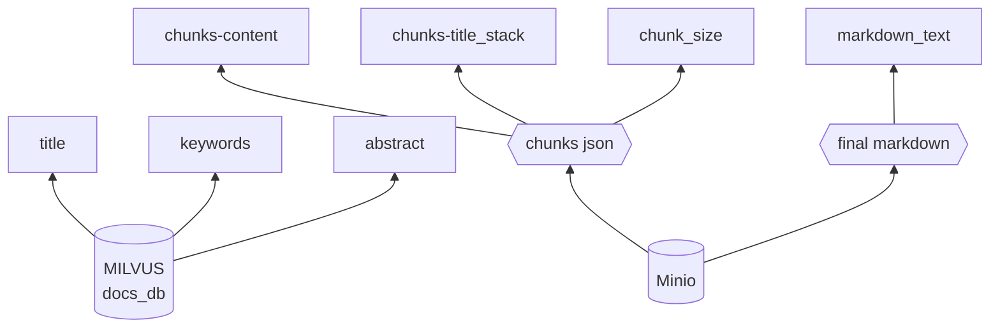

# 后端评审 V0

<!-- docs-layout: 2026-11 -->
> 状态：已完结（历史快照） · 文中 `src/`、`web/` 为 2026-11 目录改名前的路径，当前对应 `backend/`、`frontend/`；代码现状以仓库为准。索引见 [docs/feat/README.md](../README.md)。

现在我们已经敲定了前端的页面 (见最终方案 demo-v3.html)。

支持这个需求数据的后端 API 设计如下。

有需要决策与讨论的，与我交流。梳理清楚后，写入api-design.md。

## API 方案设计

### 特殊说明

- 当前阶段，外网不可访问的资源通过数据库入库阶段处理(未来解决)，后端不再做代理替换。

### `/docs/list`

- 请求方式: GET

- 传入参数：

  ```json
  {
     "cursor": 0 // 从第几项开始拉
     "limit": 20 // 拉多少项
  }
  ```

- 返回:

  ```json
  {
     "total": 6, // 当前文档总数
     "list": [
        {  // 每一个文档
           "title": "MiniRAG 架构设计文档", // 文档名
           "doc_id": "...", // 给一个id，方便删除和详情页查询
           "type": "pdf",   // 原始文档类型
           "pdf_link": "...",  // 若原始文档为 pdf，则传 pdf 链接；否则传 None（或者有什么别的规范？）
           "chunks_link": "...",  // chunks文件链接
        },
        ...
     ]
  }
  ```

- 数据来源

  全部自于 Milvus db minirag_docs 集合

- 调用时机:
  1. session 第一次进入文档管理页面后，自动调用一次。

  2. 点击刷新时调用。

  > 注：上传文件成功不自动调用!

### `/docs/detail/{doc_id}`

- 描述：获取 `doc_id` 文档 markdown 原文、chunks json、Milvus 数据库中的关键词和摘要

- 请求方式: GET

- 传入参数:

  ```json
  {
    "doc_id": "..." // Milvus docs 数据库中对应的 id
  }
  ```

- 返回:

  ```json
  {
     "title": "MiniRAG 设计文档", // 文档标题
     "markdown_text": "...", // final markdown 原文 + 链接替换(后端代理 URL)
     "chunks": [
        {
           "content": "...", // chunks 文本内容
           "title_stack": [null, "h2", "h3", ...], // 标题栈
           "chunk_size": 69, // chunks 字符数
        },
        ...
     ],
     "keywords": ["kw1", "kw2", ...],
     "abstract": "",
  }
  ```

- 数据来源
  - Milvus 数据库 docs_db:
    - **title**
    - markdown url
    - chunks url
    - **keywords**
    - **abstract**

  - 通过代理 url 从 minio 获取资料块
    - final markdown
    - chunks json

  - 逻辑处理
    - 从 minio 获取 markdown 和 chunks 文本内容，最终计算 chunks 的 chunk_size



- 调用时机:
  - 点击左侧文档列表中的某个文档时调用。
    > 注: 因为进入页面不会自动触发调用，因此需要设计一个右侧的缺省页，提示用户选择文档。

### `/docs/delete/{doc_id}`

- 描述：删除 `doc_id` 对应的文档

- 请求方式: DELETE

- 传入参数:

  ```json
  {
    "doc_id": "..." // Milvus docs 数据库中对应的 id
  }
  ```

- 返回:

  ```json
  {
    "success": true // 是否删除成功
  }
  ```

- 数据来源
  - Milvus 数据库 docs_db 操作结果

- 调用时机:
  1. 用户点击删除文档时调用。
