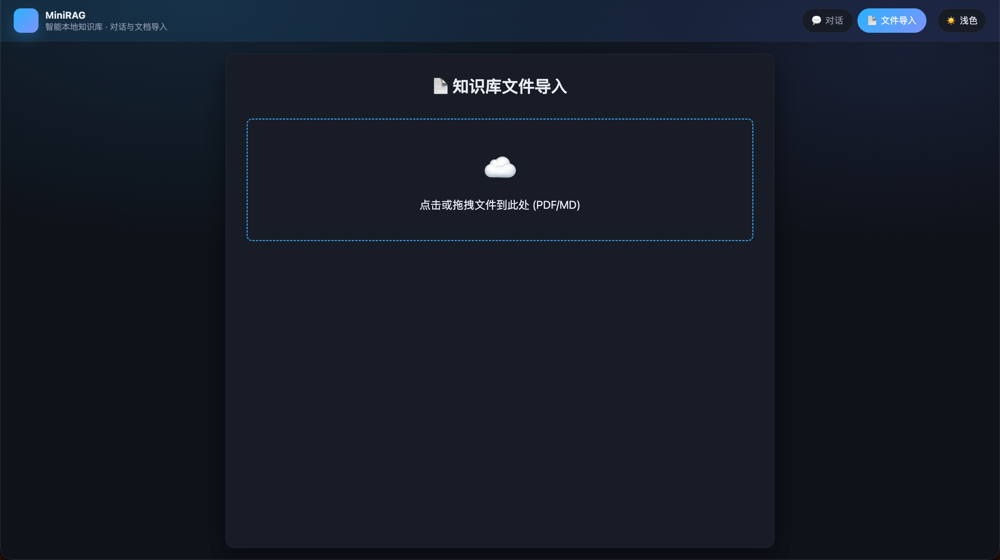
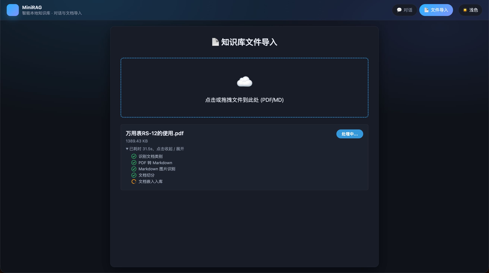

# 文档管理页面 PRD

<!-- docs-layout: 2026-11 -->

> 状态：已完结（历史快照） · 文中 `src/`、`web/` 为 2026-11 目录改名前的路径，当前对应 `backend/`、`frontend/`；代码现状以仓库为准。索引见 [docs/feat/README.md](../README.md)。

## 当前现状:

|                                 |                                   |
| :-----------------------------: | :-------------------------------: |
|  |  |

## 基本诉求

ImportPage 目前只有导入文件的功能，这远远不够。我们希望它是一个可以管理 RAG 文档的页面。
包含：文档的添加、文档的列表展示、文档的预览。

## 页面设想

文档页面分为左右两部分

### 左半区

左半区为文库中所有文档的列表，与 minirag_docs 中的条目对应

- 每个 Item 显示：
  - 文章标题
  - 原始文档类型
  - Chunks数量
  - 关键词
  - 上传时间
  - 摘要（默认收起）
- 每个 Item 上面有按钮：
  - 删除（删除此文档、以及 Milvus、Minio 上的相关数据）
  - Chunks Json（点击可在新标签页中查看切块 json 文件）
- 每个 Item 上可能有：
  - PDF（如果原始文档是 PDF，则按钮为 PDF，点击可在新标签页预览 PDF）

点击 Item 非按钮区域，右半区内容会改变

底部有添加文档按钮，点击过后，Item 列表像卷帘门一样上升，左半部变为文档导入区，和当前 import-page 内容一致。
顶部变为文档列表按钮，点击文档列表按钮，则 Item 列表像卷帘门一样下降，左半区由导入区变回文档列表区。

### 右半区

右半区为一个 markdown 预览区域。可以渲染当前选中 Item 的 final_markdown_url 中的 markdown。

刚开始右半区为空，提示用户需要在左半区选择文档。

选择后注意加载/渲染响应。

右半区底部设置一对切换按钮，可以切换 markdown / chunks。显示完整的 final_markdown，或者分段显示切好的 chunks_url。
显示 chunks 的逻辑可以参考 tools/markdown_chunks_viewer 中的方式。
