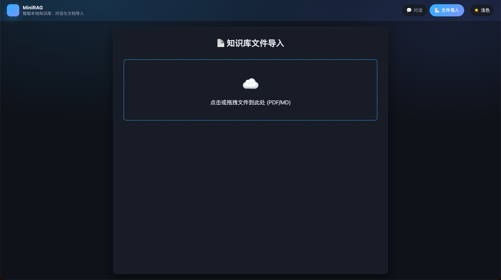
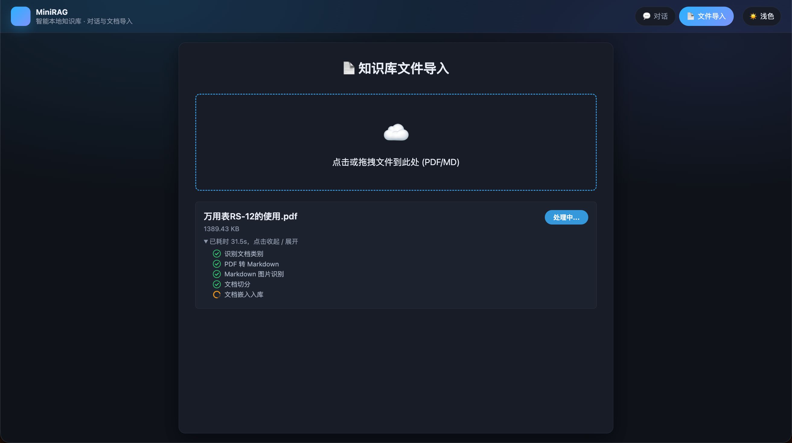

# 文档管理页面 PRD

<!-- docs-layout: 2026-11 -->

> 状态：已完结（历史快照） · 文中 `src/`、`web/` 为 2026-11 目录改名前的路径，当前对应 `backend/`、`frontend/`；代码现状以仓库为准。索引见 [docs/feat/README.md](../README.md)。

## 当前现状:

|                                 |                                   |
| :-----------------------------: | :-------------------------------: |
|  |  |

## 基本诉求

ImportPage 目前只有导入文件的功能，这远远不够。我们希望它是一个可以管理 RAG 文档的页面。
包含：文档的添加、文档的列表展示、文档的预览。

## 页面设想

文档页面分为左右两部分

### 左半区

左半区为文库中所有文档的列表，与 minirag_docs 中的条目对应。

面板头部包含：文档列表标题、当前文档总数、刷新按钮、添加文档按钮。

- 每个 Item 显示：
  - 文章标题
  - 原始文档类型（pdf ｜ markdown）
- 每个 Item 上面有按钮：
  - 删除（点击弹出确认弹窗，确认后删除此文档、以及 Milvus、Minio 上的相关数据）
  - 切块文件（点击可在新标签页中查看切块 json 文件）
- 每个 Item 上可能有：
  - PDF（如果原始文档是 PDF，则显示此按钮，点击可在新标签页预览 PDF）

点击 Item 非按钮区域，右半区内容会改变。

添加文档按钮与导入视图的文档列表按钮在同一位置：点击添加文档按钮，列表视图切换为文档导入区，和当前 import-page 内容一致；点击文档列表按钮，由导入区切回文档列表视图。

文档导入区支持上传 PDF / MD / ZIP（markdown zip 解压后，包内每个 md 成为一篇独立文档）。

### 右半区

右半区为一个文档预览区域。

- 刚开始右半区为空态，提示用户需要在左半区选择文档。
- 选择文档后显示：文档标题 + 三档开关（原文 ｜ 切块 ｜ 特征）
  - 原文：渲染当前选中 Item 的 final_markdown_url 中的 markdown
  - 切块：分段显示切好的 chunks_url，右侧附 ChunkRail（切片长度分布与总数）
  - 特征：显示文档的关键词与摘要
- 选择文档与切换模式时注意加载/渲染响应。
