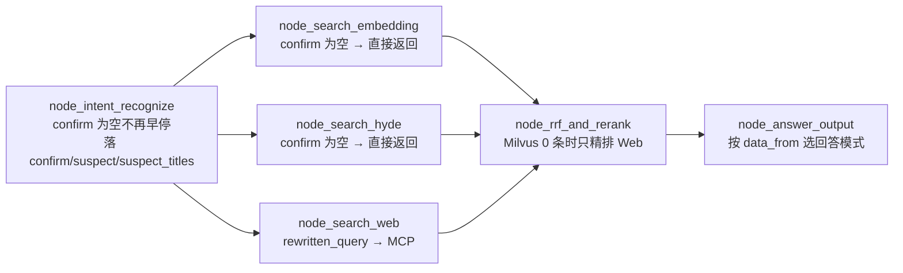

# 后端改动方案：查询兜底（v1）

<!-- docs-layout: 2026-11 -->
> 状态：已完结（历史快照） · 文中 `src/`、`web/` 为 2026-11 目录改名前的路径，当前对应 `backend/`、`frontend/`；代码现状以仓库为准。索引见 [docs/feat/README.md](../README.md)。

> 依据：[PRD.md](./PRD.md)（正文 19 行 + 评审纪要 2026-11-03；本期无前端 demo、无评审意见）
> 状态：已动工 · v1 为测试反馈修订：命中库文档但资料不足时不再拒答，改为声明后按「网络 → 通识」兜底（D8）
> 范围：查询图在「未命中文库」时不再早停，继续网络搜索 / 通识作答，并在答案首句声明依据
> 非目标：答案内的来源链接与引用卡片（PRD 未要求）；网络搜索失败的用户可见提示；任何前端改动；多 worker / 持久化
> 基线：Token 统计 v4、任务管理升级 2 期已落地；`tools/check_layers.py`、`tools/check_layout.py` 于 2026-11-03 实测为绿

## 1. 需求映射

| 编号 | 需求点（PRD 行） | demo 依据 | 后端能力 | 现状（代码证据） | 结论 |
| --- | --- | --- | --- | --- | --- |
| R1 | 无确认文档时不直接写回答，继续走最终流程（L13） | —（无 demo） | 图编排：去掉早停 | `node_intent_recognize.py:160-171` 写 `state["answer"]`；`query_graph.py:23-25` 据此直接跳 `node_answer_output` | 改 |
| R2 | embedding / hyde 空进空出（L14） | — | 节点内 `confirm_list` 为空提前 return | embedding 已满足（`node_search_embedding.py:41-45`）；HyDE 无判空，`doc_ids=[]` 会退化成全库检索（`milvus_client.py:174-175,189-191`） | 补 HyDE |
| R3 | 无命中时网络搜索仍以 `rewritten_query` 执行（L15） | — | `node_search_web` 现有能力 | 节点已实现（`node_search_web.py:74-86`），但早停让该路径不可达 | 解锁，不改节点 |
| R4 | RRF + rerank 正常融合排序（L16） | — | Web 候选并入精排；空候选保护 | 已支持 Web 混排（`node_rrf_and_rerank.py:135-141`）；候选为空时仍会调用重排序接口（`qwen_reranker.py:53-60`） | 小改 |
| R5 | 命中文档时按现状组织回答（L17-18） | — | library prompt：资料充足保持现状，资料不足按新规则兜底 | 原规则 5「不足即拒答」（`prompt_final_answer.py` 旧版） | 改（v1） |
| R6 | 未命中时答案开头强调「未匹配文库 + 依据类型」（L19-20） | — | 回答模式判定 + fallback prompt 分支 | 无任何分支；v0 版规则 1/5 强制只用参考资料、不足即拒答 | 新增 |
| R7 | 用大模型回答通识问题（L8-9） | — | fallback 模板放开引用约束 | 同上，当前会被规则 5 拒绝 | 新增 |
| R8 | 命中库文档但资料不足时不得拒答，声明后按「网络 → 通识」兜底（评审纪要 2026-11-03） | — | library prompt 规则 1/5 调整 | 旧规则 1 只准用参考内容、规则 5 强制拒答，实测「华为手机充电口」得到死胡同答案 | 改（方案 A） |

未覆盖：

- 答案内的可点击来源（标题 / URL）：PRD 只要求说明依据类型，见「未决 1」。
- 网络搜索失败的用户可见提示：失败目前被吞成空列表（`node_search_web.py:58-65`），本期只写日志并降级文案，见 D6。
- 前端交互：无 demo，答案仍走既有 `delta` / `final` 渲染，前端零改动。

## 2. 架构调整

无。改动全部落在 `graphs/query_graph/`（图内编排）与 `common/prompt/`（Tier 0 提示词），不新增模块与顶层目录，依赖方向仍是 `graphs → common`，`check_layers.py` / `check_layout.py` 无需调整。

一句话数据流：`node_intent_recognize` 只产出「检索范围 + 疑似标题」→ Milvus 两路（可能全空）与 Web 一路并行 → `node_rrf_and_rerank` 融合精排（Milvus 为空时只剩 Web 候选）→ `node_answer_output` 按候选来源选回答模式并流式输出。

## 3. 文件修改清单

| 文件 | 类型 | 改动 |
| --- | --- | --- |
| `src/graphs/query_graph/query_graph_state.py` | 改 | 删除 `answer`，新增 `suspect_titles` |
| `src/graphs/query_graph/query_graph.py` | 改 | 条件边去掉 `answer` 短路，始终三路并行检索 |
| `src/graphs/query_graph/nodes/node_intent_recognize.py` | 改 | 取消无命中早停；把疑似文档标题写入 state；更新 `step_5` 的用途说明 |
| `src/graphs/query_graph/nodes/node_search_hyde.py` | 改 | `confirm_list` 为空时在 HyDE LLM 调用前提前返回 |
| `src/graphs/query_graph/nodes/node_rrf_and_rerank.py` | 改 | 空候选跳过精排；兜底路径精排异常降级 |
| `src/graphs/query_graph/nodes/node_answer_output.py` | 改 | 删除 `answer` 早停分支；按候选来源选回答模式 |
| `src/common/prompt/prompt_final_answer.py` | 改 | 拆共用规则块，新增 fallback-web / fallback-general 两种模板 |
| `tests/test_query_fallback_prompt.py` | 新增 | prompt 模式分支的纯函数单测（零外部依赖） |

## 4. 内部重要变更

### 4.1 schema

`QueryGraphState`（`src/graphs/query_graph/query_graph_state.py:48-93`）：

| 字段 | 变更 | 类型 / 默认 | 说明 |
| --- | --- | --- | --- |
| `answer` | 删除 | `str` / — | 唯一写入方是 intent 节点的早停（已删），保留即死字段；`node_answer_output` 里对应的早停分支一并删除 |
| `suspect_titles` | 新增 | `list[str]` / `[]` | 疑似文档标题，仅供兜底回答提示；doc_id 仍留在 `suspect_list`，不对外 |

`_DEFAULT_STATE`（`:74-93`）与 `create_state` 随之增删；`suspect_list` 的字段注释从「终止提示」改为「兜底提示」。

变更后的最小实例（未命中文库、命中网络）：

```json
{
  "session_id": "bsess-8f2a1c",
  "original_query": "今天上海天气如何",
  "rewritten_query": "今天上海的天气情况",
  "enable_web_search": true,
  "enable_hyde": true,
  "confirm_list": [],
  "suspect_list": [469734951640943804],
  "suspect_titles": ["万用表RS-12的使用"],
  "embedding_recalls": [],
  "hyde_recalls": [],
  "web_matches": [
    {
      "title": "上海天气预报",
      "url": "https://example.com/weather",
      "snippet": "上海今日多云，18~24℃……",
      "hostname": "example.com",
      "hostlogo": "https://example.com/favicon.ico"
    }
  ],
  "rerank_results": [
    {"document": "上海今日多云，18~24℃……", "data_from": "Web", "score": 0.83}
  ],
  "token_meter": {
    "llm_tokens": 620,
    "vlm_tokens": 0,
    "embedding_tokens": 905,
    "reranker_tokens": 350
  }
}
```

存量数据策略：容忍。图状态只存在于进程内与 `var/` 下的调试快照，不落任何存储；旧快照里残留的 `answer` 键不会被任何节点读取，无需清库或迁移。

### 4.2 全局实例

无新增或修改。兜底路径复用既有单例：`LLM`、`RERANKER`（`common/model/`）、`MILVUS_CLIENT`（`common/client/`）、`EVENT_BUS` / `TASK_MANAGER`（`common/events/`），均已被相关节点按 `from common.<pkg> import X` 引用，不引入新单例，api 层不构造任何实例。

### 4.3 图状态 / 节点



回答模式（`node_answer_output` 内按 `rerank_results` 判定）：

| 判定 | 模式 | 参考内容 | 首句要求 |
| --- | --- | --- | --- |
| 含 `data_from == Milvus` 且参考内容能回答 | library（现状） | Milvus + Web | 不声明，沿用现有规则 |
| 含 `data_from == Milvus` 但参考内容回答不了 | library + 兜底（v1，D8） | Milvus（+Web） | 首句声明「文库中未检索到与该问题相关的内容」，再按网络结果 → 通识兜底 |
| 无 Milvus、含 `data_from == Web` | fallback-web | 仅 Web 片段 | 声明「文库中未检索到相关内容」，并说明以下为网络搜索结果 |
| 两者都无 | fallback-general | 无（模板标注「无参考资料」） | 声明未命中文库且无可用网络结果，并说明以下为通识回答 |

节点级改动：

1. `node_intent_recognize`：删除早停分支（`:160-171`）；`confirm_list` 为空时只记日志（`无确认匹配文档, 继续网络搜索/通识兜底`）并继续；`state["suspect_titles"]` 由 `doc_titles` 映射得到（过滤空标题）；用户消息仍由 `step_6` 落库（`:173-176`）；`token_meter` 仍是改写 LLM + docs 召回的增量（`:179-181`）。
2. 条件边 `after_node_intent_recognize`：删除 `if state.get("answer")` 分支，其余不变（三路并行仍由 `enable_hyde` / `enable_web_search` 开关决定）。PRD L14 要求节点空过，因此**不**在路由层跳过空节点，保持图结构与 join 语义不变。
3. `node_search_embedding`：无改动，已满足空进空出。
4. `node_search_hyde`：`confirm_list` 为空时提前返回 `{"hyde_recalls": []}`，位置放在假设性回答的 LLM 调用之前（省一次模型调用与 embedding 费用）。
5. `node_rrf_and_rerank`：候选为空（`fused_results` 与 `web_matches` 都空）时直接返回空结果，不调用精排接口；兜底路径（无 Milvus 候选）精排异常时降级为空结果并继续（D7）；有 Milvus 候选时保持原语义直接抛出。
6. `node_answer_output`：删除 `answer` 早停分支；读 `rerank_results` 算出回答模式与疑似标题，生成 prompt 后流式输出；仍不写回 state（`token_meter` 只含本次答案 LLM 增量）。

`PromptFinalAnswer` 结构：把「历史对话只作上下文、图片内嵌规则、语言一致、简洁」抽成共用规则块；library 规则在资料充足时保持原约束，资料不足时不再拒答，改为首句声明 + 按「网络结果 → 通识」兜底（v1，D8）；fallback 规则为：首句声明未命中 → 有 Web 时以其为主要依据、可补充通识但不得编造来源 → 无 Web 时直接用通识回答且不得假装引用 → 疑似标题可作为「你可能想找的是《…》」的提示。措辞统一用「文库中未检索到相关内容」，以便覆盖「`confirm_list` 非空但切片全被阈值过滤」的场景（详见 D2）。

## 5. 对外重要变更

### 5.1 HTTP 契约

无新增端点、无请求体/响应信封变化；变化发生在两次既有调用的语义上。

| 端点 | 方法 | 职责 | 变化 |
| --- | --- | --- | --- |
| `/api/query` | POST | 提交异步查询 | 无确认文档时不再立刻产出固定兜底答案，改为继续检索；本响应体不变 |
| `/api/query/sse/{session_id}` | GET | 查询推流 | `final.answer` 内容变化（兜底答案带未命中声明）；事件集合与帧形状不变 |

#### POST /api/query

- 请求（不变）：`{"query": "今天上海天气如何", "session_id": "bsess-8f2a1c", "enable_web_search": true, "enable_hyde": true}`，信封见 `src/api/schemas.py:20-26`。
- 响应（不变）：`{"status": "ok", "msg": "查询已异步启动", "session_id": "bsess-8f2a1c"}`。
- 错误：请求体缺字段 → FastAPI `422`；图内失败不体现在本响应（后台任务），走 SSE `error` 帧。
- 调用时机：前端发送消息后立即调用，随后订阅 SSE。
- 实现落点：`api/main.py:183-213` → `service/query_service.py:25-52` → `query_graph.ainvoke`。

#### GET /api/query/sse/{session_id}

- 帧序列：`ready` → 若干 `progress` → `delta`（逐 token）→ `final` → `usage` → `__close__`；失败为 `error` → `__close__`（事件定义见 `src/common/events/event_bus.py:16-27`）。
- `final.answer` 示例（fallback-web）：
  - `未在文库中检索到与该问题相关的内容，以下是网络搜索结果：上海今日多云，18~24℃……`
- `final.answer` 示例（fallback-general）：
  - `未在文库中检索到与该问题相关的内容，且本次没有可用的网络搜索结果，以下为大模型的通识回答：……`
- 错误：LLM / 精排异常 → `error` 帧 + 任务状态 `failed`，与现状一致（`query_service.py:53-62`）；兜底路径的精排异常按 D7 降级，不出 `error`。
- 调用时机：POST 后立即订阅；断线重连沿用通道缓冲。
- 实现落点：`arun_query` → `node_answer_output.step_3_call_llm_generate_answer` → `EVENT_BUS.push(FINAL)`。

### 5.2 外部服务客户端

| 客户端 | 变更 | 调用点 | 影响 |
| --- | --- | --- | --- |
| `MILVUS_CLIENT.hybrid_search_chunks` | 无签名变更 | `node_search_embedding.py:28`、`node_search_hyde.py:45` | HyDE 补判空后，`doc_ids=[]` 不再触发「不加过滤的全库检索」（原语义见 `milvus_client.py:174-175`） |
| `RERANKER.rerank` | 无签名变更 | `node_rrf_and_rerank.py:148` | 兜底路径候选只含 Web；候选为空时不调用，避免空 `documents` 请求；兜底路径异常降级（D7） |
| `LLM.invoke` / `LLM.stream` | 无 | `node_intent_recognize.py:43`、`node_answer_output.py:49` | 兜底路径必然多一次答案生成调用（原先直接返回固定文案） |
| DashScope WebSearch MCP | 无 | `node_search_web.py:25-53` | 无命中场景下成为常态调用；失败仍被吞成空列表（`:58-65`），由回答模式兜底 |

### 5.3 数据库 / 缓存 / 队列

无新增集合、字段、索引与 TTL；Milvus 无 schema 或写入变更。Mongo `chat_history` 的写入时机与字段不变，仅兜底场景的助手消息由固定文案变为模型生成答案（`node_answer_output.py:71-85`）。

存量数据策略：容忍。不涉及持久化结构变更，无需清库或迁移；`var/` 下旧图状态快照可直接保留。

## 6. 关键设计决策

| 编号 | 决策点 | 结论 | 理由 | 被否备选 |
| --- | --- | --- | --- | --- |
| D1 | 兜底在哪实现 | 查询图内完成：intent 不早停 + answer 分模式作答；不新增端点 | 无命中判定、联网、精排、答案生成都已在图里；新增端点等于把同一状态机拆两处，且要重复通道与计量收口 | 新增 `/api/query` 的兜底端点（重复鉴权/通道/计量）；前端拿固定文案自行渲染（丢失模型能力） |
| D2 | 如何判定「未命中文库」 | 看 `rerank_results` 是否含 `data_from == Milvus`，不含即兜底 | 答案实际消费的是精排后的参考内容；`confirm_list` 非空但切片被 `chunks_recall_threshold` 全过滤时，按 confirm 判会宣称「已命中」却拿不到文库内容 | 用 `confirm_list` 是否为空；用 `embedding_recalls` 是否为空（RRF 阈值可能已过滤全部） |
| D3 | 未命中声明由谁产生 | prompt 规则：模型在首句声明；代码不拼固定前缀 | 语言须与用户问题一致（现 prompt 规则 8）；固定前缀要在流式前单独推帧，且与模型首句衔接生硬 | 代码固定中文前缀（破坏语言一致）；前端按新字段渲染提示条（需改契约与前端） |
| D4 | 疑似文档提示 | 保留：state 新增 `suspect_titles`，兜底 prompt 中作为可选提示 | 现状用户能看到《疑似文档》，直接丢弃是体验回退；标题已在 intent 节点算出（`node_intent_recognize.py:149-155`），只差落 state | 彻底移除（少一个字段，但体验回退）；固定文案追加（与通识回答割裂，还需 code 分支） |
| D5 | `state["answer"]` 与短路边 | 一并删除（含 `node_answer_output` 的早停分支） | 唯一写入方消失后是死代码；保留会让后来者误以为还有早停路径 | 保留字段与分支（零风险，但隐性死代码） |
| D6 | 无网络结果时的文案 | 统一中性表述「未检索到可用的网络结果」，不区分「用户关闭」与「调用失败」 | `node_search_web` 已把失败吞成空列表（`:58-65`），要区分需新增状态字段与错误通道；PRD 只要求说明依据类型 | 新增 `web_search_failed` 标记（多一个状态字段，收益仅文案）；把 MCP 失败提升为 `error` 帧（违背兜底目标） |
| D7 | 兜底路径精排失败 | 无 Milvus 候选时降级：记 exception、`rerank_results=[]`、继续生成通识答案；有 Milvus 候选时保持抛错 | 新路径引入了原先不存在的强依赖（无命中问题原来不调精排）；兜底目标是「总能给出回答」，精排只是增强 | 与现状一致直接抛错（无命中问题从固定回答变成整次失败）；Web 结果免排序直接作答（丢失相关性过滤，且 `dynamic_topk` 语义失效） |
| D8 | 命中库文档但资料不足 | library 模式内先声明「文库中未检索到与该问题相关的内容」，再按「网络结果 → 通识」兜底，不直接拒答 | 测试反馈：`华为手机是什么充电口？` 命中《华为擎云 S520 Gen2 用户指南》（精排 0.71），严格库内模式直接拒答，网络/通识能力未生效，用户拿到死胡同答案 | 两段式检测 + 重跑 fallback prompt（多一次 LLM 调用、需缓冲流式输出）；仅放宽精排阈值或保留 Web 候选（无 Web 时仍拒答，不解决本场景） |

## 7. 风险与未决

| 风险 | 影响 | 缓解 |
| --- | --- | --- |
| 兜底路径耗时明显上升 | 无命中问题从毫秒级固定回答变为「MCP 联网 + 精排 + 答案生成」，最坏叠加 MCP 超时（`mcp_timeout=60`） | 前端已有进度条；本期接受，必要时后续加「仅通识回答」快捷开关 |
| 新增外部依赖失败面 | MCP 失败被吞成空结果；精排失败在无文库候选时降级（D7），有文库候选时仍抛错 | 日志 warning / exception + 降级路径；见未决 2 |
| 无命中时 token 消耗上升 | 联网搜索、精排、答案生成均计费，用户感知消耗变大 | 计量口径不变（`token_meter` + `usage-delta`），验收核对无虚增、无遗漏 |
| 模型可能不遵守「首句声明」 | 兜底语义被弱化 | 作为 fallback 规则第 1 条并给句式；验收人工核对；不采用代码前缀（D3） |
| 网络结果只带摘要、不带标题/URL | 答案无法给出可点击来源（PRD 未要求） | 列为未决 1 |
| 单 worker 进程内状态 | 与本期无关（不新增状态） | 不涉及 |

假设：

- 网络搜索 / HyDE 开关沿用既有布尔字段 `enable_web_search` / `enable_hyde`，请求体默认值均为 `true`（`src/api/schemas.py:20-26`）。
- 兜底场景仍需把用户消息与助手答案落 `chat_history`（`node_intent_recognize.py:173-176`、`node_answer_output.py:71-77` 已如此），历史页可回看完整对话。
- 「命中文档」的口径是「最终参考内容中存在 `data_from == Milvus` 的条目」，而不是 `confirm_list` 非空（D2）。
- 疑似文档标题仍需提示，否则相比现状是体验回退（D4）。
- 兜底答案不再输出「文库暂无内容与您的查询内容匹配」原文，措辞可润色（PRD L19-20）。
- 《任务管理升级》的节点可观测统计文档属历史快照，本期不回溯更新；如需同步另起文档任务。

⏳ 未决 1：是否在答案中给出网络搜索来源（标题 / URL）—— 需要产品 / 人类确认是否纳入本期；不阻塞的部分：本期只输出摘要，`web_matches` 与 `rerank_results` 已保留原文，后续加字段即可扩展。

⏳ 未决 2：兜底路径精排失败时的用户可见提示 —— 需要人类确认「静默降级为通识回答」是否可接受；不阻塞的部分：先按 D7 实现（降级 + 日志），如要提示再补轻量事件或文案。

## 8. 实施顺序

1. state 调整（删 `answer`、加 `suspect_titles`）+ intent 取消早停、写入疑似标题 —— 节点 `__main__` 可验证 `confirm_list=[]` 时不再产出答案。
2. 条件边去短路、HyDE 判空、RRF 空候选保护 —— 无文档查询能走到答案节点且不调用空精排。
3. `PromptFinalAnswer` 三模式与共用规则块 + 纯函数单测 —— 先绿，再接节点。
4. `node_answer_output` 接线回答模式、删除早停分支 —— 端到端跑通三类场景（library / fallback-web / fallback-general）。
5. 兜底路径精排降级与日志 —— 用错误模型名实测。
6. 回归与 pre-commit（见 §9 质量项）。

## 9. 验收条件

前置：`docker compose -f docker/compose.infra.yaml up -d` + `uvicorn --app-dir src api.main:app --reload`；SSE 用两个终端（先订阅再 POST）。

```bash
# 终端 A
curl -sN http://127.0.0.1:8000/api/query/sse/test-fallback-1
# 终端 B
curl -s -X POST http://127.0.0.1:8000/api/query \
  -H 'Content-Type: application/json' \
  -d '{"query":"今天上海天气如何","session_id":"test-fallback-1","enable_web_search":true,"enable_hyde":true}'
```

| 编号 | 验收项 | 判定方式 |
| --- | --- | --- |
| A1 | 无文库命中 + 开网搜：继续联网并给出带声明的答案 | 日志出现 `确认匹配文档: []`、`待重排序文档数量 > 0`；`final.answer` 首句声明未命中文库且说明为网络搜索结果；答案基于 Web 内容 |
| A2 | 无文库命中 + 关网搜：通识作答 | `enable_web_search=false` 重跑 A1；`final.answer` 声明未命中文库且无网络结果，正文为通识回答；不得出现「参考内容中未提供足够信息」 |
| A3 | 库内命中回归：行为不变 | 查询「如何用 RS-12 测量电阻」；`final.answer` 无未命中声明，日志 `data_from` 含 Milvus，答案与改动前一致 |
| A4 | 疑似文档 | 构造 0.5 ≤ score < 0.75 的查询；日志出现疑似标题，state `suspect_titles` 非空；答案可含《…》提示（人工核对，不强制） |
| A5 | 空库兜底 | `tools/reset_db.py` 清库后重跑 A1：无 `error` 帧，返回通识 / 网搜答案，Milvus `count(*)` 为 0 |
| A6 | 网络搜索失败 | 改坏 `DASHSCOPE_WEB_SEARCH_MCP_URL`；日志出现 `MCP 调用失败`，无 `error` 帧，答案降级为通识并声明无可用网络结果 |
| A7 | 兜底路径精排失败 | `DASHSCOPE_RERANK_MODEL=invalid-rerank-model` + 无命中查询：无 `error` 帧，返回通识答案，日志含 `重排序失败` / 降级记录；同一配置下命中查询仍按现状报错 |
| A8 | 计量准确 | 兜底路径 SSE `usage-delta` 只出现实际调用；`usage` 总账与日志中的 token 数一致，无 embedding / reranker 虚增 |
| A9 | 契约不变 | `POST /api/query` 请求/响应与改动前一致；SSE 事件集合未增删（对照 `event_bus.py:16-27`） |
| A10 | 历史落库 | `GET /api/history/test-fallback-1` 能看到兜底问答两条消息，助手消息为完整声明答案 |
| A11 | 单测 | `.venv/bin/pytest -q tests/test_query_fallback_prompt.py` 通过：library 模板含「资料不足 → 声明 + 通识兜底」规则且不含旧拒答句；fallback 模板含首句声明要求且不含「参考内容不足必须拒答」 |
| A12 | 质量 | `.venv/bin/ruff check . && .venv/bin/ruff format --check .`、`.venv/bin/python tools/check_layout.py`、`.venv/bin/python tools/check_layers.py`、`.venv/bin/pytest -q` 全绿 |
| A13 | 命中但资料不足（v1） | 同历史复现「华为手机是什么充电口？」+ 关网搜：library 模式，首句声明「文库中未检索到与该问题相关的内容」并给出通识回答，不再出现「参考内容中未提供足够信息」 |

## 10. 评审记录

| 版本 | 事项 | 结论 |
| --- | --- | --- |
| v0 | 首版成稿（依据 PRD 19 行，无 demo、无评审意见） | 待评审 |
| v1 | 测试反馈：命中库文档但资料不足仍拒答 | 采纳方案 A（D8）；PRD 评审纪要已追加，代码与单测同步 |
