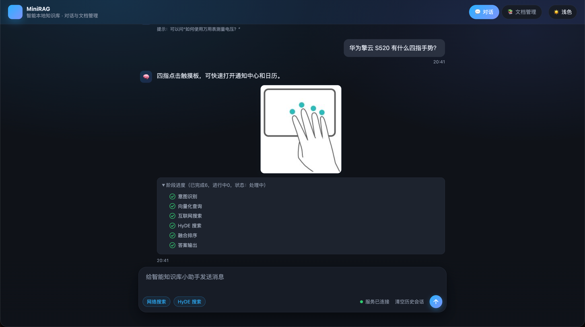
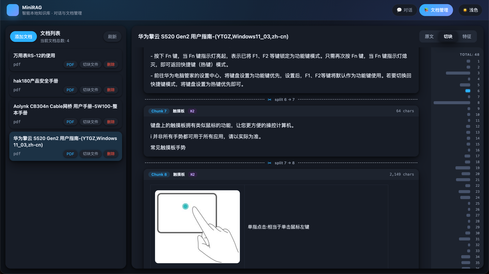
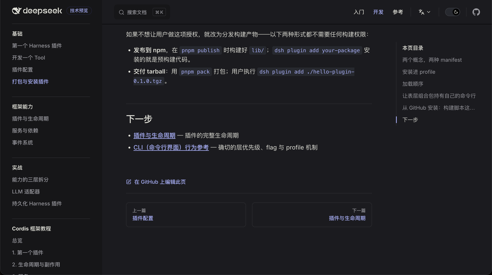
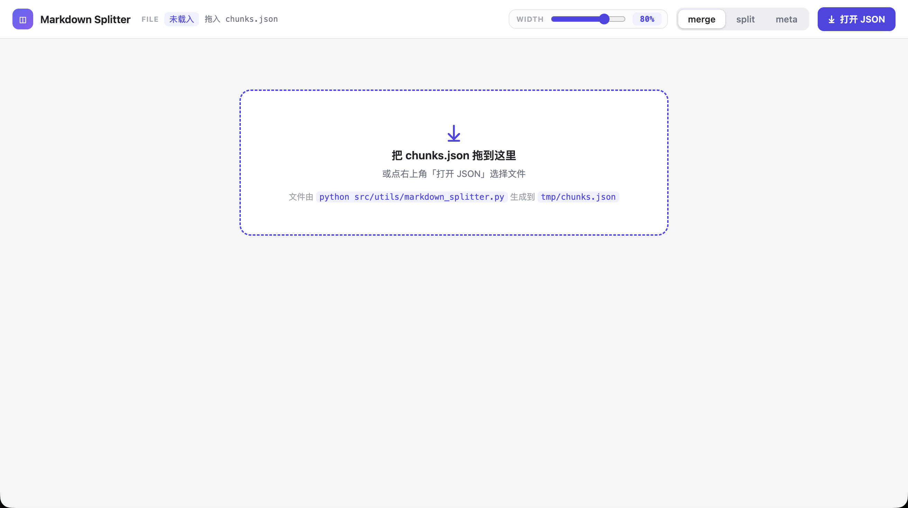

# 页面美化 PRD

## 现状

| 聊天页面                         | 导入页面                             |
| -------------------------------- | ------------------------------------ |
|  |  |

渐变的背景色、渐变的按钮颜色已经是过时的 UI 设计了，页面的美观性还有很大的提升空间。

## 目标

- 配色优化
  - Dark 模式配色参考: [DeepSeek Harness Develope Guide](https://deepseek-harness.github.io/deepseek-harness/develop/basic/publish)
  - Light 模式配色参考: [Markdown Splitter (本地页面)](tools/markdown-splitter/index.html)

    | Dark                                      | Light                                        |
    | ----------------------------------------- | -------------------------------------------- |
    |  |  |

- 扁平化
  - 移除渐变背景色和按钮颜色，采用纯色设计。
  - 了解 Material Design 中的 Elevated Card 风格, 合理效仿。
  - 不要过多使用阴影和浮层。markdown 内容中的图片显示不需要阴影。

- 微调，不是大改
  - 保持页面整体布局和功能不变，主要针对配色和视觉效果进行优化。

## 需求计划

1. 采集部分现有界面截图，作为归档信息，输出 现状一览.md，图片存放在 images 目录下。
2. 调研方案，输出 方案设计.md，需包括新的配色方案，分别针对 Dark 模式和 Light 模式，给出色卡。
3. 输出 chatpage.html 和 importpage.html，作为页面美化后的示例。
