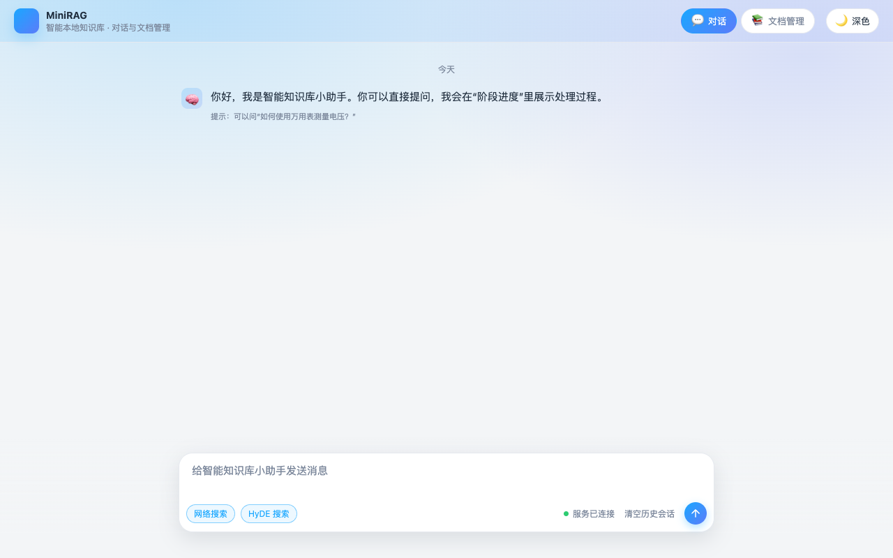
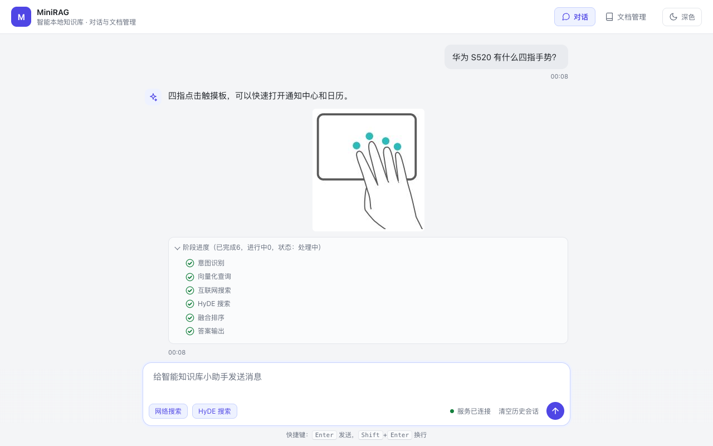
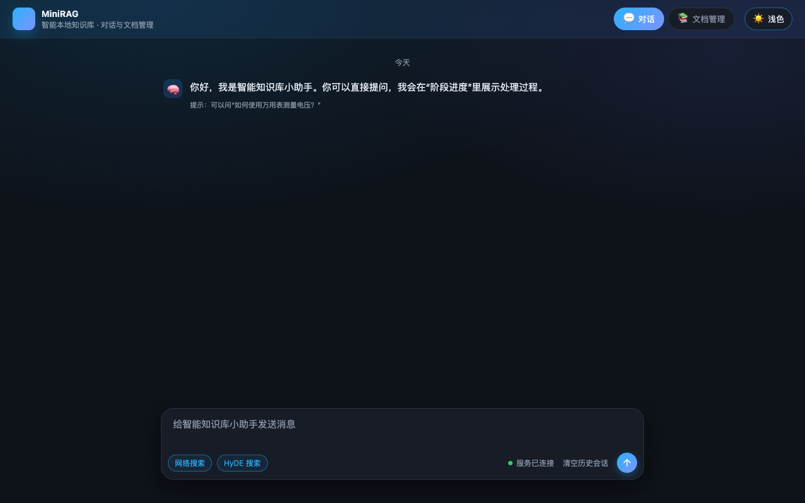
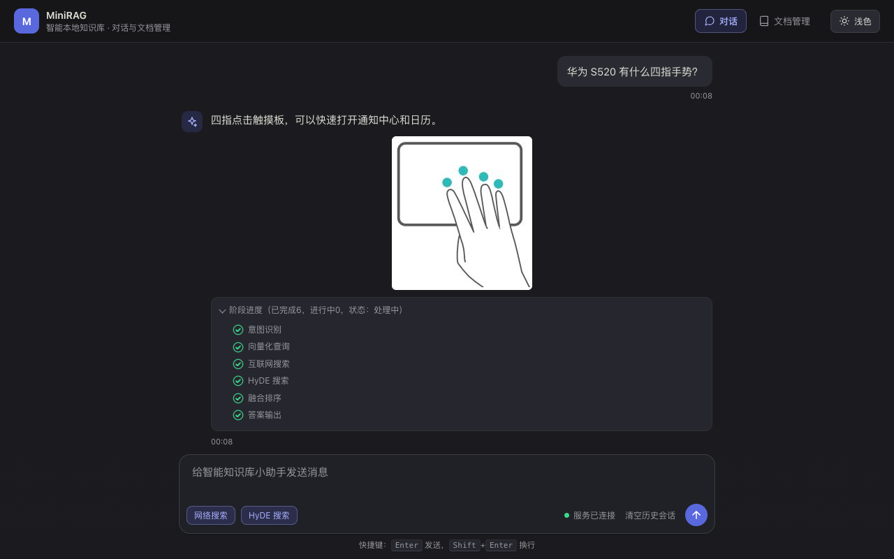
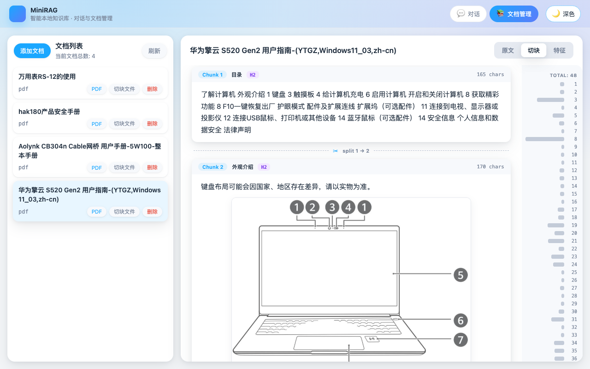
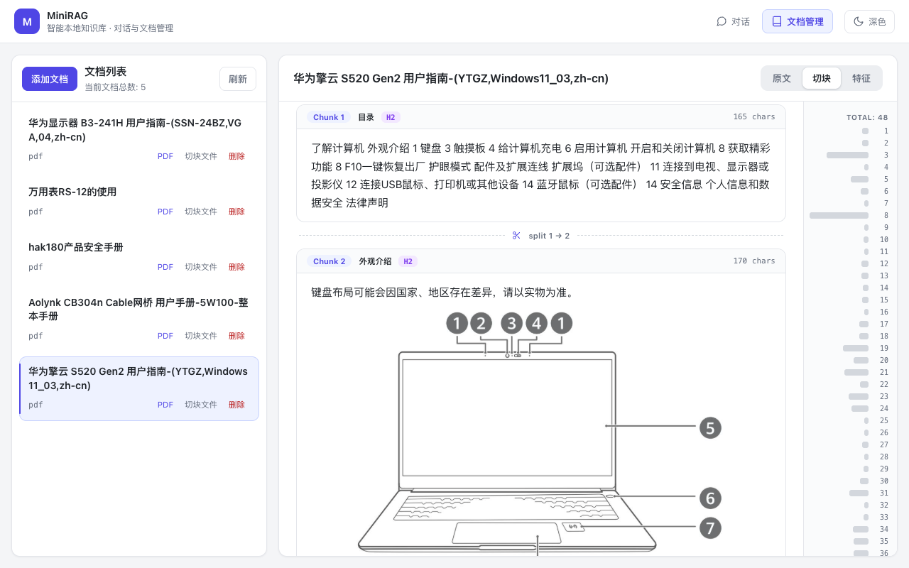
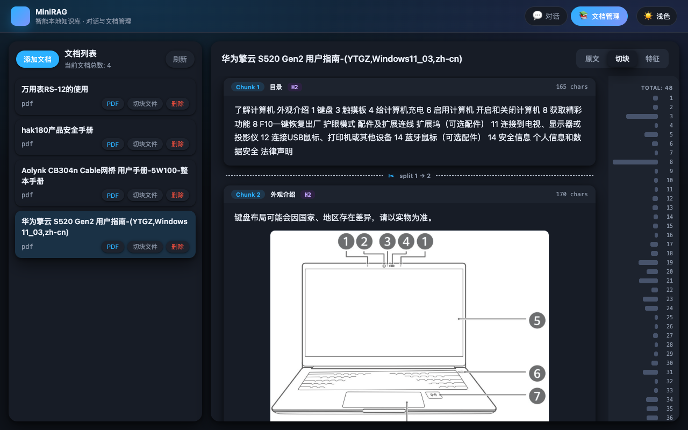
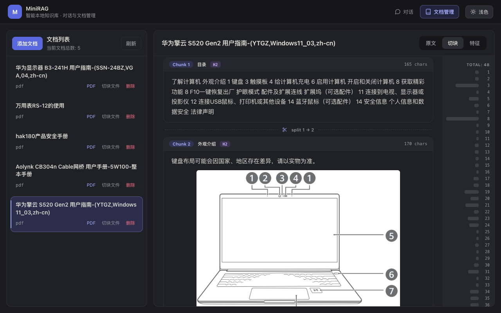
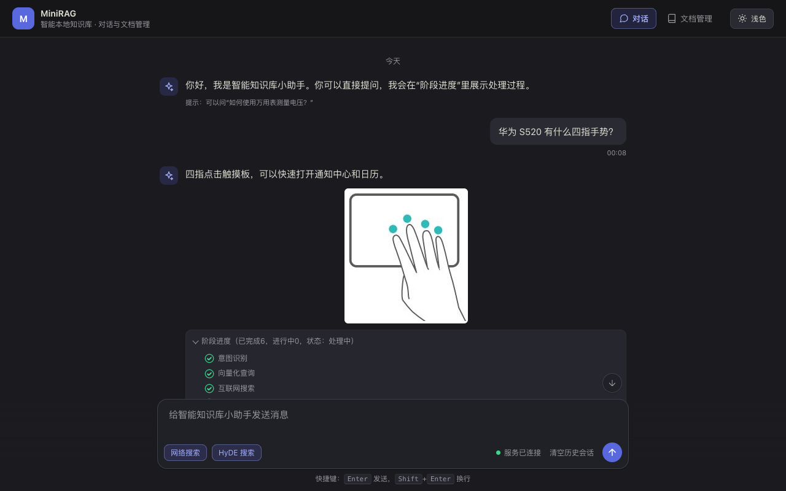

# 页面美化 · 前后对比

| 项       | 内容                                                                |
| -------- | ------------------------------------------------------------------- |
| 需求状态 | **已验收，需求关闭**                                                |
| 完成时间 | 2026-10-25                                                          |
| 改版前   | [现状一览](现状一览.md)                                             |
| 设计依据 | [方案设计](方案设计.md)                                             |
| 实现记录 | [方案实现](方案实现.md)                                             |
| 静态预览 | [chatpage.html](chatpage.html) · [importpage.html](importpage.html) |

> 对话页的改版前截图为空态，终态为一次真实查询，消息内容不同；对比聚焦页面框架、色彩、材质与控件。文档管理页前后均选中华为 S520 用户指南并进入「切块」；文档数后来从 4 篇增至 5 篇（新增一本显示器手册），不影响视觉对比。

## 1. 页面级对照

| 页面 / 主题      | 改版前                                                                           | 改版后                                                                         |
| ---------------- | -------------------------------------------------------------------------------- | ------------------------------------------------------------------------------ |
| 对话 · Light     |      |      |
| 对话 · Dark      |       |       |
| 文档管理 · Light |  |  |
| 文档管理 · Dark  |   |   |

## 2. 视觉与体感变化

| 维度          | 改版前                                   | 改版后                                             |
| ------------- | ---------------------------------------- | -------------------------------------------------- |
| 背景          | 彩色径向渐变 + 蓝黑画布                  | 纯色画布：Light `#f4f5f7`、Dark `#1b1b1f`          |
| 品牌          | `#1aa7ff` / `#5b7cfa` / `#3498db` 三套蓝 | 单一 indigo / periwinkle；文字、软底、实心三档分工 |
| 表面          | 白卡叠阴影、卡内再叠卡片                 | 画布 / 导航 / 卡片纯色分层；暗色靠明度抬升而非阴影 |
| 控件          | 渐变胶囊、彩色光晕、胶囊按钮             | 透明或 accent-soft 底 + 1px 描边；按钮 8px 圆角    |
| 状态          | 饱和色块 + 白字                          | soft 底 + 语义色文字 + 6px 圆点，四态统一          |
| Markdown 图片 | 阴影 + 1px 边框 + 底色                   | 无阴影、无边框、无底色，保留 6px 圆角              |
| 图标          | 彩色 Emoji                               | 10 个单色线性 SVG                                  |
| 观感          | 蓝紫科技风、层次依赖阴影                 | 中性扁平、层次由表面与描边建立，接近参考站         |

## 3. 量化对比

| 指标                | 改版前                        | 改版后                                                   |
| ------------------- | ----------------------------- | -------------------------------------------------------- |
| 装饰性渐变          | 7 处                          | **0 处**（保留 1 处输入区功能性渐隐）                    |
| 阴影                | 4 档令牌、21 处使用、卡内嵌套 | 2 档 elevation + 1 个分段 thumb 阴影；主面板外无卡内阴影 |
| 品牌色              | 3 套蓝并存                    | 1 套 indigo / periwinkle                                 |
| 语义色              | 双主题同值、饱和底白字        | 双主题成对 text / soft；关键组合 ≥4.5:1                  |
| tokens 外硬编码颜色 | 37 处                         | **0 处**（仅剩 `transparent` 渐变端点）                  |
| 圆角值              | 15 种零散值                   | 7 个令牌                                                 |
| Markdown 图片圆角   | 旧圆角 + 边框                 | 6px（`--r-sm`）                                          |
| 状态徽章            | 饱和底 + 白字                 | soft 底 + 语义色文字 + 圆点                              |

## 4. 本次新增交互

**发送贴底与回到底部**：发送（按钮 / Enter）始终滚到最新；上翻后出现圆形回底按钮，点击恢复贴底。

- 按钮位于输入卡片外沿右上方，与发送按钮中心对齐。
- 流式增量、进度展开、图片懒加载均继续跟随；用户主动上翻后停止跟随。
- 上翻后再次发送会强制贴底，适合连续追问。

## 5. 结论

页面从「渐变 + 多层阴影 + 三套蓝」收敛为「纯色表面 + 单强调色 + 受控描边」，Light / Dark 观感与参考站一致；主布局、宽度和断点未改，仅窄屏 footer 换行、品牌副标题收起与回底按钮为新增，用户无需重新学习界面。视觉目标全部达成。
