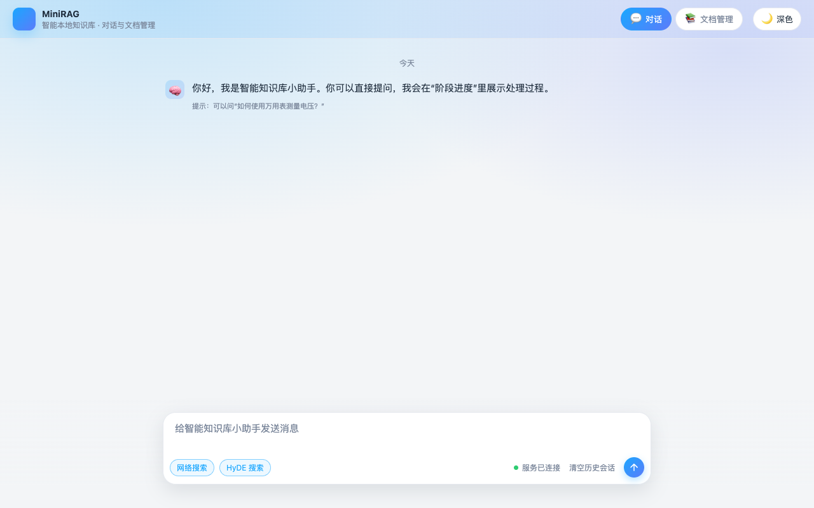
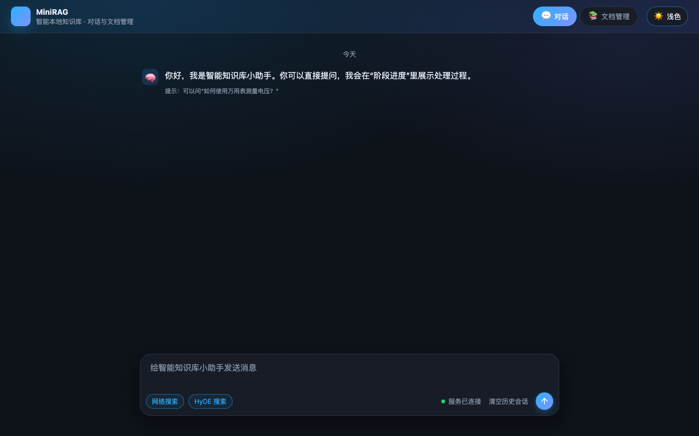
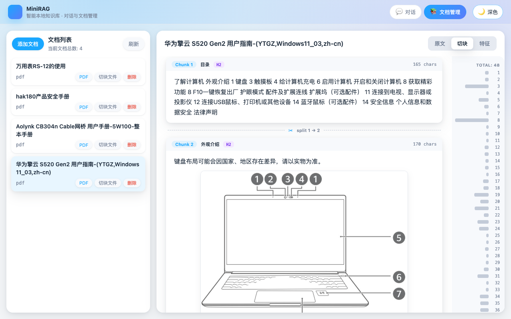
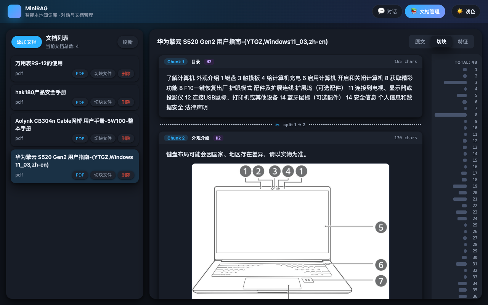
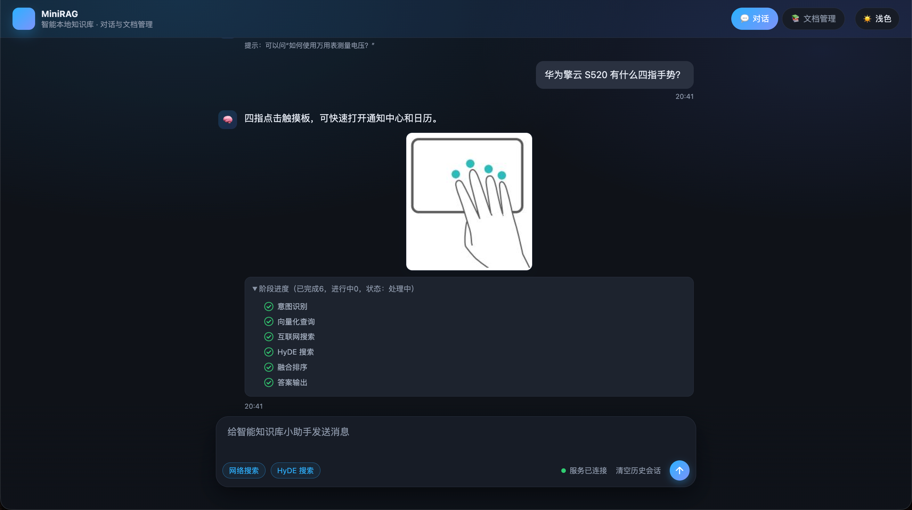
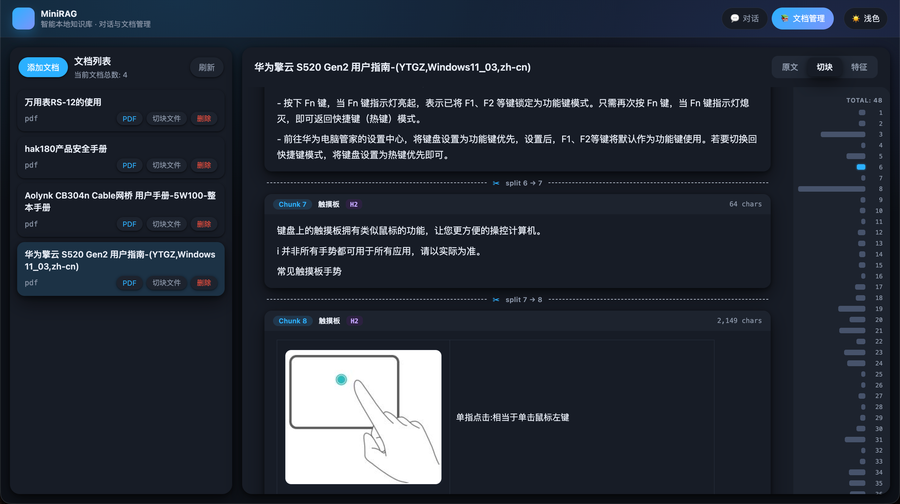

# 页面美化 · 现状一览

<!-- docs-layout: 2026-11 -->
> 状态：已完结（历史快照） · 文中 `src/`、`web/` 为 2026-11 目录改名前的路径，当前对应 `backend/`、`frontend/`；代码现状以仓库为准。索引见 [docs/feat/README.md](../README.md)。

| 项 | 内容 |
| --- | --- |
| 采集范围 | 对话页、文档管理页；Light / Dark 双主题 |
| 采集环境 | 本地 dev（Vite `:5173` + FastAPI `:8000`）；视口 1280×800；文档库 4 篇 |
| 页面状态 | 对话页为欢迎语空态；文档管理页选中《华为擎云 S520 Gen2 用户指南》，预览处于「切块」模式 |
| 说明 | PRD 附带的深色截图内容更完整（含真实问答、文档配图），作为补充归档 |

## 1. 归档截图

**现有实现（本次采集）**

| 对话页 · Light | 对话页 · Dark |
| --- | --- |
|  |  |

| 文档管理页 · Light | 文档管理页 · Dark |
| --- | --- |
|  |  |

**PRD 附带（深色，内容完整）**

| 对话页 `chatpage.png` | 文档管理页 `importpage.png` |
| --- | --- |
|  |  |

## 2. 当前视觉令牌

| 类别 | 变量 | Light | Dark |
| --- | --- | --- | --- |
| 画布 | `--bg` + 两层径向渐变 | `#f3f5f7` | `#0e1219` |
| 导航栏 | 内联 linear-gradient | 主色 10% 叠加 | 主色 10% 叠加 |
| 卡片 | `--panel` | `#ffffff` | `#171c26` |
| 次级面 | `--panel-2` | `#f7f9fc` | `#1d232e` |
| 主文本 | `--text` | `#1f2d3d` | `#e7ecf5` |
| 次文本 | `--muted` | `#7a869a` | `#8b96a8` |
| 品牌主色 | `--brand` | `#1aa7ff` | `#2bb1ff` |
| 品牌辅色 | `--brand2` | `#5b7cfa` | `#7d94fb` |
| 用户气泡 | `--user-pill` | `#e8ebef` | `#2a3140` |
| 边框 | `--border` | `#e6e9ef` | `#2a3140` |
| 语义色 | `--success / --warning / --danger` | `#2ecc71 / #f39c12 / #e74c3c` | 与 Light 完全相同 |
| 主信息色 | `--info` | `#3498db` | 与 Light 完全相同 |
| 阴影 | `--shadow`、`--sh-1..3` | 4 档蓝灰阴影 | 4 档纯黑阴影 |

## 3. 问题清单

按对「参考风格 / 可读性 / 维护成本」的影响排序。

| 优先级 | 问题 | 证据 | 影响 |
| --- | --- | --- | --- |
| P0 | 渐变是主视觉 | 7 处装饰性渐变：body 2 层径向、导航栏、Logo、激活 Tab、发送按钮、Bot 头像 | 与参考的纯色、扁平方向直接冲突；浅色下背景彩雾明显 |
| P0 | 语义色写死且不可读 | 成功/警告/危险双主题同值；白字对比度分别为 **2.10:1 / 2.19:1 / 3.82:1**，`--info` 白字 **3.15:1** | 导入状态徽章、toast、删除按钮不满足 AA；深色下发荧光 |
| P0 | 浅色辅助文本对比不足 | `--muted #7a869a` 对白底 **3.68:1**、对画布 **3.37:1**；品牌链接 `#1aa7ff` 对白底 **2.62:1** | 12px 元信息、链接、时间戳偏灰偏淡，暗光环境可读性差 |
| P1 | 品牌色分裂 | `--brand #1aa7ff`、`--brand2 #5b7cfa`、`--info #3498db` 三套蓝并存；上传区用 `--info`，正文链接用 `--brand` | 同页出现冷暖不同的蓝，强调层级不清晰 |
| P1 | 阴影过多且嵌套 | 4 档阴影令牌、21 处 `box-shadow`；主卡片 `sh-2` 内再叠 doc-item / chunk-card / button 的 `sh-1..2`；Logo 与发送按钮带彩色光晕 | 浅色下「卡片浮卡片」，深色下阴影几乎不可见，层次靠猜 |
| P1 | 深色底与材质偏离参考 | 画布 `#0e1219` 偏蓝黑；面板 `#171c26` / `#1d232e`；参考站为中性 `#1b1b1f` / `#161618` / `#202127` | 与 DeepSeek Harness 的中性深灰气质不一致，蓝色大面积铺底显脏 |
| P1 | 硬编码颜色散落 | `tokens.css` 之外共 **37 处**颜色字面量（layout 6、chat 15、docs 12、ui 4），如 `rgba(26,167,255,.5)` 出现 4 次、`#9aa6b2` 出现 5 次 | 主题变量无法完整覆盖；换色需逐文件搜改，易漏 |
| P2 | 圆角与描边不统一 | 15 种圆角值（3/4/5/6/7/8/9/10/12/15/16/20/999px 等）；上传框 2px 虚线，其余 1px 实线 | 细节不齐，卡片、按钮、徽章不在同一套形状语言里 |
| P2 | Markdown 图片带阴影 | `box-shadow: 0 6px 16px rgba(31,45,61,.08)` + 边框 | 与 PRD「图片不需要阴影」冲突；深色下图片边缘发灰 |
| P2 | 彩色 Emoji 与扁平风格冲突 | 导航 💬/📚、主题 🌙/☀️、头像 🧠、空态 📄/📭、上传 ☁️ | 在低饱和、单色强调的新配色里成为最跳眼的色块 |

### 附带观察

- 加载态同样依赖渐变：骨架屏、刷新文字、图片占位共 4 处 gradient shimmer，建议改为透明度脉冲，保留「正在加载」语义但去掉彩色扫光。
- 输入区底部渐隐是功能性遮罩（防止消息压在输入卡片下），不属于装饰渐变，可保留，但应缩短并使用纯画布色。
- 文档管理页左右双卡 + 导轨结构、左栏 360px、对话流 800px、输入卡片 768px、分段开关 thumb 动画、滚动守卫都属于既有交互资产，**不在本次改动范围**。

## 4. 必须保留

| 项 | 约束 |
| --- | --- |
| 布局 | 顶栏 + 单页容器；文档管理左 360px / 右自适应；对话流 800px；输入卡片 768px |
| 交互 | Tab 切换、左栏「列表 ⇄ 导入」横滑、预览三模式、输入框动态高度、贴底跟随、滚动恢复 |
| 断点 | 940 / 780 / 720 三档现有响应式行为 |
| 信息结构 | 导航、状态点、工具开关、文档操作按钮、切块导轨的位置和数量不变 |

## 5. 结论

布局和组件结构可原样复用，需要重做的是**视觉层**：把「渐变 + 多层阴影」换成「纯色表面分层 + 受控边框 + 单一强调色」，把固定语义色换成随主题成对的 text/soft 色，并统一圆角与图标。改动集中在 `tokens.css` 与 5 个样式文件，详见《方案设计》。
