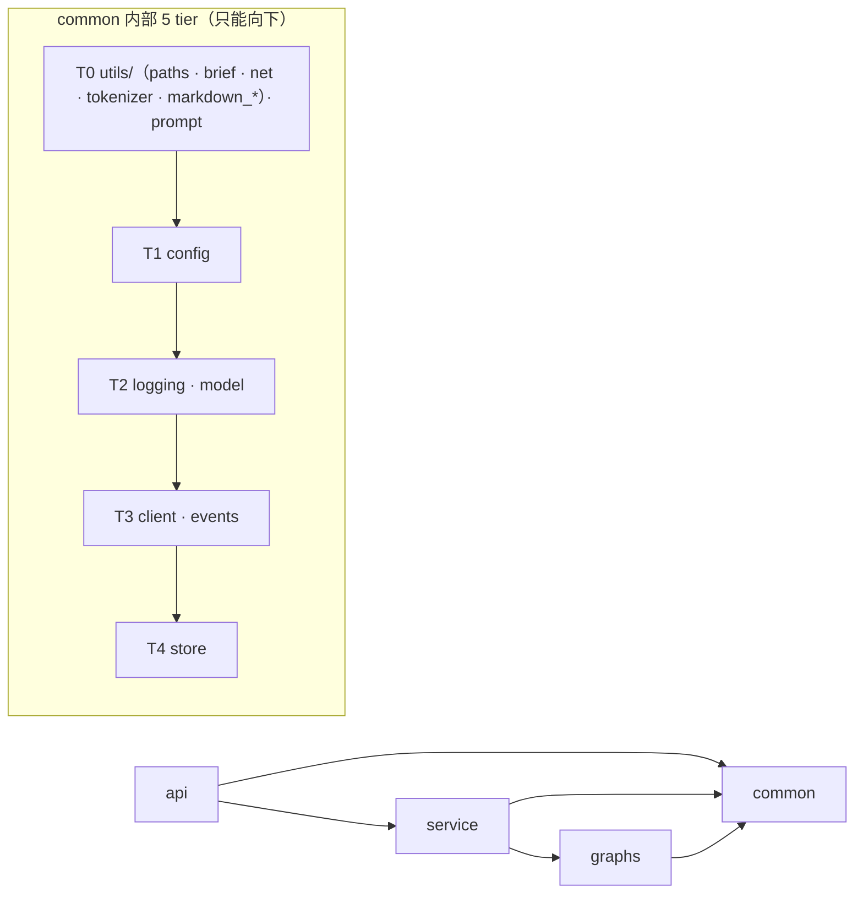
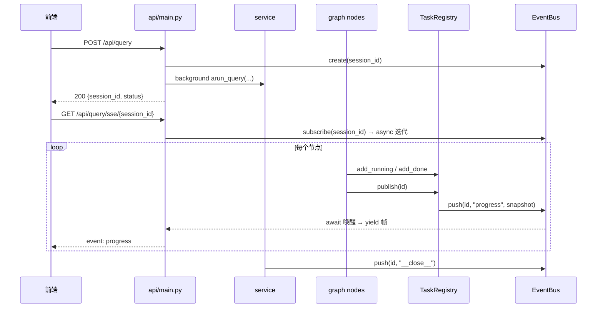

# 项目整理 · 方案设计

> 遵循 `docs/notes/RD-SOP-draft.md` §3：**评审本文档，而不是评审代码 commit**。
> 输入：`PRD.md`（含「额外要求」）+ `pre-study.md`（预研报告）。
> 本文档只描述"要改成什么样、按什么顺序改、怎么验收"，**不含代码改动**。

## 修订记录

| 版本 | 日期 | 变更 | 触发 |
| --- | --- | --- | --- |
| v1 | 2026-10-29 | 初版：预研 4 类问题 → 7 阶段（完整理想态） | `pre-study.md` |
| v2 | 2026-10-29 | PRD 额外要求「utils 整合进 common」：删 `utils`，改为 common 内部 tier | `PRD.md` #1 |
| **v3** | 2026-10-29 | **按 ROI 收敛到 A/B 档**：C 档（纯口味重构）全部移出本次范围；`utils` 整包合并但采用最小改名（去 `_utils` 叠字、不建 markdown 子包）；测试前置到搬移之前；工期从 ~8 天压到 ~5 天，diff 从 ~80 文件压到 ~60 | 人类 triage 结论 |
| **v4** | 2026-10-29 | ① 上传上限 **100MB → 10MB**（`LangGraph 学习笔记.zip` 9.2M 作边界用例）；② 纯工具统一收归 **`common/utils/`**，避免 `common` 根变成新的杂物筐；③ 由此确认"用子包组织"是本次手段，v3 的扁平取向作废 | 人类 review |

---

## 0. 一页纸摘要

| 项 | 内容 |
| --- | --- |
| 改动性质 | 修 bug + 消重复 + 目录合并 + 运行时状态治理；**不新增功能、不改图拓扑、不改 Milvus schema、不改 API 路径、不改 SSE 协议** |
| 范围 | **A 档**（6 项：真收益，不做持续付利息）+ **B 档**（4 项：与 P2/P3 路线图相关） |
| 核心变化 | `src/utils/` 整包并入 `common/`（PRD 要求），纯工具收进 **`common/utils/`** 子包；`common` 内部 5 个 tier 防环；任务状态与 SSE 从"7 张模块级 dict + 每连接一线程"改为 `TaskRegistry` + 异步 `EventBus` |
| 改动规模 | 新增 **14**、真删除 **3**、重命名/迁移 **11**、修改约 **60**（其中 34 个仅 import 路径变化） |
| 工期估算 | **5 天**（阶段 0–6，含 1 天测试前置与回归） |
| 破坏性变更 | **0 处**（SSE 节点标识仍为中文、`docs` 响应仍为 `list`、`history` 响应不变——这些都在 C 档，本次不做） |
| 总闸门 | `ruff` + `check_layout` + **新增** `check_layers` + `pytest` + 端到端手工回归（PDF / 单 md / ZIP / 查询 / 删除） |

**与 v2 的关键差异**

| 项 | v2 | v3 | 原因 |
| --- | --- | --- | --- |
| 阶段数 | 7 | 7（内容重排） | 阶段编号保留，内容按 A/B 重切 |
| 节点文件改名 | 14 个 | **不做** | 零功能收益，40 文件 diff |
| prompt 文件改名 | 6 个 | **不做** | 同上 |
| `routers/` 拆分 | 做 | **不做** | `main.py` 309 行，还没到难受的时候 |
| API DTO 统一 | 做 | **不做** | `list → items` 是破坏性变更，收益只是命名 |
| 节点标识中文 → `node_*` | 做 | **不做** | 协议变更，应单独做一次 |
| 节点增量契约 + ReadOnly 守卫 | 做 | **不做** | 属行为约定重构，与 A/B 收益无关 |
| prettier 全量格式化 | 做 | **不做** | 一次性 churn |
| ruff 扩规则（108 处日志改写） | 做 | **不做** | 同上 |
| `common/markdown/` 子包 | 做 | **不做** | 最小改名原则 |
| `common/events/` 子包 | 做 | **保留（唯一新增层级）** | registry / bus / tracing 互有依赖且本批一起重写，平铺会让 tier 规则失效（见 §2.1 注） |
| 测试位置 | 阶段 5 | **阶段 1（前置）** | 无测试动 60 文件是最大风险 |
| 工期 | ~8 天 | **~5 天** | — |

---

## 1. 范围

### 1.1 本次做（A 档 + B 档）

#### A 档：真收益（不做会持续付利息）

| # | 项 | 现状问题 | 收益 |
| --- | --- | --- | --- |
| A1 | **前端状态词表统一** | 后端 `complete/failed`，前端自造 `completed/error`；`PROGRESS_STATUS_LABELS` 里的 `completed` 永远收不到后端 `complete`；靠 `finishTask()` 与 `CHILD_STATUS_MAP` 两处归一维持 | 一套词表、一个映射表；加第三个状态时不会漂 |
| A2 | **删除逻辑单源** | 「同名覆盖导入」与「删除文档接口」各写了一遍"三制品 → 图片 → chunks → docs"的删除顺序；改一处忘一处就留孤儿对象 | 顺序只有一份；`DocumentRepo` 可单测 |
| A3 | **上传落盘按 `task_id` 分目录 + 体积上限** | 现在写到 `var/uploads/<原文件名>`，两个同名文件并发上传互相覆盖（`task_id` 生成了却闲置）；`await file.read()` 全量入内存、无上限 | 并发安全；内存可控 |
| A4 | **两个真 bug** | ① `node_md_img` 图片上传失败时仍写 `` 并计入替换数（静默数据损坏）；② `node_pdf_to_md` 里 `file_title` 赋值后被覆盖（死赋值，且 docstring 声称写入 state 但没写） | 消除静默坏数据 |
| A5 | **零风险清理** | 死代码（`from_project_root` / `get_path_dir` / `get_src_root` / `SRC_ROOT` / 3 个 task 读取函数 / 2 个 `get_default_state` / `prompt_item_name_of_document.py` / `sessionStore.ts`）、4 个 `*_TPM` 死配置、`minio_client` 的 `rprint`、`_PROXY_FILES_PREFIX` 两处重复、依赖声明漂移（缺 `httpx2/mcp/mcp-types`，多 4 个无用包） | 减面积；依赖不再靠传递 |
| A6 | **`utils` 整包并入 `common`（PRD #1）** | `utils` 是杂物筐：11 个模块里 5 个是基础设施、6 个是纯函数；且 `common/config → utils/path_utils` 反向依赖，再挂一个 config 相关的东西就真成环 | 唯一共享层 + 5 tier 防环；`common` 全包零 fastapi |

#### B 档：与路线图相关（P2/P3 要省一次重写）

依据：代码里已留路标——`task_utils.py:62` "P2 引入 cancelled 后在此追加"、`chatStore.ts:95` "真正中止留给 P3"。取消/中止必须能按 `task_id` 找到运行中任务并停住它，现在这 7 张模块级 dict 会让 P2 重写同一块代码。

| # | 项 | 现状 | 之后 |
| --- | --- | --- | --- |
| B1 | **任务状态收敛为 `TaskRegistry`** | 7 张模块级 dict + 约 22 处函数调用；无 TTL、无上限 | 1 个类 + `dict[str, TaskEntry]`；`sweep(ttl)` 清扫；新增 `cancelled` 只需加一个方法 |
| B2 | **SSE 通道改为异步 `EventBus`** | `queue.Queue` + 每个连接常驻一个线程池线程（`run_in_executor(get, 0.1s)`）；连接数一多线程池顶穿；客户端从不连 SSE 时队列永驻 | `list` 缓冲 + `asyncio.Event` + `loop.call_soon_threadsafe`；不占线程；单通道上限 + TTL 回收 |
| B3 | **失败路径补 `__close__`** | `arun_query` 失败只推 `error` 不推 `__close__`，前端靠 `closeOnServerError` 的隐含约定兜；import 流又传 `false` | 两个流行为一致，前端可删参数 |
| B4 | **日志定位去全栈开销** | `fix_log_position` 每条日志 `inspect.stack()` | `sys._getframe` 向上走两帧 |

> B 档的必要性判断：如果 **不做 P2/P3**，B 只值"多标签页更稳 + 少占线程"，可以推迟。已确认按"做 P2/P3"的假设纳入本次。

### 1.2 本次不做（明确清单）

| 不做 | 归属 | 原因 |
| --- | --- | --- |
| `nodes/node_*.py` → `nodes/*.py`（14 个文件） | C | 零功能收益，只为少个前缀；40 文件 diff 淹没 review |
| `prompt/prompt_*.py` → `prompt/*.py`（6 个） | C | 同上 |
| `api/main.py` 拆 `routers/` + 端点改名 | C | 309 行尚未到需要拆分 |
| `list → items`、补 `response_model`、`delete_doc` 改 `HTTPException` | C | 破坏性变更换命名，收益不足 |
| SSE 节点标识中文 → `node_*` + 前端 `NODE_LABELS` | C | 属协议变更，应单独一次做（涉及前端映射与兼容） |
| 节点"只返回增量"契约 + `_ReadOnlyState` 守卫 | C | 行为约定重构，与 A/B 收益无关 |
| `data/` `StrEnum`（`SSEEvent`/`FileType`/`DataFrom`） | C | 值不变，纯写法统一 |
| `summary_history` 里的 prompt 拼装移到 `common/prompt/history.py` | C | 分层洁癖，无实际故障 |
| 节点间私有符号抽取（`utils/image_refs.py`） | C | 跨 node import 私有名难看但不产生 bug |
| prettier + 全量格式化 | C | 一次性 churn，收益只是 diff 干净 |
| ruff 扩规则（含 108 处 f-string 日志改写） | C | 同 prettier，且会碰 40+ 文件 |
| CI（`.github/workflows`） | C | 单仓库单人，pre-commit 已足够；先落 `pytest` |
| `qwen.tiktoken` 迁移 / `api/main.py` 改名 / `common/markdown/` 子包 | C | 无收益 |
| docs 目录大搬迁、原型 html 归档、`Milvs DB Refactor.md` 改名 | C | 只修断链（A5 附），不搬目录 |

> 这些项在 v2 里都有详细设计，git 历史可查；本次不删文档，只标"推迟"。

---

## 2. 规则（只立本次会用到的）

### 2.1 分层：4 层 + common 内部 5 tier

顶层：

| 从 \ 到 | api | service | graphs | common | fastapi |
| --- | --- | --- | --- | --- | --- |
| **api** | — | ✅ | ❌ | ✅ | ✅ |
| **service** | ❌ | — | ✅ | ✅ | ❌ |
| **graphs** | ❌ | ❌ | — | ✅ | ❌ |
| **common** | ❌ | ❌ | ❌ | 见下 | ❌ |

`common` 内部（`utils` 合并后必须显式分层，否则很快互相打结）：

| tier | 模块 | 允许 import |
| --- | --- | --- |
| **0** 基础 | `utils/`（`paths` / `brief` / `net` / `tokenizer` / `markdown_splitter` / `markdown_image`）、`prompt/` | 仅标准库 / 第三方 |
| **1** 配置 | `config/` | tier 0 |
| **2** 设施 | `logging`、`model/` | tier 0–1 |
| **3** 资源 | `client/`、`events/` | tier 0–2 |
| **4** 聚合 | `store/` | tier 0–3 |

规则：

1. 只能依赖**更低** tier；**同 tier 的不同模块/子包禁止互相依赖**；同一子包内部自由。
2. `if __name__ == "__main__":` 块不参与校验（脚本，允许 import 任意层）。
3. tier 表写进 `common/__init__.py` 的 docstring 作为唯一文档源；`tools/check_layers.py` 强制。

> **为什么要用子包（`utils/` 与 `events/`）**
>
> 1. `registry.py` / `bus.py` / `tracing.py` 互相依赖（tracing → registry → bus）。平铺会让三者落在同一 tier 却必须互引，只能再拆 tier（会变成 8 层，没人记得住）；放进同一子包则"子包内自由"一条规则就够。
> 2. 6 个纯工具如果平铺在 `common/` 根，`common` 就会变成"7 个松散模块 + 5 个子包"的新杂物筐——和本次要解决的 `utils` 问题同构。收进 `common/utils/` 后，`utils` 才名副其实（只放零项目依赖的纯函数），基础设施各有其位（`logging.py` / `events/`）。
> 3. 反面约束：`common/utils/` **不允许**出现 import 项目内模块的文件。一旦某函数需要 `ENV_CONFIG`，它就归 `config/`（如 `runtime_paths.py`），不归 utils。

### 2.2 状态词表：后端唯一，前端 1:1

| 取值 | 含义 |
| --- | --- |
| `pending` | 已受理，未开始 |
| `processing` | 执行中 |
| `complete` | 成功终态 |
| `failed` | 失败终态 |

前端：

```ts
type TaskStatus = "pending" | "processing" | "complete" | "failed"; // 与后端 1:1
type ImportStatus = "uploading" | TaskStatus;                        // uploading 是前端本地态
type ImportChildStatus = TaskStatus | "interrupted";                 // interrupted 是前端派生
```

- 删除前端自造的 `completed` / `error` 两个**任务状态值**（`error` 作为 Toast 严重级仍然合法）。
- 删除 `CHILD_STATUS_MAP`（值一致后不需要）。
- 展示文案收在 `lib/constants.ts`：`TASK_STATUS_LABELS`、`IMPORT_STATUS_META`、`IMPORT_CHILD_STATUS_META` 三张表；合并 `QueryProgress.tsx` 里的 `SUMMARY_STATUS_LABELS` 与 `PROGRESS_STATUS_LABELS`。

### 2.3 模块命名（最小集）

| 规则 | 应用 |
| --- | --- |
| 搬入 `common/` 时去掉 `_utils` 叠字（否则出现 `common/utils/brief_utils.py` 这种双重叠字） | `path_utils`→`utils/paths`、`brief_utils`→`utils/brief`、`net_utils`→`utils/net`、`token_utils`→`utils/tokenizer`、`markdown_utils`→`utils/markdown_image`、`logging_utils`→`logging`、`node_utils`→`events/tracing`、`task_utils`→`events/registry` |
| 避免标准库同名 | 不用 `common/token.py` / `tokenize.py`（stdlib 模块），改 `tokenizer.py` |
| 保留无叠字的原名 | `markdown_splitter.py`（只移动父目录） |
| 一个主题多个互依模块 → 子包 + `__init__` 导出 | `common/events/{registry,bus,tracing}.py` |
| 零项目依赖的纯工具统一收归 `common/utils/`（**不再有顶层 `utils/`**） | `common/utils/{paths,brief,net,tokenizer,markdown_splitter,markdown_image}.py` |
| 其余文件/目录**保持现名** | `nodes/node_*.py`、`prompt/prompt_*.py`、`api/main.py`、`api/schemas.py` 都不动 |

### 2.4 项目名

| 场景 | 唯一写法 |
| --- | --- |
| 展示名（页面标题 / NavBar / README / 日志 / API title） | `MiniRAG` |
| Python 标识符（`MiniRagMilvusClient` 等 3 个类名） | `MiniRag` |
| 包与容器 | `mini-rag` |
| 存储资源前缀（bucket / db / collection） | `minirag` |

本次只改 4 处展示名：`README.md:1`、`pyproject.description`、`api/main.py` 的 `title=` 与启动日志。

---

## 3. 架构调整

### 3.1 目标目录结构（后端）

`+ 新增` / `~ 迁移` / `- 删除`

```text
src/
├── api/
│   ├── __init__.py               # docstring 依赖方向 → common
│   ├── main.py                   # 不变（仅 import 与 lifespan 增加清扫任务）
│   ├── schemas.py                # 不变（本次不拆包）
│   ├── sse.py                    # + SSE 帧格式化 + 生成器（唯一 import fastapi 的事件模块）
│   └── startup_checks.py         # 改 import + 单 worker 告警
├── service/
│   ├── import_service.py         # TASK_REGISTRY.publish / 发终态事件
│   ├── query_service.py          # 同上 + 失败补 __close__
│   └── docs_service.py           # 删除走 repo，其余不变
├── graphs/                       # 目录、文件名、节点标识全部不变
│   └── ...                       # 仅 import 路径与 repo 调用变化
└── common/                       # 唯一共享层（原 utils 全部并入）
    ├── __init__.py               # + 4 层 + 5 tier 规则的唯一文档源（原为命名空间包）
    ├── utils/                    # + 纯工具收归（零项目内 import）                        [T0]
    │   ├── __init__.py           #   + 导出面：fixture_path / brief / probe_tcp / compute_token / split_markdown
    │   ├── paths.py              #   ~ utils/path_utils.py：PROJECT_ROOT / FIXTURES_DIR / fixture_path
    │   ├── brief.py              #   ~ utils/brief_utils.py + 并入 brief_list / brief_dict
    │   ├── net.py                #   ~ utils/net_utils.py
    │   ├── tokenizer.py          #   ~ utils/token_utils.py（避开 stdlib token / tokenize）
    │   ├── markdown_splitter.py  #   ~ utils/markdown_splitter.py（仅移动）
    │   └── markdown_image.py     #   ~ utils/markdown_utils.py
    ├── logging.py                # ~ utils/logging_utils.py（T2：依赖 config，故不进 utils/）
    ├── events/                   # +（原 task_utils / node_utils / sse_utils 归宿）        [T3]
    │   ├── __init__.py           #   TASK_REGISTRY / EVENT_BUS / TaskStatus / SSEEvent
    │   ├── registry.py           #   ~ utils/task_utils.py（B1 重写为类）
    │   ├── bus.py                #   ~ utils/sse_utils.py 的队列部分（B2 重写为异步桥）
    │   └── tracing.py            #   ~ utils/node_utils.py
    ├── config/
    │   ├── app_config.py                                                          [T1]
    │   ├── env_config.py                                                          [T1]
    │   └── runtime_paths.py      # + runtime_dir / runtime_tmp_dir / snapshot_path  [T1]
    ├── model/                    #                                                       [T2]
    ├── client/                   #                                                       [T3]
    ├── prompt/                   # 文件名不变                                                  [T0]
    └── store/
        ├── chat_history.py                                                          [T4]
        └── document_repo.py      # + 写路径单源（覆盖删除 / 上传制品 / 写两表）            [T4]
```

> `src/utils/` 不再存在——`git rm -r src/utils` 是本需求的显式交付物。

### 3.2 依赖关系（改后）



对照预研报告：

| 预研问题 | 改后状态 | 强制手段 |
| --- | --- | --- |
| P0-1 `common ↔ utils` 循环 | 顶层 `utils` 不存在（纯工具收在 `common/utils/`，基础设施在 `logging.py` / `events/`），循环从结构上消失；`common` 内部 5 tier 保证单向 | `tools/check_layers.py` |
| P0-2 events 依赖 fastapi | 队列在 `common/events/bus.py`（无 fastapi）；仅 `api/sse.py` import fastapi | `check_layers` 白名单仅 `api/**` |
| P0-3 全局状态无淘汰 | `TaskRegistry` / `EventBus` 均有 `sweep()`，lifespan 每 60s 清扫 | 单测 + 启动日志 |
| P0-4 图节点 = repository | 只下沉**写路径**（A2/B 范围），节点仍返回原样；读路径不动 | 手工回归 |

### 3.3 迁移顺序（三个"必须先"）

```
阶段 1 先补 4 个纯函数测试
   └── 阶段 3 的 84 处 import 改写才有机器验证（否则只能手工点三遍）
阶段 3 先落 common/logging.py，再落 common/events/
   └── 否则 tracing/registry 会短暂 import utils.logging_utils，在中间 commit 留下 common → utils 反向边
阶段 2 先清死代码，再进阶段 3
   └── 搬家时不必判断"这个函数还要不要"
```

**阶段 3 只搬不改**：`registry.py` 搬过去仍是模块级函数 + 7 张 dict，`bus.py` 仍是 `threading.Queue`；行为改造全部留给阶段 6。这样阶段 3 的 review 只需确认"import 全对、行为没变"。

### 3.4 运行时状态架构（阶段 6 达成）



| 项 | 现在 | 之后 |
| --- | --- | --- |
| 状态存储 | 7 张模块级 dict（374 行单文件） | `TaskRegistry` + `dict[str, TaskEntry]` |
| 队列 | `queue.Queue` + 每连接一线程轮询 | `list` 缓冲 + `asyncio.Event` + `call_soon_threadsafe` |
| 生命周期 | 仅 SSE 生成器 finally 删除 | POST 创建 + `sweep(ttl=30min)` 兜底 + 单通道 2000 事件上限 |
| fastapi 位置 | `utils/sse_utils.py` 顶层 import | 仅 `api/sse.py` |

---

## 4. 数据结构

### 4.1 配置

**`common/config/app_config.py`（新增 6 项）**

| 字段 | 默认 | 用途 | 阶段 |
| --- | --- | --- | --- |
| `task_ttl_seconds` | `1800.0` | 任务状态过期（30 min） | 6 |
| `sse_channel_ttl_seconds` | `1800.0` | SSE 通道过期 | 6 |
| `sse_sweep_interval_seconds` | `60.0` | 清扫间隔 | 6 |
| `sse_channel_max_events` | `2000` | 单通道缓冲上限（超限丢最旧 + WARN） | 6 |
| `max_upload_bytes` | `10 * 1024 * 1024` | 上传体积上限（超限 413）。仓库自带最大夹具 `LangGraph 学习笔记.zip` 为 9.2MB，占用上限的 ~92%，作边界用例 | 5 |
| `files_proxy_prefix` | `"/api/files/"` | 取代 `minio_client` / `docs_service` 两处 `_PROXY_FILES_PREFIX` | 2 |

**`common/config/env_config.py`**：删 `llm_tpm` / `vlm_tpm` / `embedding_tpm` / `rerank_tpm`；`from utils.path_utils import PROJECT_ROOT` → `from common.paths import PROJECT_ROOT`；顶部裸字符串改真 docstring。

**`common/config/runtime_paths.py`（新增）**：`runtime_dir(name)` / `runtime_tmp_dir()` / `snapshot_path(name)`（原 `path_utils` 的后三个函数，因依赖 `ENV_CONFIG` 而放进 config tier）。

**`common/utils/paths.py`（新增）**：`PROJECT_ROOT` / `FIXTURES_DIR` / `fixture_path()`（零项目内依赖）。

> `common/utils/tokenizer.py` 读取 `common/model/qwen.tiktoken` 属**数据文件**依赖（非 import），路径用 `Path(__file__).parents[1] / "model" / "qwen.tiktoken"` 计算，不经过 `PROJECT_ROOT`。

**`.env` / `.env.example`**：删 4 个 `*_TPM`（`.env.example` 用 `tools/make_env_example.py` 重新生成）。

### 4.2 全局实例

| 实例 | 位置 | 阶段 |
| --- | --- | --- |
| `TASK_REGISTRY = TaskRegistry()` | `common/events/__init__.py` | 6 |
| `EVENT_BUS = InMemoryEventBus()` | `common/events/__init__.py` | 6 |
| `DOCUMENT_REPO = DocumentRepo()` | `common/store/__init__.py`（该文件从空变为导出） | 5 |
| `CHAT_HISTORY_MANAGER` | `common/store/__init__.py` | 重命名自小写 `chat_history_manager`（仅 4 处引用） |

### 4.3 核心数据类

**`common/events/registry.py`**

```python
class TaskStatus(StrEnum):          # pending / processing / complete / failed
@dataclass
class TaskEntry:
    task_id: str
    parent_id: str | None           # 子任务才有
    status: TaskStatus
    running: list[str]
    done: list[str]
    failed: list[str]
    error: str
    result: dict[str, str]
    created_at: float
    updated_at: float

class ChildSpec(TypedDict):         # fork 入参（与 graphs 的 MdChild 解耦）
    child_id: str; title: str; path: str; index: int

class TaskRegistry:                 # 全部方法内置 _lock（沿用现状 RLock）
    def add_running(self, task_id, node, *, publish=False) -> None
    def add_done(self, task_id, node, *, publish=False) -> None
    def add_failed(self, task_id, node, error="") -> None
    def fork(self, parent_id: str, children: list[ChildSpec]) -> None
    def complete_child(self, child_id) -> None
    def fail_child(self, child_id, error="") -> None
    def set_status(self, task_id, status: TaskStatus) -> None
    def get_status(self, task_id) -> str
    def set_error(self, task_id, error) -> None
    def set_result(self, task_id, key, value) -> None
    def get_result(self, task_id, key, default="") -> str
    def get_nodes(self, task_id) -> tuple[list[str], list[str], list[str]]
    def publish(self, task_id) -> None          # 取代 task_push_sse
    def clear(self, task_id) -> None            # 幂等，连带子任务
    def sweep(self, ttl_seconds: float) -> int  # 返回清掉的条目数
```

**`common/events/bus.py`**

```python
class SSEEvent:                      # 值不变（本次不转 StrEnum）
    READY / PROGRESS / FORK / CHILD_PROGRESS / DELTA / FINAL / ERROR / __close__

class EventBus(Protocol):
    def create(self, channel_id: str) -> None
    def push(self, channel_id: str, event: str, data: dict) -> None
    def remove(self, channel_id: str) -> None
    def sweep(self, ttl_seconds: float) -> int
    async def subscribe(self, channel_id: str) -> AsyncIterator[tuple[str, dict]]

@dataclass
class _Channel:
    buffer: list[tuple[str, dict]]
    closed: bool
    created_at: float
    touched_at: float
    wake: asyncio.Event | None       # 首个订阅者在 loop 线程内创建
    loop: asyncio.AbstractEventLoop | None
```

**`common/store/document_repo.py`（只收写路径）**

```python
@dataclass(frozen=True)
class DocumentArtifacts:
    origin_file_url: str
    final_markdown_url: str
    chunks_url: str

class DocumentRepo:
    # 同名覆盖 + 删除接口共用；顺序: MinIO 三制品 → chunks → docs
    def delete_by_title(self, file_title: str) -> int
    # 上传 origin / markdown / chunks 三制品
    def upload_artifacts(self, file_title, *, origin: Path|None, markdown: Path, chunks: Path) -> DocumentArtifacts
    # 写 docs 并返回 doc_id（含 pymilvus 3.x ids 兼容 + 查回兜底）
    def save_meta(self, *, task_id, file_title, artifacts, keywords, abstract,
                  keywords_sparse, abstract_dense) -> int
    def save_chunks(self, *, doc_id, file_title, embedded: list[dict]) -> int
```

> 读路径（`list_docs` / `get_doc_detail` / `count`）**不进 repo**，仍在 `docs_service` 调 `MILVUS_CLIENT`。本次目标是消除删除顺序的重复，不是建完整数据访问层。

### 4.4 SSE 协议

**不变**：事件名、帧格式、`__close__` 语义、节点标识（仍为中文 `desc`）、payload 字段全部保持。

行为变化只有两处，都在阶段 6：

1. `arun_query` 失败路径补发 `__close__`（与 import 流对齐）；
2. 队列从"每连接一线程轮询"改为"发布唤醒"，帧顺序不变。

### 4.5 前端类型变更

| 类型 | 现在 | 之后 |
| --- | --- | --- |
| `TaskStatus`（新增） | — | `"pending" \| "processing" \| "complete" \| "failed"` |
| `ProgressView.status` | `string` | `TaskStatus` |
| `ImportStatus` | `uploading \| processing \| completed \| error` | `"uploading" \| TaskStatus` |
| `ImportChildStatus` | `pending \| processing \| completed \| error \| interrupted` | `TaskStatus \| "interrupted"` |
| `lib/constants.ts` | `PROGRESS_STATUS_LABELS`（含永不命中的 `completed`）+ `IMPORT_STATUS` + `IMPORT_CHILD_STATUS`（数组） | `TASK_STATUS_LABELS` + `IMPORT_STATUS_META` + `IMPORT_CHILD_STATUS_META` |
| `docsStore` 的 `CHILD_STATUS_MAP` | 前端自行映射 | 删除（值已一致） |

`StatusResponse` 拆分、`ImportFile` 改名、`role: bot → assistant`、`DocsListResponse.items` 均**不做**。

---

## 5. 阶段计划

> 每阶段独立 commit、独立验收、独立回滚。阶段内不做跨阶段顺手改动。

| 阶段 | 主题 | 内容 | 工期 | 依赖 |
| --- | --- | --- | --- | --- |
| 0 | 规则与口径 | AGENTS 规则 + README/setup 更正 + 断链 + 项目名 | 0.5 天 | — |
| 1 | **测试前置** | pytest 配置 + 4 个纯函数用例 | 0.5 天 | 0 |
| 2 | 零风险清理 | A5 + A4（死代码/死配置/rprint/依赖/单源常量/2 bug） | 0.5 天 | 0 |
| 3 | **utils → common** | A6（含 sse 拆分、check_layers、84 处 import） | 1–1.5 天 | 1, 2 |
| 4 | 前端状态词表 | A1 | 0.5 天 | 3（可并行） |
| 5 | 写路径单源 | A2 + A3（document_repo、上传落盘、大小上限） | 1 天 | 3 |
| 6 | 运行时状态治理 | B1–B4 | 1.5 天 | 3 |

### 阶段 0 · 规则与口径（0.5 天）

| 动作 | 文件 |
| --- | --- |
| 写入 §2 规则（4 层 + 5 tier / 状态词表 / 模块命名 / 项目名）+ 补完 pre-commit 断句 | `AGENTS.md` |
| 一级标题 `MiniRAG` | `README.md` |
| 更正软依赖清单（删 `VLM_API_KEY` / `QWEN_API_KEY` / `LLM_API_KEY`） | `docs/setup.md:32` |
| 修 404 的代码内文档引用 | `node_document_embedding.py` 注释 |

**验收**：人读 `AGENTS.md` 能回答"新文件放哪（哪个 tier）、函数叫什么"。

### 阶段 1 · 测试前置（0.5 天）

| 动作 | 说明 |
| --- | --- |
| `pyproject` 加 `pytest` + `[tool.pytest.ini_options] pythonpath = ["src"]` | 无 pytest 插件依赖 |
| `tests/conftest.py` | 仅提供 `fixture_path` 便利与 `DEBUG` 开关占位 |
| `tests/test_markdown_splitter.py` | 标题栈对齐 / 缺失层级 `None` 占位 / 代码块不被切断 / 超长块二次切分 |
| `tests/test_brief.py` | `brief` / `brief_list` / `brief_dict` 的截断与空值 |
| `tests/test_rrf_and_topk.py` | `step_2_rrf_fusion` 去重与加权、`step_4_dynamic_topk` 底线/断崖/全低分兜底 |
| `tests/test_task_registry.py` | 先写**当前行为**的用例（fork/complete/fail/终态过滤/clear 幂等）——阶段 6 重写时用它守行为 |

**验收**：`pytest -q` 全绿；这 4 个文件在阶段 3/6 前后必须保持全绿（这是"行为不变"的机器验证）。

### 阶段 2 · 零风险清理（0.5 天）

| 动作 | 明细 |
| --- | --- |
| 删死代码 | `path_utils` 4 个符号；`task_utils` 3 个读取函数；2 个 `get_default_state`；`prompt_item_name_of_document.py`；`web/src/store/sessionStore.ts` |
| 删死配置 | 4 个 `*_TPM`（`env_config` + `.env` + `.env.example`） |
| 删调试输出 | `minio_client.py:188-190` 的 `rprint(res)` |
| 单源常量 | `_PROXY_FILES_PREFIX` ×2 → `APP_CONFIG.files_proxy_prefix` |
| 依赖声明 | 增 `httpx2>=2.13`、`mcp>=2.2`、`mcp-types>=2.2`；删 `openai-agents`、`langchain-community`、`python-dotenv`、`regex`；`grandalf` 移入 dev 组。`uv lock` 重生成（需网络） |
| 修 bug | ① `node_md_img.step_5`：`url` 为 `None` 时跳过替换与计数；② `node_pdf_to_md.step_1`：删死赋值 |

**验收**：`import api.main` 成功（无缺包）；`pytest` 全绿；手工走一遍上传+查询（行为零变化）。

### 阶段 3 · utils → common（1–1.5 天，PRD #1）

**本阶段零逻辑改动**，顺序：paths → logging → brief/net/tokenizer/markdown → events。

| 子项 | 内容 | tier |
| --- | --- | --- |
| 3a | 新增 `common/__init__.py`（只放 docstring：4 层 + 5 tier）与 `common/utils/__init__.py`（导出面） | — |
| 3b | `path_utils` 拆分：`common/utils/paths.py` + `common/config/runtime_paths.py` | T0 / T1 |
| 3c | `logging_utils` → `common/logging.py`（`fix_log_position` 优化留阶段 6） | T2 |
| 3d | `brief_utils` → `common/utils/brief.py`，并入从 `logging_utils` 拆出的 `brief_list` / `brief_dict` | T0 |
| 3e | `net_utils` → `common/utils/net.py`；`token_utils` → `common/utils/tokenizer.py` | T0 |
| 3f | `markdown_splitter` / `markdown_utils` → `common/utils/markdown_splitter.py` / `common/utils/markdown_image.py` | T0 |
| 3g | `node_utils` → `common/events/tracing.py`；`task_utils` → `common/events/registry.py`（**原样搬**）；新增 `common/events/__init__.py` | T3 |
| 3h | `sse_utils` 技术性拆分：队列部分 → `common/events/bus.py`（`threading.Queue` 不变、无 fastapi）；生成器 → `api/sse.py`（仍用 `run_in_executor`） | T3 / api |
| 3i | `git rm -r src/utils`；全仓 **34 文件 / 84 处** import 改路径 | — |
| 3j | 文案同步：`README` 目录树、`tests/README` 的 `fixture_path` 示例、`api/__init__` 与 `service/__init__` 的依赖说明 | — |
| 3k | 新增 `tools/check_layers.py`（4 层矩阵 + 5 tier + 同 tier 禁互依，跳过 `__main__`），加入 pre-commit | — |

**验收**：

1. `test ! -d src/utils` 通过；`rg "from utils|import utils" src tools tests` 无结果。
2. `python tools/check_layers.py` 退出码 0，且**故意造一个 `common/utils/paths.py → common/config` 的反向 import 时会报错**（负向测试）。
3. `pytest` 全绿；`import api.main` 成功；启动自检通过。
4. 手工回归三条导入链路 + 查询 + 删除，行为与阶段 2 一致。

**回滚**：纯 `git mv` + import 改写，单 commit revert，无数据/接口影响。

### 阶段 4 · 前端状态词表（0.5 天，可与阶段 3 并行）

| 动作 | 文件 |
| --- | --- |
| `TaskStatus` 等类型 + 三张映射表 | `types/app.ts`、`types/docs.ts`、`lib/constants.ts` |
| 状态写入值改 `complete` / `failed` | `store/chatStore.ts`（`finishTask`）、`store/docsStore.ts`（`CHILD_STATUS_MAP` 删除、`freezeChildren`、`uploadFiles` 分支） |
| 展示取值改表 | `components/chat/QueryProgress.tsx`、`components/docs/ImportTaskItem.tsx`、`ImportChildItem.tsx` |
| `ProgressView.status` 收窄 | `types/app.ts` + `QueryTaskBar.tsx` 的终态判断 |

**验收**：`tsc --noEmit` 通过；查询卡片与导入卡片的状态文案、颜色、自动收起行为与改前一致（逐态手工比对：pending / processing / complete / failed / interrupted）。

### 阶段 5 · 写路径单源 + 上传加固（1 天）

| 动作 | 内容 |
| --- | --- |
| 5a | 新增 `common/store/document_repo.py`（§4.3）；`common/store/__init__.py` 导出 `DOCUMENT_REPO` / `CHAT_HISTORY_MANAGER` |
| 5b | `node_document_embedding` 的 step_2/3/6/7 改调 repo（返回契约不变，仍 `return {}`） |
| 5c | `docs_service.delete_doc` 改调 `DOCUMENT_REPO.delete_by_title()`，删除顺序只剩一份 |
| 5d | 上传落盘 `var/uploads/<task_id>/<filename>`；`max_upload_bytes` 校验（超限 413，明确中文提示） |
| 5e | `tests/test_document_repo.py`：用假 client 断言**删除顺序**（三制品 → chunks → docs）与任一步失败即抛 |

**验收**：删除文档后 Attu / MinIO 无残留；两个同名文件并发上传都成功且互不覆盖；>10MB 返回 413；恰好 9.2MB 的 `LangGraph 学习笔记.zip` 仍可正常上传；`pytest` 全绿。

### 阶段 6 · 运行时状态治理（1.5 天，B 档）

| 子项 | 内容 |
| --- | --- |
| 6a | `events/registry.py`：7 张 dict → `TaskRegistry` + `TASK_REGISTRY`；`task_push_sse` → `publish`；约 22 处调用点改造（阶段 1 的用例先跑绿再改） |
| 6b | `events/bus.py`：`threading.Queue` + 轮询 → `list` 缓冲 + `asyncio.Event` + `call_soon_threadsafe`；单通道上限 |
| 6c | `main.py` lifespan 起 `asyncio.create_task(_sweep_loop())`，退出 cancel；启动/退出日志打印存活通道数 |
| 6d | `api/sse.py` 用 `EVENT_BUS.subscribe()` 异步迭代，删 `run_in_executor` 与 `get_event_loop()` |
| 6e | `arun_query` 失败补 `__close__`；前端删 `closeOnServerError` 参数 |
| 6f | `logging.fix_log_position` 改 `sys._getframe` |
| 6g | `startup_checks` 检测多 worker 时 WARN；`README` 写明"当前仅支持单 worker" |
| 6h | `var/tmp/smoke_events.py`：先 push 后 subscribe 能收到缓冲；`sweep(ttl=0)` 后通道归零 |

**验收**：

1. `pytest` 全绿（含阶段 1 的 registry 用例）。
2. 手工：ZIP 上传 → `fork` + 多路 `child-progress`；查询 → `delta` + `final` + `__close__`；断开浏览器 60s 内通道被清扫（日志可查）。
3. 连续 3 次查询不残留通道；两个标签页同时查询互不串流。

---

## 6. 文件修改清单

### 6.1 新增（14）

| # | 文件 | 阶段 |
| --- | --- | --- |
| 1 | `src/common/__init__.py` | 3 |
| 2 | `src/common/utils/__init__.py` | 3 |
| 3 | `src/common/utils/paths.py` | 3 |
| 4 | `src/common/config/runtime_paths.py` | 3 |
| 5 | `src/common/events/__init__.py` | 3 |
| 6 | `src/api/sse.py` | 3 |
| 7 | `src/common/store/document_repo.py` | 5 |
| 8 | `tools/check_layers.py` | 3 |
| 9 | `tests/conftest.py` | 1 |
| 10 | `tests/test_markdown_splitter.py` | 1 |
| 11 | `tests/test_brief.py` | 1 |
| 12 | `tests/test_rrf_and_topk.py` | 1 |
| 13 | `tests/test_task_registry.py` | 1 |
| 14 | `tests/test_document_repo.py` | 5 |

> 其中源码/工具 8 个、测试 6 个（5 个用例 + `conftest.py`）。

### 6.2 真删除（3）

| # | 文件 | 阶段 | 原因 |
| --- | --- | --- | --- |
| 1 | `src/utils/`（含空的 `__init__.py`） | 3 | **PRD #1**：整包并入 `common` |
| 2 | `src/common/prompt/prompt_item_name_of_document.py` | 2 | 全仓 0 引用 |
| 3 | `web/src/store/sessionStore.ts` | 2 | 全仓 0 import |

### 6.3 重命名 / 迁移（11 文件 / 10 项，阶段 3）

| 现在 | 之后 | tier |
| --- | --- | --- |
| `utils/logging_utils.py` | `common/logging.py` | T2 |
| `utils/path_utils.py` | `common/utils/paths.py` + `common/config/runtime_paths.py` | T0 + T1 |
| `utils/brief_utils.py` | `common/utils/brief.py`（+ 并入 `brief_list`/`brief_dict`） | T0 |
| `utils/net_utils.py` | `common/utils/net.py` | T0 |
| `utils/token_utils.py` | `common/utils/tokenizer.py` | T0 |
| `utils/markdown_splitter.py` | `common/utils/markdown_splitter.py` | T0 |
| `utils/markdown_utils.py` | `common/utils/markdown_image.py` | T0 |
| `utils/node_utils.py` | `common/events/tracing.py` | T3 |
| `utils/task_utils.py` | `common/events/registry.py` | T3 |
| `utils/sse_utils.py` | `common/events/bus.py` + `api/sse.py` | T3 + api |

### 6.4 修改（约 60）

| 目录 / 文件 | 阶段 | 改动要点 |
| --- | --- | --- |
| `AGENTS.md` | 0 | §2 规则 + 补完断句 |
| `README.md` | 0, 3, 6 | 展示名、目录树删 `utils`、单 worker 说明 |
| `tests/README.md` | 3 | `from utils.path_utils` → `from common.paths` |
| `docs/setup.md` | 0 | 软依赖清单 |
| `pyproject.toml` | 1, 2 | pytest 配置；依赖增删、`grandalf`→dev |
| `uv.lock` | 2 | `uv lock` 重生成（需网络） |
| `.pre-commit-config.yaml` | 3 | 加 `check_layers` local hook |
| `src/api/__init__.py`、`src/service/__init__.py` | 3 | docstring 依赖方向 `→ common/utils` 改 `→ common` |
| `src/api/main.py` | 3, 5, 6 | import 改；上传落盘；lifespan 清扫任务 |
| `src/api/startup_checks.py` | 3, 6 | import 改；多 worker WARN |
| `src/service/{import,query}_service.py` | 3, 6 | `TASK_REGISTRY`/`EVENT_BUS` 调用；query 失败补 `__close__` |
| `src/service/docs_service.py` | 3, 5 | import 改；删除走 repo |
| `src/graphs/**/*.py`（16 个） | 1, 3, 5, 6 | import 改；`document_embedding` 走 repo；`node_md_img` 修 bug |
| `src/common/config/{app_config,env_config}.py` | 2, 3, 5, 6 | 6 个新配置；删 TPM；import 改 |
| `src/common/client/*.py`（3 个） | 2, 3 | 删 rprint；单源常量；import 改 |
| `src/common/model/*.py`、`prompt/*.py`、`store/chat_history.py` | 3 | `__main__`/运行时 import 改 |
| **34 个引用 `utils` 的文件** | 3 | 仅 import 路径变化（84 处） |
| `web/src/types/{app,docs}.ts`、`lib/constants.ts` | 4 | §4.5 |
| `web/src/store/{chat,docs}Store.ts` | 4 | 状态值 + 删 `CHILD_STATUS_MAP` |
| `web/src/components/chat/QueryProgress.tsx`、`QueryTaskBar.tsx`、`docs/{ImportTaskItem,ImportChildItem}.tsx` | 4 | 取值改表、终态判断改 `complete` |
| `web/src/lib/sse.ts` | 6 | 删 `closeOnServerError` |

---

## 7. 风险与回滚

| 风险 | 影响 | 缓解 | 回滚 |
| --- | --- | --- | --- |
| **阶段 3 批量 import（84 处 / 34 文件）** | 漏改导致启动即挂 | 按子项逐包改，每包后跑 `python -c "import api.main"` + `pytest`；`ruff F401/I001` 兜残留 | 单 commit revert |
| **合并 `brief_list/dict`、拆 `path_utils` 时漏函数** | 运行期才暴露 | `git mv` 保历史；删除前 `rg "def <name>"` 确认新位置；阶段 3 末全量回归 | revert |
| **common 内部 tier 违规** | 循环依赖隐患 | `check_layers` 进 pre-commit；tier 表写进 `common/__init__.py` | 改代码 |
| **TaskRegistry 重写改坏进度** | 卡片错乱/卡住 | 阶段 1 先写当前行为用例；重写后同一批用例必须绿 | 恢复模块级实现 |
| **EventBus 异步桥丢事件** | 进度缺失、连接不关 | 用例覆盖"先 push 后 subscribe"（缓冲必须保留）+ `__close__` 退出；每次改动后走 ZIP 上传 | 恢复 `threading.Queue` |
| **前端状态值改动漏一处** | 某个状态一直显示英文/不收卡片 | `tsc` 收窄类型会报错；逐态手工比对 5 种状态 | 单 commit revert |
| **依赖删除（`openai-agents` 等）** | 未发现的功能 import 失败 | 阶段 2 先 `rg` 确认 0 引用；`import api.main` + 启动自检 | revert + `uv lock` |
| **`uv lock` 需网络** | 阶段 2 被卡 | 放阶段 2 最后；离线则单独 commit，不阻塞阶段 3 | — |
| **document_repo 下沉改错删除顺序** | 残留数据 | repo 内保留原注释与顺序；`test_document_repo` 断言顺序 | 恢复节点内联实现 |

---

## 8. 验收条件

### 8.1 每阶段闸门

```bash
.venv/bin/ruff check . && .venv/bin/ruff format --check .
.venv/bin/python tools/check_layout.py
.venv/bin/python tools/check_layers.py     # 阶段 3 起
.venv/bin/pytest -q                         # 阶段 1 起
(cd web && npm run build)                   # 前端改动阶段（4）必跑（build 内含 tsc --noEmit）
```

### 8.2 静态验收

| # | 断言 | 命令 | 期望 |
| --- | --- | --- | --- |
| 1 | `utils` 目录消失 | `test ! -d src/utils` | 退出码 0 |
| 2 | 全仓不再引用顶层 `utils` | `rg "from utils\|import utils" src tools tests` | 无结果（`from common.utils.*` 合法，不在匹配范围内） |
| 2b | `common/utils/` 保持零项目内依赖 | `rg "from common\.(config\|logging\|client\|model\|events\|store\|prompt)" src/common/utils` | 无结果 |
| 3 | `common` 不依赖上层 | `rg "from (api\|service\|graphs)" src/common` | 无结果（`__main__` 除外） |
| 4 | `common` 不触达 fastapi | `rg "fastapi\|starlette" src/common` | 无结果 |
| 5 | `graphs` 不触达 fastapi | `rg "fastapi\|starlette" src/graphs` | 无结果 |
| 6 | common 内部 tier 单向 | `python tools/check_layers.py` | 退出码 0 |
| 7 | 无遗留调试输出 | `rg "rprint\(" src/common/client` | 无结果 |
| 8 | 死配置已清 | `rg "_tpm" src .env.example` | 无结果 |
| 9 | 单源常量 | `rg "_PROXY_FILES_PREFIX" src` | 无结果 |
| 10 | 前端无自造任务状态 | `rg '"completed"\|status: "error"\|status === "error"' web/src` | 无结果（`"error"` 作为 Toast 严重级仍合法，需人工确认 2 处） |
| 11 | 项目名展示一致 | `rg "MiniRag" README.md web/index.html src/api/main.py` | 无结果（Python 标识符除外） |
| 12 | 测试全绿 | `pytest -q` | 0 failed |

### 8.3 行为验收（人工）

前置：`docker compose -f docker/compose.infra.yaml up -d` + 后端 `uvicorn --app-dir src api.main:app --reload` + 前端 `npm run dev`。

| # | 场景 | 期望 |
| --- | --- | --- |
| B1 | 上传 PDF（`万用表RS-12的使用.pdf`） | 进度卡片按中文节点名依次推进，最终"已完成"；列表自动刷新 |
| B2 | 上传单 md（`hello-agent.md`） | 图片上传并改写为 `/api/files/...`；无 `None` 链接 |
| B3 | 上传 ZIP（`LangGraph 学习笔记.zip`） | `fork` + 多路子任务进度；父子状态互不污染 |
| B4 | 查询（"如何用 RS-12 测量电阻"） | 进度卡片推进；答案流式；结束后卡片可关闭 |
| B5 | 查询兜底（"今天天气如何"） | 直接返回"文库暂无内容…" |
| B6 | 删除文档 | 列表少一条；Milvus/MinIO 无残留（Attu 抽查） |
| B7 | 断开重连 | 不报错；不残留僵尸通道（60s 内日志有清扫记录，阶段 6 后） |
| B8 | 并发同名上传 | 两个同名文件都成功，`var/uploads/<task_id>/` 各自独立 |
| B9 | 大文件 | >10MB 返回 413 与中文提示 |
| B9b | 边界文件 | 9.2MB 的 `LangGraph 学习笔记.zip` 正常上传（占用上限 ~92%） |
| B10 | 多 worker 启动 | 日志出现"仅支持单 worker"WARN，服务仍启动（阶段 6 后） |
| B11 | 五态文案比对 | pending/processing/complete/failed/interrupted 的文案、颜色、收起行为与改前一致 |

### 8.4 回归清单（阶段 6 结束时）

- [ ] 三条导入链路（PDF / 单 md / ZIP）
- [ ] 查询链路：召回 → RRF → rerank → 答案 → 历史落库
- [ ] 文档管理：列表 / 详情（原文·切块·特征）/ 删除
- [ ] 图片内嵌渲染、可新窗口打开、无闪烁
- [ ] 主题切换、Tab 保活、滚动恢复
- [ ] `pytest` 全绿；`check_layers` / `check_layout` 绿
- [ ] `src/utils` 不存在；`common` 零 fastapi

---

## 9. 待拍板问题

| # | 问题 | 默认 | 备选 |
| --- | --- | --- | --- |
| Q1 | 上传上限已定 **10MB**；`LangGraph 学习笔记.zip` 占 92%，以后加夹具容易顶到上限——是否改成 `.env` 可配？ | 保持 `app_config` 常量（改一行） | 新增 `UploadSettings(env_prefix="UPLOAD_")`，`.env` 可调（+0.1 天） |
| Q2 | `common/logging.py` 是本次唯一放在 `common` 根的松散模块（T2，依赖 config，进不了 `utils/`）——保持单文件还是也建包？ | 保持单文件（~150 行，建包是纯仪式） | `common/logging/{__init__,position}.py` |
| Q3 | `document_repo` 只收写路径（读仍走 `MILVUS_CLIENT`），够不够？ | 够（本次只消除删除顺序重复） | 读写都收（+0.5 天） |
| Q4 | 阶段 4（前端状态词表）与阶段 3 同 commit，还是分开两个 commit？ | **分开**（一个纯搬移、一个语义变更，便于回滚） | 同 commit（一次改完前端） |
| Q5 | 阶段 6 是否包含 B 档全部 4 项，还是先做 B1+B2（其余随 P2 一并做）？ | 全做（4 项互相耦合小） | 只做 B1+B2 |

### 附：PRD 建议补充

SOP §1 要求 PRD 有 **现状 / 目标 / 约束 / 评审纪要** 四节。当前 `PRD.md` 只有一句话 + 一条额外要求，建议把本文档 §1.1 / §1.2 摘过去，`评审纪要` 记录 Q1–Q5 的结论与本轮"只做 A/B 档"的 triage 决定（含被移出的 C 档清单）。
