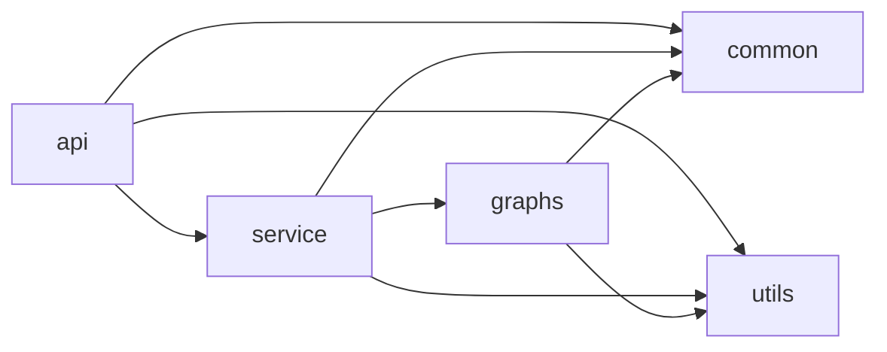
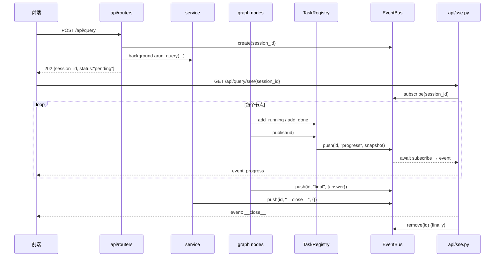

# 项目整理 · 方案设计

> 遵循 `docs/notes/RD-SOP-draft.md` §3：**评审本文档，而不是评审代码 commit**。
> 输入：`PRD.md`（一句话）+ `pre-study.md`（预研报告）。
> 本文档只描述"要改成什么样、按什么顺序改、怎么验收"，**不含代码改动**。
> 所有"建议"在评审通过前都只是提案；`§9 待拍板问题` 需要人类逐条回答后再动工。

---

## 0. 一页纸摘要

| 项 | 内容 |
| --- | --- |
| 改动性质 | 纯重构 + 清理，**不新增功能、不改图拓扑、不改 Milvus schema、不改 API 路径与时序** |
| 改动规模 | 新增 **31** 个文件、真删除 **3** 个、重命名/迁移 **30** 项、修改约 **60** 个（其中约 20 个仅 import 路径变化）。明细见 §6 |
| 存量代码 | 后端 65 个 py / 7774 行；前端 58 个文件 / 7049 行；docs 7.3 MB |
| 分阶段 | 7 个阶段（0–6），**每个阶段独立 commit、独立回滚、独立验收** |
| 破坏性变更 | 3 处，且都要求"前后端同一个 commit"：① SSE 里的节点标识 `中文 → node_xxx`；② `GET /api/docs` 的 `list → items`；③ `DELETE /api/history` 响应体改为 `{deleted_count}` |
| 不做 | 多 worker 部署、Redis 化、pytest 全量铺开、图节点拆分重组、前端视觉/交互调整 |
| 总闸门 | `ruff` + `check_layout` + **新增** `check_layers` + **新增** `check_version` + `pytest` + `prettier --check` + 端到端手工验收（上传 PDF / 上传 ZIP / 查询 / 删除） |

**为什么分 7 个阶段而不是预研报告里的 4 批**：预研的第 3 批（结构重构）混了"迁文件""改接口""改契约"三种风险等级，一旦 review 出问题无法只回滚其中一种。这里按"可独立验证的单一主题"拆开，每个阶段结束时系统都必须是可运行的。

---

## 1. 范围

### 1.1 目标（正）

把预研报告里 4 类问题落成可执行的规则与结构，让下一个人（或 AI）加代码时**不需要靠记忆遵守约定**：

1. **规则书面化**：项目名三分法、分层依赖、节点标识、状态词表、枚举判定、文件与文档命名——全部写进 `AGENTS.md`，并用脚本可校验。
2. **分层真实成立**：消除 `common ↔ utils` 循环，`utils` 退回纯函数，`graphs` 不再依赖 Web 框架，`service` 真的不碰 HTTP。
3. **状态可回收**：进程内任务状态与 SSE 通道有 TTL / 上限 / 清扫，不再无界增长。
4. **落地层下沉**：图节点只做状态流转，MinIO/Milvus 的写操作收敛到 `document_repo`。
5. **契约单源**：节点标识、状态值、SSE 事件、HTTP DTO 各只有一套词表，且前端只在一处做展示映射。
6. **闸门**：pre-commit + 新增静态检查 + pytest + CI，让上述规则不会随时间腐化。

### 1.2 非目标（反 / 约束）

| 不做 | 原因 |
| --- | --- |
| 多 worker / Redis / 独立任务服务 | 属于部署架构升级，不在"整理"范围；本次只把**单 worker 前提显式化**（文档 + 启动告警），接口按可替换设计 |
| 改动 LangGraph 图拓扑（节点增删、边调整） | 整理不改业务语义；`md_tail` 子图、`Send` 扇出、兜底答案分支全部保持 |
| 改 Milvus collection / 字段 / 索引 | 涉及数据迁移，风险和收益不匹配 |
| 改 API 路径、查询参数、事件时序 | 前端要同步改；只改**响应体形状**与**节点标识值**这两处已列出的 |
| 拆分/合并图节点（例如把 `node_document_embedding` 拆成 3 个节点） | 那是业务重构，会改动 LangGraph 拓扑；本次只在**节点内部**下沉存储调用 |
| 前端视觉、布局、滚动跟随逻辑 | 已有 PRD/设计文档支撑，不属于整理 |
| 升级 Python / Node / 依赖大版本 | 只做"依赖声明与实际使用对齐" |
| 把 39 个 `__main__` 全部转成 pytest | 只覆盖零外部依赖的那部分（splitter / brief / rrf+topk / registry）；其余保留（`tests/README.md` 已把该模式定义为约定） |
| 大规模搬 docs 目录 | 只处理 4 个明确违规项（见 §5 阶段 6） |

### 1.3 预研问题 → 阶段映射

| 预研编号 | 问题 | 落在 | 阶段 |
| --- | --- | --- | --- |
| — | 项目名 / 文档口径 / 断链 | §2.1、§5 | 0 |
| P2 | 死代码、死配置、`rprint`、依赖漂移、`npm install` | §5 | 1 |
| P1-2 | `trace_node` 的 desc 变成协议字段 | §2.3、§4.4 | 2 |
| P1-3 | 枚举三种并存 + 前后端状态词表两套 | §2.4、§2.5、§4.6 | 2 |
| P1-5 | `_PROXY_FILES_PREFIX` 重复 | §4.1 | 2 |
| §3.4 / §3.5 / §3.7 | 文件名冗余前缀、端点动词、前端命名 | §2.6、§4.5、§4.6 | 2 |
| P0-1 | `common ↔ utils` 循环 | §3.2、§3.3 | 3 |
| P0-2 | `utils` 装着 Web 传输层 | §3.2、§3.4 | 3 + 4 |
| P0-3 | 全局状态无淘汰、单 worker 隐含前提 | §3.4、§4.3 | 4 |
| P0-4 | 图节点 = repository + service | §3.5、§4.3 | 5 |
| P1-1 | 节点返回值契约不一致 | §2.3、§3.6 | 5 |
| P1-4 | API 契约三种 | §4.5 | 2 |
| P1-6 | 持久层里拼 prompt | §3.5 | 5 |
| P3 | 无测试 / 无 CI / ruff 规则窄 / 日志风格 | §5 | 1 + 6 |
| — | 预研 §四 的 7 个 bug | §5 阶段 1 / 4 | 1、4 |

---

## 2. 命名规则（先立规矩，后面所有改动都是应用规则）

> 这一节的内容最终要**原样写进 `AGENTS.md`**，成为仓库级约定。

### 2.1 项目名三分法

| 场景 | 唯一写法 | 出现位置 |
| --- | --- | --- |
| **展示名** | `MiniRAG` | 页面 `<title>`、NavBar、README 一级标题、文档正文 |
| **包 / 容器 / 项目名** | `mini-rag` | `pyproject.name`、`web/package.json#name`、compose `name:`、`container_name`、uv 项目 |
| **存储资源前缀** | `minirag` | MinIO bucket、MongoDB db、Milvus collection、`minirag_*` 私有方法 |

**唯一例外**：Python 标识符内保留 `MiniRag`（`MiniRagMilvusClient` 比 `MiniRAGMilvusClient` 可读，也不破坏现有 3 个 client 类名）。这样只需改 4 处展示名——`README.md:1`、`pyproject.description`、`api/main.py` 的 `title=` 与启动日志——而不动任何类名。

**落地规则（写进 `AGENTS.md`）**：展示名 `MiniRAG` / 标识符 `MiniRag` / 包与容器 `mini-rag` / 存储资源 `minirag`，禁止混用。

### 2.2 分层规则（由 `tools/check_layers.py` 强制）

```
api → service → graphs → common
                          ↑
                        utils（纯函数；任何层可 import，但它不 import 任何项目内模块）
```

| 从 \ 到 | api | service | graphs | common | utils | fastapi |
| --- | --- | --- | --- | --- | --- | --- |
| **api** | — | ✅ | ❌ | ✅ | ✅ | ✅ |
| **service** | ❌ | — | ✅ | ✅ | ✅ | ❌ |
| **graphs** | ❌ | ❌ | — | ✅ | ✅ | ❌ |
| **common** | ❌ | ❌ | ❌ | —（包内自由） | ❌ | ❌ |
| **utils** | ❌ | ❌ | ❌ | ❌ | —（包内自由） | ❌ |

补充规则：

- `if __name__ == "__main__":` 块**不参与**依赖校验（它是脚本，允许 import 任意层，用于点火调试）。
- `common` 包内允许 `config` ← `paths` 这类**单向**依赖，但**禁止** `paths` 反向 import `config`。
- 新增第三方依赖若同时被 `utils` 与 `common` 使用，优先放进 `common`，`utils` 保持零项目依赖。

### 2.3 节点标识规则

**节点标识 = LangGraph 节点名 = 节点函数名**（ASCII，全小写下划线）。

| 用途 | 字段 | 示例 |
| --- | --- | --- |
| 协议 / 追踪 / 前端映射键 | `name` | `node_answer_output` |
| 日志 / 人类可读 | `desc` | `答案输出` |

- `trace_node(name=..., desc=...)`；`name` 缺省取 `func.__name__`，`desc` 缺省取 `name`。
- SSE `progress` / `child-progress` 的 `done_list` / `running_list` / `failed_list` 里**只出现 `name`**。
- 前端用 `NODE_LABELS: Record<string, string>`（`lib/constants.ts`）做展示，未知 key 原样显示（保证旧后端/新增节点不白屏）。
- `import_graph.py` 里的子图包装函数 `node_md_tail_branch` → 改名 `node_md_tail`，与 `add_node("node_md_tail", ...)` 的注册名一致。

### 2.4 状态词表规则

后端 `TaskStatus` 是**唯一**词表，SSE 与 HTTP 响应只传后端值：

| 取值 | 含义 |
| --- | --- |
| `pending` | 已受理，未开始 |
| `processing` | 执行中 |
| `complete` | 成功终态 |
| `failed` | 失败终态 |

前端：

```ts
type TaskStatus = "pending" | "processing" | "complete" | "failed"; // 与后端 1:1
type ImportStatus = "uploading" | TaskStatus;                        // uploading 是前端本地态
type ImportChildStatus = TaskStatus | "interrupted";                 // interrupted 是前端派生
```

- **删除** 前端自行发明的 `completed` / `error` 两个值。
- **删除** `CHILD_STATUS_MAP`（值已一致，无需映射）。
- 展示文案只在 `lib/constants.ts` 的 `TASK_STATUS_LABELS` / `IMPORT_STATUS_META` / `IMPORT_CHILD_STATUS_META` 三张表里，其他文件不得出现 `if (status === "...")` 以外的状态字符串拼接。
- 合并现有重复表：`QueryProgress.tsx` 内的 `SUMMARY_STATUS_LABELS` 与 `constants.ts` 的 `PROGRESS_STATUS_LABELS` → 一张 `TASK_STATUS_LABELS`。

### 2.5 枚举 vs 常量表

| 用法 | 实现 | 现有对象 |
| --- | --- | --- |
| **封闭取值集合**（会被比较、会进协议） | `StrEnum` | `TaskStatus`、`MessageRole`、`LogLevel`；**新增** `SSEEvent`、`FileType`、`DataFrom` |
| **字段名 / 索引名常量表**（不会被比较，只拼查询） | 普通类 + 常量 | `MilvusDocsField`、`MilvusChunksField`、`MilvusDocsIndex`、`MilvusChunksIndex` |

判定标准写进 `AGENTS.md`：**"需要 `is/==` 比较或出现在 JSON 里的封闭集合用 `StrEnum`；纯字符串拼接用的名字表用普通类。"**

### 2.6 文件 / 模块命名

| 规则 | 应用 |
| --- | --- |
| 目录已是 `nodes/`，文件名去掉 `node_` 前缀 | `nodes/entry.py` 内含函数 `node_entry` |
| 目录已是 `prompt/`，文件名去掉 `prompt_` 前缀 | `prompt/query_rewrite.py` |
| 目录已是 `utils/`，文件名去掉 `_utils` 后缀 | `utils/net.py`、`utils/token.py`、`utils/brief.py` |
| 一个文件只放一个主题；超过 400 行考虑拆分 | `node_document_embedding.py`（现 430 行）→ 下沉后 `document_embedding.py` 应 ≤ 250 行 |
| API 端点函数用 `动作_资源` | `list_docs` / `get_doc` / `delete_doc` / `create_import` / `stream_import` / `run_query` / `stream_query` / `list_history` / `delete_history` / `get_file` |

### 2.7 文档命名

`docs/feat/<需求名>/` 内固定 5 类文件，**新增需求必须遵守**：

| 文件 | 编写者 | 必需 |
| --- | --- | --- |
| `PRD.md` | 人类 | ✅ |
| `方案设计.md` | AI | ✅ |
| `测试反馈.md` | 人类 + AI | 有测试才写 |
| `需求总结.md` | AI | 交付时 |
| `prototype/*.html` | AI | 有 UI 才写 |

- 版本演进**不再进文件名**，改为文档内"修订记录"表格（`v0 / v1` 混用就是文件名装不下的历史包袱）。
- 命名统一"中文主题 + 固定后缀"，禁止空格与英文大小写混写。
- 已有 4 个违规项本次处理，其余不动（避免大搬迁）：见阶段 6。

---

## 3. 架构调整

### 3.1 目标目录结构（后端）

`+ 新增` / `~ 重命名` / `- 删除`

```text
src/
├── api/                          # HTTP 层：只做编解码 + 参数校验
│   ├── __init__.py               # ~ __version__ 保留
│   ├── main.py                   # app / lifespan / CORS / include_router（预计 ≤ 70 行）
│   ├── sse.py                    # + Request→StreamingResponse 适配（唯一 import fastapi 的事件相关模块）
│   ├── startup_checks.py
│   ├── routers/                  # +
│   │   ├── __init__.py
│   │   ├── health.py             #   GET  /api/health
│   │   ├── chat.py               #   POST /api/query、GET /api/query/sse、history 三件套
│   │   ├── imports.py            #   POST /api/upload、GET /api/upload/sse
│   │   ├── docs.py               #   GET/DELETE /api/docs...
│   │   └── files.py              #   GET  /api/files/{object_name:path}
│   └── schemas/                  # +（原 schemas.py 拆包）
│       ├── __init__.py
│       ├── chat.py
│       ├── docs.py
│       └── imports.py
├── service/                      # 编排层：调图 + 组装结果，不碰 HTTP
│   ├── docs_service.py
│   ├── import_service.py
│   └── query_service.py
├── graphs/                       # 图：只描述状态流转
│   ├── import_graph/
│   │   ├── import_graph.py
│   │   ├── import_graph_state.py
│   │   └── nodes/                # 文件名去 node_ 前缀
│   │       ├── __init__.py
│   │       ├── entry.py
│   │       ├── pdf_to_md.py
│   │       ├── process_standalone_md.py
│   │       ├── process_md_zip.py
│   │       ├── md_fork.py
│   │       ├── md_img.py
│   │       ├── document_split.py
│   │       └── document_embedding.py
│   └── query_graph/
│       ├── query_graph.py
│       ├── query_graph_state.py
│       └── nodes/
│           ├── __init__.py
│           ├── intent_recognize.py
│           ├── search_embedding.py
│           ├── search_hyde.py
│           ├── search_web.py
│           ├── rrf_and_rerank.py
│           └── answer_output.py
├── common/                       # 基础设施（不依赖业务）
│   ├── paths.py                  # + PROJECT_ROOT / FIXTURES_DIR / fixture_path
│   ├── logging.py                # ~ 原 utils/logging_utils.py
│   ├── config/
│   │   ├── app_config.py
│   │   ├── env_config.py
│   │   └── runtime_paths.py      # + runtime_dir() / snapshot_path()（依赖 ENV_CONFIG）
│   ├── events/                   # +
│   │   ├── __init__.py           #   TASK_REGISTRY / EVENT_BUS / TaskStatus / SSEEvent
│   │   ├── models.py             #   TaskStatus、SSEEvent、TaskEntry、ChildSpec
│   │   ├── bus.py                #   EventBus 协议 + InMemoryEventBus（不 import fastapi）
│   │   ├── registry.py           #   TaskRegistry（替代 task_utils 的 7 张表）
│   │   └── tracing.py            #   ~ 原 utils/node_utils.py（trace_node / node_log / step_log）
│   ├── client/                   # milvus / minio / mongodb
│   ├── model/
│   ├── prompt/                   # 文件名去 prompt_ 前缀 + history.py
│   └── store/
│       ├── chat_history.py
│       └── document_repo.py      # + MinIO/Milvus 写操作下沉
└── utils/                        # 纯函数，零项目依赖
    ├── brief.py                  # ~ 原 brief_utils.py（并入 brief_list / brief_dict）
    ├── image_refs.py             # + 从 node 抽出的图片引用正则/下载/改写
    ├── markdown.py               # ~ 原 markdown_utils.py
    ├── markdown_splitter.py
    ├── net.py                    # ~ 原 net_utils.py
    └── token.py                  # ~ 原 token_utils.py
```

关键点：

- `utils/` 里**不再有** `logging_utils.py` / `path_utils.py` / `node_utils.py` / `sse_utils.py` / `task_utils.py`——它们都是"基础设施"，不属于"工具函数"。
- `src/common/model/qwen.tiktoken`（151k 行词表）**本次不动**，但 `utils/token.py` 内的路径改为 `Path(__file__).parents[1] / "common" / "model" / "qwen.tiktoken"`，去掉对 `PROJECT_ROOT` 的跨层依赖。（见 §9 Q4）

### 3.2 依赖关系（改后）



对照预研报告的三个"承诺与实现不符"，改后：

| 预研问题 | 改后状态 | 强制手段 |
| --- | --- | --- |
| P0-1 `common ↔ utils` | `common` 不再 import `utils`：`paths`/`logging` 进 `common`；`brief` 留在 `utils`，`common` 侧没有任何调用方（`brief_list/dict` 只被 graphs 层的 `document_embedding` 用） | `tools/check_layers.py` |
| P0-2 `utils` 依赖 fastapi | `utils` 零 fastapi；事件队列在 `common/events`（不 import fastapi）；只有 `api/sse.py` import fastapi | `tools/check_layers.py` 白名单仅 `api/**` |
| P0-3 全局状态无淘汰 | `TaskRegistry` / `InMemoryEventBus` 均有 `created_at` + `sweep()`，由 lifespan 后台任务每 60s 清扫 | 单测 + 启动日志打印清扫结果 |

### 3.3 迁移顺序（为什么不能一次性全挪）

`common/paths.py` 与 `common/logging.py` 必须先于事件层落地：

```
阶段 3 把 paths/logging 提到 common
   └── 阶段 4 的 common/events/* 才能在不 import utils 的前提下拿到 logger 与路径
         └── 阶段 5 的 document_repo 才能安全 import common.logging
```

若顺序颠倒，`common/events` 会短暂 import `utils.logging_utils`，与阶段 3 的目标冲突，形成"重构中的循环依赖"。

### 3.4 事件 / 任务状态架构



与现状的差异：

| 项 | 现在 | 之后 |
| --- | --- | --- |
| 队列实现 | `threading.Queue` + 每连接一个线程池线程 `run_in_executor(get, 0.1s)` | `InMemoryEventBus`：sync 侧 push 进 `list` 缓冲，`loop.call_soon_threadsafe()` 唤醒 async 侧；**不占线程** |
| 队列生命周期 | 创建于 POST，仅 SSE generator finally 删除 | 创建于 POST；`sweep()` 兜底（TTL 30 min / 最大通道数 500） |
| 事件创建点 | `graphs/**` 直接 `sse_push` | `graphs/**` 只调 `TASK_REGISTRY.publish()`；`service` 发终态事件 |
| 谁 import fastapi | `utils/sse_utils.py` | 仅 `api/sse.py` |
| 节点标识 | 中文 desc | `node_*` name |
| 缓冲上限 | 无 | 单通道 2000 事件，超限丢最旧并 WARN |

### 3.5 存储层下沉（`document_repo`）

现状：`node_document_embedding.py`（430 行）里 7 个 `step_*` 直接调 `MILVUS_CLIENT` / `MINIO_CLIENT`；`docs_service.py` 里删除逻辑又写了一遍"三制品 + chunks + docs"的顺序。

下沉后：

| 行为 | 现在所在 | 之后所在 |
| --- | --- | --- |
| 按 title 查旧行、删 chunks/docs/制品 | `node_document_embedding.step_2` + `docs_service.delete_doc`（两份） | `DOCUMENT_REPO.delete_by_title()`（一份） |
| 上传 origin/markdown/chunks 三制品 | `step_3` | `DOCUMENT_REPO.upload_artifacts()` |
| insert docs + 查回 doc_id | `step_6` | `DOCUMENT_REPO.save_meta()` |
| insert chunks | `step_7` | `DOCUMENT_REPO.save_chunks()` |
| 列表 / 详情 / 按 id 删除 | `docs_service` | `DOCUMENT_REPO.list_page/get/delete_by_id` |

节点保留的职责：**校验 state → 调 repo → 记录错误 → 返回增量**。`docs_service` 保留的职责：**DTO 组装 + 异常翻译**（`DocNotFoundError` → 404）。

`chat_history.summary_history()` 里的 prompt 拼装移到 `common/prompt/history.py::format_history(messages) -> str`；`ChatHistoryManager` 只保留 CRUD。

### 3.6 节点增量契约（P1-1）

统一为：**节点必须是纯函数式更新——只返回增量 dict，禁止原地修改入参 state。**

| 节点 | 现在 | 之后 |
| --- | --- | --- |
| `node_entry` | mutate + return state | `return {"origin_file_type": ..., "file_title": ...}` |
| `node_pdf_to_md` | mutate + return state | `return {"markdown_file_path": ...}` |
| `node_md_fork` | mutate + return state | `return {"md_children": children}` |
| `node_process_md_zip` | mutate + return state | `return {"markdown_file_paths": [...], "markdown_file_path": ...}` |
| `node_intent_recognize` | mutate + return state | `return {"rewritten_query","confirm_list","suspect_list","answer"}` |
| `node_answer_output` | return state | `return {}` |
| 其余 8 个 | 已是增量 | 不变 |

保护手段（默认关闭，测试与 CI 开启）：

```python
# common/events/tracing.py
class _ReadOnlyState(Mapping):          # __setitem__ / pop / update 一律抛 StateMutationError
...
@trace_node(...)                        # ENV DEBUG_STRICT_STATE=true 时自动包一层
```

新增 `.env` 项 `DEBUG_STRICT_STATE`（默认 `false`），CI 里设 `true` 跑 `pytest`。

---

## 4. 数据结构

> SOP 要求：schemas / 全局实例 / 数据库缓存队列 / 跨模块接口 / 配置文件 的引入与修改。

### 4.1 配置变更

**`src/common/config/app_config.py`（`_AppConfig` 新增 6 项）**

| 字段 | 默认 | 用途 |
| --- | --- | --- |
| `task_ttl_seconds` | `1800.0` | 任务状态过期时间（30 min） |
| `sse_channel_ttl_seconds` | `1800.0` | SSE 通道过期时间 |
| `sse_sweep_interval_seconds` | `60.0` | 清扫任务间隔 |
| `sse_channel_max_events` | `2000` | 单通道缓冲上限 |
| `files_proxy_prefix` | `"/api/files/"` | 原 `_PROXY_FILES_PREFIX` 单源（收口 P1-5） |
| `max_upload_bytes` | `100 * 1024 * 1024` | 上传体积上限，超限 413（阶段 4） |

**`src/common/config/env_config.py`**

| 变更 | 内容 |
| --- | --- |
| 删除 | `llm_tpm` / `vlm_tpm` / `embedding_tpm` / `rerank_tpm`（4 处死配置） |
| 新增 | `DebugSettings(BaseSettings, env_prefix="DEBUG_")`：`strict_state: bool = False` |
| 修改 | 顶部模块 docstring 从"import 后裸字符串"改为真正的模块 docstring；`from utils.path_utils import PROJECT_ROOT` → `from common.paths import PROJECT_ROOT` |

**`src/common/config/runtime_paths.py`（新增）**

```python
def runtime_dir(name: str) -> Path          # <var>/<name>，按 ENV_CONFIG 解析
def runtime_tmp_dir() -> Path               # 原 path_utils.runtime_tmp_dir
def snapshot_path(name: str) -> str         # 原 path_utils.snapshot_path
```

**`.env` / `.env.example`**：删 4 个 `*_TPM`，增 `DEBUG_STRICT_STATE=False`。（`.env.example` 用 `tools/make_env_example.py` 重新生成）

### 4.2 全局实例（新增 / 重命名）

| 实例 | 位置 | 说明 |
| --- | --- | --- |
| `TASK_REGISTRY = TaskRegistry()` | `common/events/__init__.py` | 替代 7 张模块级 dict |
| `EVENT_BUS = InMemoryEventBus()` | `common/events/__init__.py` | 替代 `_session_stream` |
| `DOCUMENT_REPO = DocumentRepo()` | `common/store/__init__.py` | 新增；`common/store/__init__.py` 从空变为导出 |
| `CHAT_HISTORY_MANAGER` | `common/store/__init__.py` | 重命名自 `chat_history_manager`，与大写单例约定统一 |

`common/client/__init__.py`、`common/model/__init__.py` 保持现状（已是大写单例），`common/config/__init__.py`、`common/prompt/__init__.py` 保持空包（不引入 export 副作用）。

### 4.3 核心数据类

**`common/events/models.py`**

```python
class TaskStatus(StrEnum):        # 值不变：pending/processing/complete/failed
class SSEEvent(StrEnum):          # 值不变：ready/progress/fork/child-progress/delta/final/error/__close__
class FileType(StrEnum):          # pdf / markdown / markdown-zip / <unknown>
class DataFrom(StrEnum):          # Milvus / Web

@dataclass
class TaskEntry:
    task_id: str
    parent_id: str | None          # 子任务才有
    status: TaskStatus           # 序列化时取 .value
    running: list[str]
    done: list[str]
    failed: list[str]
    error: str
    result: dict[str, str]
    created_at: float
    updated_at: float

class ChildSpec(TypedDict):        # fork 入参（与 graphs 的 MdChild 解耦）
    child_id: str
    title: str
    path: str
    index: int
```

**`common/events/bus.py`**

```python
class EventBus(Protocol):
    def create(self, channel_id: str) -> None: ...
    def push(self, channel_id: str, event: str, data: dict[str, Any]) -> None: ...
    def remove(self, channel_id: str) -> None: ...
    def sweep(self, ttl_seconds: float) -> int: ...
    async def subscribe(self, channel_id: str) -> AsyncIterator[tuple[str, dict]]: ...


@dataclass
class _Channel:
    buffer: list[tuple[str, dict]]
    closed: bool
    created_at: float
    touched_at: float
    wake: asyncio.Event | None  # 由首个订阅者在 loop 线程内创建
    loop: asyncio.AbstractEventLoop | None
```

**`common/store/document_repo.py`**

```python
@dataclass(frozen=True)
class DocumentArtifacts:            # 三份制品的代理 URL
    origin_file_url: str
    final_markdown_url: str
    chunks_url: str

@dataclass(frozen=True)
class DocumentMeta:                 # 一级召回所需的元数据
    keywords: str
    abstract: str
    keywords_sparse: dict[int, float]
    abstract_dense: list[float]

class DocumentRepo:
    def delete_by_title(self, file_title: str) -> int
    def delete_by_id(self, doc_id: int) -> None
    def upload_artifacts(self, file_title, *, origin, markdown, chunks) -> DocumentArtifacts
    def save_meta(self, *, task_id, file_title, artifacts, meta) -> int      # 返回 doc_id
    def save_chunks(self, *, doc_id, file_title, chunks) -> int
    def list_page(self, offset: int, limit: int) -> list[dict]
    def count(self) -> int
    def get(self, doc_id: int) -> dict | None
```

### 4.4 SSE 协议变更

事件名、帧格式（`event: x\ndata: {json}\n\n`）、`__close__` 语义**全部不变**；只有 payload 内的节点标识取值变化。

| event | payload | 变更 |
| --- | --- | --- |
| `ready` | `{}` | 不变 |
| `progress` | `{status, done_list, running_list, failed_list?, error?}` | 列表元素：`"答案输出"` → `"node_answer_output"` |
| `fork` | `{parent_task_id, total, children:[{child_id,title,path,index}]}` | 不变 |
| `child-progress` | `{child_id, status, done_list, running_list, failed_list?, error?}` | 同 `progress` |
| `delta` | `{delta}` | 不变 |
| `final` | `{answer}` | 不变 |
| `error` | `{error}` | 不变 |
| `__close__` | `{}` | 不变 |

**行为修复（预研 §四-5）**：`arun_query` 失败路径补发 `__close__`，与 `arun_import` 对齐；前端可以统一用 `closeOnServerError` 默认值。

### 4.5 HTTP DTO 变更（`api/schemas/`）

| 端点 | 现在 | 之后 |
| --- | --- | --- |
| `POST /api/query` | 裸 dict `{status, msg, session_id}`，无 model | `QueryAcceptedResponse{session_id, status}` + `response_model` |
| `QueryRequest` | 无校验 | `query: str = Field(min_length=1)`、`session_id: str = Field(min_length=1)` |
| `GET /api/history/{id}` | 裸 dict `{status, history}` | `HistoryResponse{history: list[HistoryItem]}` |
| `DELETE /api/history/{id}` | 裸 dict `{status, msg}` | `DeleteHistoryResponse{deleted_count: int}` |
| `POST /api/upload` | `UploadResponse{task_id,status}` | 重命名 `ImportAcceptedResponse{task_id,status}`（**wire key 不变**） |
| `GET /api/docs` | `{total, list}` | `{total, items}`（**破坏性**，前端同 commit 改） |
| `DELETE /api/docs/{id}` 部分失败 | 手写 `JSONResponse(500, {success:false,detail})` | `raise HTTPException(500, detail=...)`（错误体统一为 `{detail}`） |
| `DELETE /api/docs/{id}` 成功 | `{success:true}` | `{success:true}`（不变） |
| `GET /api/health` | 裸 dict | `HealthResponse{status, version}` |

同时把 `GET /api/docs/{doc_id}` / `DELETE /api/docs/{doc_id}` 的 `int(doc_id)` + 404 重复逻辑收到一个依赖函数：

```python
# api/routers/docs.py
def parse_doc_id(doc_id: str) -> int:     # 非法 → HTTPException(404)
```

### 4.6 前端类型变更（`web/src/types/`）

| 类型 | 现在 | 之后 |
| --- | --- | --- |
| `TaskStatus`（新增） | — | `"pending" \| "processing" \| "complete" \| "failed"` |
| `ProgressView.status` | `string` | `TaskStatus` |
| `ImportStatus` | `uploading \| processing \| completed \| error` | `"uploading" \| TaskStatus` |
| `ImportChildStatus` | `pending \| processing \| completed \| error \| interrupted` | `TaskStatus \| "interrupted"` |
| `StatusResponse` | 一种类型描述 query/upload 两种载荷 | 拆 `QueryStatusResponse` / `ImportStatusResponse` |
| `DocsListResponse.list` | `list` | `items` |
| `QueryResponse` | 声明了 `answer/done_list/error/message`（后端从不返回） | 与后端 `QueryAcceptedResponse` 对齐 |
| `ImportFile` | — | `ImportTask`（可选，见 §9 Q6） |
| `ChatMessage.role` | `"user" \| "bot"` | `"user" \| "assistant"`（可选，见 §9 Q6） |

新增 `NODE_LABELS`（见 §2.3）与 `TASK_STATUS_LABELS`（见 §2.4）。

### 4.7 图状态（`*_state.py`）

**结构不变**（`ImportGraphState` / `QueryGraphState` 字段、`_keep_latest` reducer 全部保留），只做两件清理：

1. 删除 `get_default_state()`（0 引用）；
2. 模块 docstring 补充"节点只返回增量，禁止 mutate"的契约说明（§3.6）。

---

## 5. 分批实施计划

> 每个阶段：独立 commit（可多个）、独立验收、独立回滚。**阶段内不允许跨阶段顺手改动。**

| 阶段 | 主题 | 对应预研 | 预计 diff | 依赖 |
| --- | --- | --- | --- | --- |
| 0 | 规则与口径落地 | pre-study §3.1 / §3.9 | 4 文件 | — |
| 1 | 零风险清理 | P2、P3 部分、§四 2 条 bug | ~40 文件（ruff 扩规则会触及日志调用点） | — |
| 2 | 命名归一 | P1-2/3/4/5、pre-study §3.4 / §3.5 / §3.7 | ~45 文件（+ 全量格式化） | 0 |
| 3 | 分层再造 | P0-1、P0-2 前半 | ~40 文件 | 2 |
| 4 | 事件与任务状态 | P0-2 后半、P0-3、§四 3/4/5 条 bug | ~15 文件 | 3 |
| 5 | 存储下沉 + 节点契约 | P0-4、P1-1、P1-6 | ~12 文件 | 4 |
| 6 | 文档整理 + CI | P3 剩余 | ~15 文件 | 2–5 |

### 阶段 0 · 规则与口径落地

**目的**：先把"规矩"写下来，后面每个阶段都是在执行规矩，review 时也有对照物。

| 动作 | 文件 |
| --- | --- |
| 新增 §2 全部规则（项目名 / 分层 / 节点标识 / 状态词表 / 枚举判定 / 文件命名 / 文档命名） | `AGENTS.md` |
| 修复断句："代码改动必须能通过 pre-commit，过不了就不算完成：" 补全为可执行命令 | `AGENTS.md` |
| 更正软依赖清单（删 `VLM_API_KEY` / `QWEN_API_KEY` / `LLM_API_KEY`） | `docs/setup.md:32` |
| 修正 404 的代码内文档引用 | `node_document_embedding.py`（引用名改为实际文件名，见阶段 6） |
| `README.md` 一级标题、结构树同步（新增 `common/events`、`api/routers` 等在后续阶段补） | `README.md` |

**验收**：人读一遍 `AGENTS.md` 能回答"新文件该放哪、函数该叫什么"。

### 阶段 1 · 零风险清理

**目的**：减面积。不动任何运行时行为。

| 动作 | 明细 |
| --- | --- |
| 删死代码 | `utils/path_utils.py` 的 `from_project_root`/`get_path_dir`/`get_src_root`/`SRC_ROOT`；`utils/task_utils.py` 的 `get_task_results`/`get_task_failed_nodes`/`get_task_result`；两个 `get_default_state()`；`common/prompt/prompt_item_name_of_document.py`（整文件，0 引用）；`web/src/store/sessionStore.ts` |
| 删死配置 | 4 个 `*_TPM`（`env_config.py` + `.env` + `.env.example`） |
| 删调试输出 | `minio_client.py:188-190` 的 `rprint(res)` |
| 依赖声明 | 增 `httpx2>=2.13`、`mcp>=2.2`、`mcp-types>=2.2`；删 `openai-agents`、`langchain-community`、`python-dotenv`、`regex`；`grandalf` 移入 `[dependency-groups] dev` |
| 修 2 个 bug | ① `node_md_img.step_5`：上传失败的图片跳过替换（现在是 ``）；② `node_pdf_to_md.step_1`：删死赋值，补上 docstring 声称的 `file_title` 写入 |
| Docker | 前端 `npm install` → `npm ci` |
| 包管理器 | 文档记录"以 npm + package-lock.json 为准"；本地 `rm -rf web/node_modules && npm ci` 重建 |
| ruff | 扩到 `B, C4, UP, SIM, G, RUF`，`ignore = ["RUF001","RUF002","RUF003"]`（中文标点误报）；修完现存问题：mutable default ×1、错误注解 ×1、**f-string 日志 108 处 → `{}` 惰性格式化**（G 规则自动报） |
| prettier | 新增 `.prettierrc.json` + `npm run format` / `format:check`，全量格式化一次（独立 commit，便于 review 时忽略） |
| 版本一致性 | 新增 `tools/check_version.py`（pyproject / `api.__version__` / `web/package.json` 三处一致） |

**验收**：`uv sync` 后 `import api.main` 成功（无缺包）；`ruff check` / `format --check` 全绿；`pytest` 尚未引入，跳过；手工走一遍上传+查询（行为零变化）。**回滚**：单文件回滚即可。

### 阶段 2 · 命名归一

**目的**：消灭"同一概念多套词表"，此时不改结构、不迁文件。

| 子项 | 内容 | 破坏性 |
| --- | --- | --- |
| 2a 节点标识 | `trace_node(name=, desc=)`；所有节点 `name` = 函数名；SSE 输出 `node_*`；前端 `NODE_LABELS` | ⚠️ SSE 协议 |
| 2b 状态词表 | 前端 `TaskStatus` 对齐后端；删 `completed`/`error`/`CHILD_STATUS_MAP`；`TASK_STATUS_LABELS` 合并 | 仅前端内部 |
| 2c StrEnum | `SSEEvent` / `FileType` / `DataFrom` 改 `StrEnum`（值不变） | 无 |
| 2d 单源常量 | `_PROXY_FILES_PREFIX` ×2 → `APP_CONFIG.files_proxy_prefix` | 无 |
| 2e 端点命名 | `routers/` 拆分 + 端点改名（§4.5）；`def query` 与 `async def` 风格统一（全部 `async def`）。**本阶段 routers 仍复用 `utils.sse_utils`**，事件实现替换留到阶段 4 | 仅函数名 |
| 2f 文件名去前缀 | `nodes/node_*.py` ×14、`prompt/prompt_*.py` ×6；`node_md_tail_branch` → `node_md_tail` | 无（import 路径） |
| 2g 前端命名 | `ImportFile` → `ImportTask`、`ChatMessage.role` → `assistant`、拆 `StatusResponse`、删多余包裹、统一引号与缩进 | 内部 |
| 2h DTO | `schemas.py` → `schemas/` 包；`list` → `items`；补 `response_model`；`delete_doc` 失败改 `HTTPException` | ⚠️ `items` |
| 2i 项目名 | README/日志/API title 统一 `MiniRAG`（标识符保留 `MiniRag`） | 无 |

**注意**：2a + 2b 必须**同一个 commit**（SSE 只传 `node_*` 且状态值统一，前端才能一次改完）；2h 的 `items` 同样前后端同 commit。

**验收**：手工上传 ZIP / 查询，观察 SSE（DevTools Network → EventStream）payload 为 `node_entry` 等；前端卡片文案与改前完全一致；`tsc --noEmit` 通过。

### 阶段 3 · 分层再造

**目的**：让 `api → service → graphs → common ← utils` 真实成立。

| 子项 | 内容 |
| --- | --- |
| 3a | 新增 `common/paths.py`（只含 `PROJECT_ROOT`/`FIXTURES_DIR`/`fixture_path`），`common/config/env_config.py` 改 import；删除 `utils/path_utils.py` |
| 3b | `utils/logging_utils.py` → `common/logging.py`；`fix_log_position` 从 `inspect.stack()` 改为 `sys._getframe` 向上走（去掉每日志全栈开销） |
| 3c | `utils/brief_utils.py` → `utils/brief.py`，并入 `brief_list`/`brief_dict`；`common/logging.py` 不再导出它们 |
| 3d | `runtime_tmp_dir()` / `snapshot_path()` → `common/config/runtime_paths.py` |
| 3e | `utils/net_utils.py` / `token_utils.py` / `markdown_utils.py` → `net.py` / `token.py` / `markdown.py`；`markdown.py` 去掉 `APP_CONFIG` 默认值，改必传参数（调用方传入） |
| 3f | 新增 `tools/check_layers.py`（AST 校验 §2.2 规则，跳过 `__main__` 块与 `TYPE_CHECKING`），加入 pre-commit |
| 3g | 批量改 import：**21 个文件**引用 `path_utils`、**27 个文件**引用 `logging_utils` |

**验收**：`python tools/check_layers.py` 退出码 0；`rg "from fastapi" src/utils` 无结果；`rg "from utils" src/common` 无结果；后端启动自检通过；上传+查询回归通过。

### 阶段 4 · 事件与任务状态

**目的**：切断 `graphs → fastapi`，给全局状态加生命周期。

| 子项 | 内容 |
| --- | --- |
| 4a | 新增 `common/events/{models,bus,registry,tracing}.py`（`tracing.py` 由 `utils/node_utils.py` 迁入） |
| 4b | 新增 `api/sse.py`：`sse_format()` + `async stream_events(request, bus, channel_id)`；删除 `utils/sse_utils.py` 与 `utils/task_utils.py` |
| 4c | `main.py` lifespan 启动清扫任务：`asyncio.create_task(_sweep_loop())`，退出时 cancel |
| 4d | 上传落盘改为 `upload_dir/<task_id>/<filename>`（修并发同名覆盖）；加 `MAX_UPLOAD_BYTES` 上限（新配置项，默认 100MB，超限 413） |
| 4e | `arun_query` 失败路径补发 `__close__`；前端 `closeOnServerError` 统一为默认（可删该参数） |
| 4f | `sse_generator` 里 `get_event_loop()` → `get_running_loop()`（随 4b 一并消失） |
| 4g | README 写明"当前仅支持单 worker"，`startup_checks` 检测多 worker 时 WARN |

**验收**：

1. `python tools/check_layers.py` 通过（`graphs` 不再触达 fastapi）。
2. `var/tmp/smoke_events.py` 脚本：创建 3 个通道，push 若干事件，`sweep(ttl=0)` 后通道数归零。
3. 手工：上传 ZIP → 观察 `fork` + 多路 `child-progress`；查询 → `delta` 流式 + `final` + `__close__`；断开浏览器后 60s 内该通道被清扫（日志可查）。
4. 并发同名上传：两个 `同名.pdf` 同时上传，`var/uploads/<task_id>/` 各自独立，两者都成功。

### 阶段 5 · 存储下沉 + 节点契约

**目的**：图节点变薄，写库逻辑单源，且可离线测试。

| 子项 | 内容 |
| --- | --- |
| 5a | 新增 `common/store/document_repo.py`（§4.3 API）；`common/store/__init__.py` 导出 `DOCUMENT_REPO` / `CHAT_HISTORY_MANAGER` |
| 5b | `node_document_embedding.py` 的 step_2/3/6/7 改为 repo 调用，文件预计 430 → ≤ 250 行 |
| 5c | `docs_service.py` 的 list/detail/delete 改为 repo 调用，只留 DTO 组装与异常翻译 |
| 5d | `chat_history.summary_history()` → `common/prompt/history.py::format_history()` |
| 5e | 节点增量契约（§3.6）落地 6 个节点；`_ReadOnlyState` + `DEBUG_STRICT_STATE` 守卫 |
| 5f | 新增 `tests/` 用例：`test_markdown_splitter.py`、`test_brief.py`、`test_rrf_and_topk.py`、`test_task_registry.py`、`test_node_contract.py`（用 monkeypatch 替换 repo，断言节点不 mutate state、返回增量）；`pyproject` 加 `pytest` + `[tool.pytest.ini_options]` |
| 5g | 新增 `utils/image_refs.py`：把 `_MARKDOWN_IMAGE_RE` / `_IMG_TAG_RE` / `_build_local_filename` / `_download_image` / `_is_online_url` / `_normalize_url` / `_replace_image_urls` / `_rewrite_img_tag` 这些「以私有名跨 node 复用」的符号改为公开名集中于此；`_MD_FIXED_SUFFIX` 属命名约定，移到 `utils/markdown.py` 作 `MD_FIXED_SUFFIX` |

**验收**：`pytest` 全绿（≥ 15 个用例）；`rg "from graphs.import_graph.nodes" src/graphs/import_graph/nodes` 无结果（节点之间不再互相 import）；手工回归上传 PDF / 单 md / ZIP 三种链路 + 查询 + 删除文档。

### 阶段 6 · 文档整理 + CI

| 子项 | 内容 |
| --- | --- |
| 6a | `docs/feat/数据库重构/Milvs DB Refactor.md` → `milvus-db-refactor.md`（修 typo）；另两份同目录文档合并后归档为 `archive/` |
| 6b | `docs/notes/*.json`（抓包样本）→ `docs/notes/samples/` |
| 6c | `docs/web-arch.md` 顶部加"历史设计稿，现状以 README 为准"横幅 |
| 6d | 8 个原型 html → `docs/feat/<需求>/prototype/`（**可选**，见 §9 Q3） |
| 6e | `README.md` 补全结构树 + 目录约定表（新增 `common/events` 等），`tools/check_layout.py` 保持绿 |
| 6f | `.github/workflows/ci.yml`：backend（uv sync + ruff + pytest + check_layers + check_version）、frontend（npm ci + tsc/vite build + prettier --check）、repo（check_layout） |
| 6g | pre-commit 增 local hooks：`check_layers` / `check_version` / `prettier` |

**验收**：CI 在 PR 上跑通；阶段 0 写的规则与磁盘一致。

---

## 6. 文件修改清单

### 6.1 新增（31）

| # | 文件 | 阶段 |
| --- | --- | --- |
| 1 | `src/common/paths.py` | 3 |
| 2 | `src/common/config/runtime_paths.py` | 3 |
| 3 | `src/common/events/__init__.py` | 4 |
| 4 | `src/common/events/models.py` | 4 |
| 5 | `src/common/events/bus.py` | 4 |
| 6 | `src/common/events/registry.py` | 4 |
| 7 | `src/api/sse.py` | 4 |
| 8 | `src/api/routers/__init__.py` | 2 |
| 9 | `src/api/routers/health.py` | 2 |
| 10 | `src/api/routers/chat.py` | 2 |
| 11 | `src/api/routers/imports.py` | 2 |
| 12 | `src/api/routers/docs.py` | 2 |
| 13 | `src/api/routers/files.py` | 2 |
| 14 | `src/api/schemas/__init__.py` | 2 |
| 15 | `src/api/schemas/chat.py` | 2 |
| 16 | `src/api/schemas/docs.py` | 2 |
| 17 | `src/api/schemas/imports.py` | 2 |
| 18 | `src/common/store/document_repo.py` | 5 |
| 19 | `src/common/prompt/history.py` | 5 |
| 20 | `src/utils/image_refs.py` | 5 |
| 21 | `tools/check_layers.py` | 3 |
| 22 | `tools/check_version.py` | 1 |
| 23–27 | `tests/test_markdown_splitter.py`、`tests/test_brief.py`、`tests/test_rrf_and_topk.py`、`tests/test_task_registry.py`、`tests/test_node_contract.py` | 5 |
| 28 | `tests/conftest.py` | 5 |
| 29 | `web/.prettierrc.json` | 1 |
| 30 | `web/.prettierignore` | 1 |
| 31 | `.github/workflows/ci.yml` | 6 |

> 表格 30 行；其中 23–27 一行含 5 个文件，合计 **31 个新文件**。不含测试夹具。

### 6.2 真删除（3）

| # | 文件 | 阶段 | 原因 |
| --- | --- | --- | --- |
| 1 | `src/common/prompt/prompt_item_name_of_document.py` | 1 | 全仓 0 引用（只有自己的 `__main__`） |
| 2 | `src/api/schemas.py` | 2 | 由 `api/schemas/` 包取代 |
| 3 | `web/src/store/sessionStore.ts` | 1 | 全仓 0 import（PRD 预留骨架，需要时再从 git 历史找回） |

### 6.3 重命名 / 迁移（30）

**A. 文件改名（阶段 2、3、6，共 24）**

| 阶段 | 现在 → 之后 |
| --- | --- |
| 2 | `nodes/node_entry.py` → `nodes/entry.py` |
| 2 | `nodes/node_pdf_to_md.py` → `nodes/pdf_to_md.py` |
| 2 | `nodes/node_process_standalone_md.py` → `nodes/process_standalone_md.py` |
| 2 | `nodes/node_process_md_zip.py` → `nodes/process_md_zip.py` |
| 2 | `nodes/node_md_fork.py` → `nodes/md_fork.py` |
| 2 | `nodes/node_md_img.py` → `nodes/md_img.py` |
| 2 | `nodes/node_document_split.py` → `nodes/document_split.py` |
| 2 | `nodes/node_document_embedding.py` → `nodes/document_embedding.py` |
| 2 | `nodes/node_intent_recognize.py` → `nodes/intent_recognize.py` |
| 2 | `nodes/node_search_embedding.py` → `nodes/search_embedding.py` |
| 2 | `nodes/node_search_hyde.py` → `nodes/search_hyde.py` |
| 2 | `nodes/node_search_web.py` → `nodes/search_web.py` |
| 2 | `nodes/node_rrf_and_rerank.py` → `nodes/rrf_and_rerank.py` |
| 2 | `nodes/node_answer_output.py` → `nodes/answer_output.py` |
| 2 | `prompt/prompt_doc_keywords_abstract.py` → `prompt/doc_keywords_abstract.py` |
| 2 | `prompt/prompt_final_answer.py` → `prompt/final_answer.py` |
| 2 | `prompt/prompt_hypo_answer.py` → `prompt/hypo_answer.py` |
| 2 | `prompt/prompt_image_summary.py` → `prompt/image_summary.py` |
| 2 | `prompt/prompt_query_rewrite.py` → `prompt/query_rewrite.py` |
| 2 | `prompt/prompt_rerank_text_refine.py` → `prompt/rerank_text_refine.py` |
| 3 | `utils/net_utils.py` → `utils/net.py` |
| 3 | `utils/token_utils.py` → `utils/token.py` |
| 3 | `utils/markdown_utils.py` → `utils/markdown.py` |
| 6 | `docs/feat/数据库重构/Milvs DB Refactor.md` → `milvus-db-refactor.md` |

**B. 跨包迁移（阶段 3、4）**

| 阶段 | 现在 | 之后 | git 视角 |
| --- | --- | --- | --- |
| 3 | `utils/logging_utils.py` | `common/logging.py` | rename |
| 3 | `utils/brief_utils.py` | `utils/brief.py`（并入 `brief_list`/`brief_dict`） | rename + 合并 |
| 3 | `utils/path_utils.py` | `common/paths.py` + `common/config/runtime_paths.py` | 1 → 2，git 视为 delete + add |
| 4 | `utils/node_utils.py` | `common/events/tracing.py` | rename |
| 4 | `utils/task_utils.py` | `common/events/registry.py` | rename + 重写为类 |
| 4 | `utils/sse_utils.py` | `common/events/bus.py` + `api/sse.py` | 1 → 2，git 视为 delete + add |

> 迁移类条目在 `git mv` 后需要重新格式化与改 import，`git log --follow` 仍可追溯。

### 6.4 修改（按目录聚合）

| 目录 / 文件 | 阶段 | 改动要点 |
| --- | --- | --- |
| `AGENTS.md` | 0 | §2 全部规则 + 补完 pre-commit 断句 |
| `README.md` | 0, 6 | 展示名、结构树、单 worker 说明 |
| `docs/setup.md` | 0 | 更正软依赖清单 |
| `docs/web-arch.md` | 6 | 历史稿横幅 |
| `pyproject.toml` | 1 | 依赖增删、`grandalf`→dev、ruff 规则扩、pytest 配置 |
| `uv.lock` | 1 | `uv lock` 重新生成（需网络） |
| `.pre-commit-config.yaml` | 3, 6 | local hooks（check_layers / check_version / prettier） |
| `.dockerignore` | 1 | 无需改（确认 pytest/tests 已排除） |
| `docker/frontend.Dockerfile` | 1 | `npm install` → `npm ci` |
| `src/api/main.py` | 2–4 | 拆 routers、lifespan 清扫任务、`__version__` 保持 |
| `src/api/startup_checks.py` | 4 | 单 worker 告警 |
| `src/common/config/{app_config,env_config}.py` | 1, 2, 4 | 4 个新配置、删 TPM、`files_proxy_prefix`、`DebugSettings` |
| `src/common/client/{milvus,minio,mongodb}_client.py` | 1, 3 | 删 rprint、改 logging 路径 |
| `src/common/model/*.py` | 3 | 改 logging/paths import（仅 `__main__` 与 docstring 内） |
| `src/common/prompt/*.py`（6 个保留文件） | 2, 3 | 改名后同步 import；`rerank_text_refine.py` 的 `__main__` 里 `output/` 旧路径顺带修正 |
| `src/common/store/chat_history.py` | 3, 5 | 改 logging 路径、`CHAT_HISTORY_MANAGER`、移出 `summary_history` |
| `src/service/{import,query}_service.py` | 2, 4 | 端点改名、`TASK_REGISTRY`/`EVENT_BUS` 调用、query 失败补 `__close__` |
| `src/service/docs_service.py` | 2, 5 | DTO 改名、repo 化、`items` |
| `src/graphs/import_graph/{import_graph,import_graph_state}.py` | 2, 3, 5 | 节点 import、`node_md_tail` 改名、删 `get_default_state`、state 契约说明 |
| `src/graphs/import_graph/nodes/*.py`（8 → 8） | 1–5 | 改名、增量契约、repo 化、去私有跨 import、修 2 个 bug |
| `src/graphs/query_graph/{query_graph,query_graph_state}.py` | 2, 3, 5 | 同上 |
| `src/graphs/query_graph/nodes/*.py`（6 → 6） | 1–4 | 改名、`trace_node(name=)`、增量契约、`DataFrom` StrEnum、`brief` 路径 |
| `src/utils/markdown_splitter.py` | 3 | 改 paths 依赖（`__main__`） |
| `web/package.json` | 1 | `format` / `format:check` 脚本、prettier devDependency |
| `web/src/lib/constants.ts` | 2 | `NODE_LABELS`、`TASK_STATUS_LABELS`、`IMPORT_*_META`、删 `PROGRESS_STATUS_LABELS` |
| `web/src/lib/sse.ts` | 2, 4 | 状态类型、可删 `closeOnServerError` |
| `web/src/lib/api/*.ts` | 2 | `items`、`ImportAcceptedResponse` |
| `web/src/types/{app,chat,docs}.ts` | 2 | §4.6 全部 |
| `web/src/store/{chat,docs}Store.ts` | 2 | 状态词表、`NODE_LABELS` 消费、删 `CHILD_STATUS_MAP`、缩进修正 |
| `web/src/components/chat/QueryProgress.tsx` | 2 | 删本地 `SUMMARY_STATUS_LABELS`、节点名映射 |
| `web/src/components/docs/{DocsSidePanel,ImportTaskItem,ImportChildItem,DocListItem}.tsx` | 2 | 类型改名、删多余包裹 |
| `web/src/components/docs/DocsSidePanel.tsx` | 2 | `onUploadFiles={onUploadFiles}` |
| `web/src/hooks/useScrollRestore.ts` | 1 | 删无 eslint 环境下的 `eslint-disable` 注释（阶段 6 恢复） |
| `web/src/utils/{text,markdown}.ts`、`main.tsx` | 1 | prettier 格式化 |
| `tests/README.md` | 5 | 补充 pytest 与 fixture 的分工 |

> 全仓另有约 20 个文件仅因 import 路径变更（阶段 3/4）被改动，不逐一列出。

---

## 7. 风险与回滚

| 风险 | 影响 | 缓解 | 回滚 |
| --- | --- | --- | --- |
| SSE 节点标识变更 | 前端旧代码把中文当 key 时卡片空白 | 前端 `NODE_LABELS` 未知 key 原样显示；同 commit 上线 | 单 commit revert |
| `list → items` | 前端文档列表空 | 同 commit 改 `docsStore`；`tsc` 会报错兜住 | 单 commit revert |
| `TaskRegistry` 重写 | 进度卡片错乱 / 卡住 | 保留原函数语义 1:1；新增 `test_task_registry.py` 覆盖 fork/complete/fail/terminal 过滤 | 恢复 `utils/task_utils.py`（阶段 4 单 commit） |
| EventBus 异步桥 | 事件丢失、连接不关闭 | 单测覆盖"先 push 后 subscribe"（缓冲必须保留）+ "subscribe 后 push" + `__close__` 退出；每次改动后手工走 ZIP 上传 | 恢复 `utils/sse_utils.py` |
| 依赖删除（`openai-agents` 等） | 某个未发现的功能 import 失败 | 阶段 1 先 `rg` 确认 0 引用；CI `uv sync --frozen` 后跑 `python -c "import api.main"` | revert + `uv lock` |
| `uv lock` 需要网络 | 阶段 1 可能被卡 | 该阶段最后执行；若离线则单独出一个 commit，不阻塞阶段 2 | — |
| 阶段 3 批量改 import | 漏改导致 ImportError | `check_layers.py` 只查方向不查存在性 → 用 `python -c "import api.main"` + 启动自检兜底；每改完一个包立即跑一次 | 按包回滚 |
| `document_repo` 下沉 | 删除顺序错导致残留数据 | repo 内保留原注释与顺序（MinIO 三制品 → 图片 → chunks → docs），逐行对照；补一个"删除后 4 类对象都不存在"的手工回归项 | 恢复节点内联实现 |
| 节点增量契约 | 漏写字段导致 state 缺键 | `_ReadOnlyState` 在 CI 开启；state 默认值仍在 `create_state` 里兜底 | 单节点回退 |
| prettier 全量格式化 | diff 巨大淹没 review | 单独 commit，commit message 写明"仅格式化"，review 时用 `git show -w` | revert |

---

## 8. 验收条件

> SOP 要求"AI 率先提出验收标准"，人类可在 PRD 的评审纪要中补充。

### 8.1 每阶段闸门（全部必须通过，缺一不进下一阶段）

```bash
.venv/bin/ruff check . && .venv/bin/ruff format --check .
.venv/bin/python tools/check_layout.py
.venv/bin/python tools/check_layers.py        # 阶段 3 起
.venv/bin/python tools/check_version.py       # 阶段 1 起
.venv/bin/pytest -q                            # 阶段 5 起
(cd web && npm run build)                      # 阶段 1 起（build 内含 tsc --noEmit）
(cd web && npx prettier --check .)              # 阶段 1 起
```

### 8.2 静态验收（规则可被机器验证）

| # | 断言 | 命令 | 期望 |
| --- | --- | --- | --- |
| 1 | `utils` 不依赖项目内模块 | `rg "^from (api\|service\|graphs\|common)" src/utils` | 无结果（`__main__` 除外） |
| 2 | `common` 不依赖 `utils` | `rg "from utils" src/common` | 无结果 |
| 3 | `graphs` 不触达 fastapi | `rg "fastapi\|starlette" src/graphs` | 无结果 |
| 4 | 节点之间不互相 import | `rg "from graphs\.import_graph\.nodes\." src/graphs/import_graph/nodes` | 无结果 |
| 5 | 节点标识为 ASCII | `pytest tests/test_node_contract.py` 断言 snapshot 里 `done_list/running_list/failed_list` 元素匹配 `^node_` | 通过 |
| 6 | 无遗留调试输出 | `rg "rprint\(" src/common/client` | 无结果 |
| 7 | 死配置已清 | `rg "_tpm" src .env.example` | 无结果 |
| 8 | 项目名 | `rg "MiniRag" README.md web/index.html src/api/main.py` | 无结果（仅允许 Python 标识符内） |
| 9 | 文档引用可解析 | `rg -o "docs/feat/[^ §)]+\\.md" src` 逐条 `test -f` | 全部存在 |
| 10 | 任务状态无前端自造值 | `rg '"completed"\|status: "error"\|status === "error"' web/src --glob '!**/constants.ts'` | 无结果（`"error"` 作为 Toast 严重级仍合法） |

### 8.3 行为验收（端到端，必须人工确认）

前置：`docker compose -f docker/compose.infra.yaml up -d` + 后端 `uvicorn --app-dir src api.main:app --reload` + 前端 `npm run dev`。

| # | 场景 | 操作 | 期望 |
| --- | --- | --- | --- |
| B1 | PDF 导入 | 上传 `tests/fixtures/万用表RS-12的使用.pdf` | 进度卡片依次出现 `node_entry → node_pdf_to_md → node_md_img → node_document_split → node_document_embedding`，最终"已完成"；文档列表自动刷新 |
| B2 | 单 md 导入 | 上传 `hello-agent.md` | 同上链路，图片被上传并改写为 `/api/files/...` |
| B3 | ZIP 分叉 | 上传 `LangGraph 学习笔记.zip` | 先出现 `fork` 卡片 + N 个子卡片，再逐个子任务推进；父卡与子卡状态互不污染 |
| B4 | 查询流式 | 提问"如何用 RS-12 测量电阻" | 阶段进度卡片随节点推进；答案逐字流式；结束后卡片保留并可关闭 |
| B5 | 查询兜底 | 提问"今天天气如何"（无匹配文档） | 直接返回"文库暂无内容…"，不进入检索节点 |
| B6 | 删除文档 | 文档列表删除一篇 | 确认弹窗 → 删除成功 toast → 列表少一条 → MinIO/Milvus 无残留（`tools/reset_db.py` 前可用 Attu 抽查） |
| B7 | 断开重连 | 查询中关闭页面再打开 | 不报错；历史正常加载；不残留僵尸通道（后端日志 60s 内出现清扫记录） |
| B8 | 并发同名上传 | 同时上传两个同名 `a.pdf` | 两个任务都成功，`var/uploads/<task_id>/` 各自独立 |
| B9 | 大文件 | 上传 > 100MB 文件 | 返回 413 与明确提示（阶段 4 后） |
| B10 | 单 worker 告警 | `uvicorn --workers 2` 启动 | 日志出现"当前仅支持单 worker"WARN，服务仍可启动 |

### 8.4 回归清单（阶段 6 结束时逐项打勾）

- [ ] 三个导入链路（PDF / 单 md / ZIP）全部通过
- [ ] 查询链路：Milvus 召回 → RRF → rerank → 答案 → 历史落库
- [ ] 文档管理：列表分页、详情（原文/切块/特征）、删除
- [ ] 图片：聊天页内嵌图片可渲染、可新窗口打开、无闪烁
- [ ] 主题切换、Tab 切换保活、滚动位置恢复
- [ ] `docker compose` 三件套可构建启动，`/api/health` 200
- [ ] CI 全绿
- [ ] `AGENTS.md` 规则与磁盘一致（人工抽查 3 条）

---

## 9. 待拍板问题（review 时逐条回答）

| # | 问题 | 方案默认值 | 备选 |
| --- | --- | --- | --- |
| Q1 | **本次范围**：只做到哪个阶段？ | 0–2（规则 + 清理 + 命名） | 0–4（含分层与事件）/ 0–6（全量） |
| Q2 | `api/main.py` 是否改名为 `api/app.py`？ | **不改**（保留 `uvicorn api.main:app` 部署入口，减少 Docker/README 改动） | 改名 + 同步 Dockerfile/README/compose |
| Q3 | `docs/feat/*` 下的 8 个原型 html 是否搬进 `prototype/`？ | **搬**（历史文件检索成本高） | 只加索引 README，不搬 |
| Q4 | `qwen.tiktoken` 是否移出 `src/common/model/`（例如 `src/common/assets/`）？ | **本次不动**，只改路径引用方式 | 一并迁移（Dockerfile 的 `COPY src` 不受影响） |
| Q5 | `document_repo` 的粒度：只收写操作，还是把列表/详情读也收进去？ | **读写都收**（`docs_service` 只留 DTO 与异常翻译） | 只收写操作，读仍走 `MILVUS_CLIENT` |
| Q6 | 前端"可选改名"（`ImportFile`→`ImportTask`、`role: bot`→`assistant`）是否做？ | **做**（一次性对齐，后续不再讨论） | 跳过，仅保留状态词表对齐 |
| Q7 | `openai-agents` 删除是否安全？（它是 `mcp` 的当前提供者） | **安全**：显式声明 `mcp` 后可删；若未来要用 agents SDK 再加回 | 暂时保留，仅告警 |
| Q8 | 上传大小上限取值 | **100 MB**（覆盖现有 13MB 样例的最大值一个数量级） | 50 MB / 不限制 |
| Q9 | `pytest` 是本次落地还是单独需求？ | **本次落地**（阶段 5，5 个用例约 15 个断言） | 单独开"测试基建"需求 |
| Q10 | 是否允许本方案产生 3 个破坏性变更（SSE 节点名 / `items` / `delete_history` 响应）？ | **允许**，前后端同 commit | 加兼容层（后端同时接受中文与 `node_*`）——会增加长期负担 |

### 附：PRD 建议补充（SOP §1 要求 PRD 有 4 章）

当前 `PRD.md` 只有一句话。建议人类在 review 前补齐 **现状 / 目标 / 约束 / 评审纪要** 四节——本文档的 §1.1 与 §1.2 可以直接摘过去，`评审纪要` 用来记录本轮 review 对 Q1–Q10 的结论。
