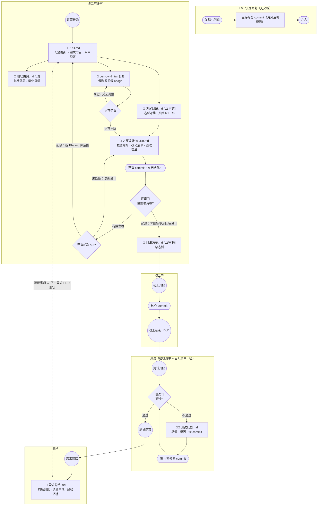

# 需求 SOP v2 —— 人类 + AI 协同开发流程

> 目标：用最少的评审轮次，让第一次核心 commit 就接近目标；让人只做决策与判断，让 AI 做生成与执行；每一轮沟通都有落盘证据与固定格式。
>
> **v2 相对 v1 的变化**：
>
> 1. 引入需求分级 L0 / L1 / L2，避免小修也走全流程导致 SOP 被架空；
> 2. 区分两条嵌套评审循环（demo 内循环 / PRD 外循环），并给评审设**门禁与止损**；
> 3. 增加方案调研、现状快照、回归清单、遗留事项回流等环节（均取自 docs/feat/ 历史实践）；
> 4. 明确动工后需求冻结、demo 契约边界、AI 完成定义（DoD）；
> 5. 提示词去掉依赖 git 暂存区的脆弱模式，增加开局恢复、交叉评审自查等条目。
>
> 完成标准引用仓库约定 [AGENTS.md](../../AGENTS.md)：任何改动必须通过 pre-commit；git 只读约定对 AI 同样生效。
> v1 原稿见同目录 `AI-assistant-develop-SOP-v1.md`（原始提交 `cbbf854`）。

## 一、需求分级

| 级别   | 适用                               | 流程                                              | 产物                                 |
| ------ | ---------------------------------- | ------------------------------------------------- | ------------------------------------ |
| **L0** | 单点 bug、文案、一行配置等         | 直接修复，commit message 注明根因                 | 修复 commit                          |
| **L1** | 有明确方案、影响面局部的功能       | PRD → 方案设计 → 评审门 → 动工 → 测试 → 总结      | PRD / 方案设计 / 测试反馈 / 需求总结 |
| **L2** | 涉及 UI 交互、技术选型或跨模块架构 | L1 + 现状快照 + 方案调研（可选）+ demo + 回归清单 | 全套文档                             |

**分级判据**（满足任一即升级）：

- 触及 UI / 交互 → 需要 demo 内循环 → **L2**
- 涉及新技术选型 / 数据模型 / 跨模块接口 → 需要方案调研 → **L2**
- 影响面跨模块，或历史上反复出过 bug 的区域 → 需要回归清单 → **L2**
- 有明确方案、影响面局部 → **L1**
- 单点修复 → **L0**

级别由人类定，AI 可给出建议（见提示词 1）。

## 二、主流程



> - 标注 `[L2]` 的节点仅 L2 需要；L1 主线 = PRD → 方案设计 → 评审门 → 动工 → 测试 → 总结。
> - 评审 commit：每轮文档迭代（PRD 纪要 / 设计 / demo）落一个评审 commit，保留历史可回溯。
> - demo 内循环（快、视觉、AI 可大量自主迭代）与 PRD 外循环（慢、涉及人的决策）分离，防止评审节奏互相拖累。

## 三、各文档说明

### 3.1 PRD.md

> 👤 人类编写（L1 / L2）

需求开启的标志。章节：

- **状态指针**：当前 Phase、评审轮次、依据文档版本。任何会话开局先读它。
  ```md
  > 状态指针：P1 · 动工前评审 R2/2 · 已冻结 · 测试中 | 完结 ✅
  > 依据：方案设计R2.md · demo-v3.html · 回归清单.md
  ```
- **现状**：锁定注意力，归档需求前是什么样；引用或内嵌现状快照（L2）。
- **目标（正）**：要做成什么样，借鉴什么。
- **约束（反）**：不要做成什么样。
- **需求节奏**：按 Phase 拆分，每个 Phase 独立方案设计（参考 `任务管理升级/PRD.md`）；暂缓的 Phase 保留研究稿并标注状态。
- **评审纪要**：每轮评审的三段式结论 + 决策，格式见「门禁与规则」第 1 条。

### 3.2 现状快照.md

> 🤖 AI 生成（L2，可并入 PRD 现状章节）

基线截图、可量化指标、复现步骤。`页面美化/现状一览.md`、`前端重构` 的 Phase 0 基线截图即此物。它是回归对照与前后对比的证据来源，**动工前必须落盘**。

### 3.3 demo.html

> 🤖 AI 生成（L2）

- 静态可打开预览：页面布局、动画效果、交互逻辑。
- **契约边界**：demo 只承载视觉与交互；API 契约以方案设计为准，冲突时以后者为准；假数据 / 假端点必须带可见 demo-badge，评审时按占位忽略（`综合评审反馈V0.md` 第 3/4 条教训）。
- 版本化 demo-vN：每轮交互评审后出新版并保留历史（`文档管理页面` demo-v0~v4 先例）。
- 人类用 DevTools 捕捉关键视图元素，用精准语言描述问题。

### 3.4 方案调研.md

> 🤖 AI 生成（L2 可选）

技术选型对比、推荐结论、风险清单 R1~Rn、明确边界。被采纳后设计文档直接引用（`Session-MVVM/方案调研-V0.md` 先例）。调研不充分时明确标注「暂缓 · 研究稿」（`任务管理升级` P2 先例），**不作为开工依据**。

### 3.5 方案设计.md

> 🤖 AI 生成（L1 / L2）

review 文档而非 review 代码。章节：

- **数据结构**：schemas、全局实例、数据库/缓存/队列、对外与跨模块接口、配置文件。
- **架构调整**：目录结构、模块划分、依赖关系。
- **文件修改清单**：新增 / 删除 / 重命名 / 修改。
- **实施顺序**：每步附该步的验收口径（`Session-MVVM/方案设计-V0.md` §6 先例）。
- **验收清单**：勾选制、可执行；AI 先提，人类在评审中补充。
- **实现注意项**：评审非阻塞提示的回填处。
- **决策记录**：本设计的取舍与依据。

版本化 R1..Rn，与评审轮次对应。

### 3.6 回归清单.md

> 🤖 生成 👤 补充（L2 / 重构类 L1）

勾选制清单；沿用历史需求的回归口径（如 `Session-MVVM` §5 六条），明确「维持现状」的口径与基线对照。测试以它为走查口径（`前端重构/回归清单.md` 先例）。

### 3.7 测试反馈.md

> 👤🤖 人类与 AI 协作生成

一个章节一个问题：

- **标题**：👤 问题的简要描述。
- **描述**：👤 出现的场景和影响。
- **修改建议**：👤 可能的解决方案和注意事项。
- **根因分析**：🤖 定位到的根因（`Session-MVVM` BUG 表证明其价值）。
- **修改反馈**：🤖 修复内容 + fix commit 号。

约定：**一轮测试的问题合并为一批，修复合并为一个 fix commit**（`c49ce16` 一轮修 BUG-001~004 先例）；fix 之后按回归清单复验，避免修复引入新问题。

### 3.8 需求总结.md

> 🤖 AI 生成

- **前后对比**：量化优先（`页面美化/前后对比.md` 先例）。
- **commit 范围**：需求相关的 commit 范围。
- **实际架构变化 / 实际修改文件**。
- **验收期追加记录**：动工后被迫追加的范围变更必须显式记录。
- **遗留事项**：喂给下一个需求的 PRD 现状（`Session-MVVM` 遗留事项 → `前端重构` 引用 BUG-003 先例）。
- **经验沉淀**：根因类教训，一句话一条。
- **仓库级文档同步**：`docs/web-arch.md`、`setup.md` 等是否需要更新（`前端重构` 已自觉执行，此处固化为规则）。

归档完成后将 PRD 状态指针更新为「完结 ✅」。

## 四、门禁与规则

1. **评审通过标准（评审门）**：每轮评审输出固定三段式——**结论**（✅ 通过 / ❌ 有阻塞项）+ **阻塞项**（必须改，进入下一轮）+ **非阻塞提示**（记录在案，不挡开工，实现时注意）。通过 = 阻塞项清零，且 PRD / demo / 方案设计 / 代码现实四方交叉核对无矛盾（`综合评审反馈V0.md` 格式）。
2. **评审轮次止损**：方案设计评审默认上限 **2 轮**（`任务管理升级` P1 用 R1/R2 两轮收敛）。超限不硬顶，改为：拆 Phase 分批落地，未定部分标注「暂缓 · 研究稿」。
3. **需求冻结**：评审门通过即冻结。动工 / 测试期的新增需求 → 新 PRD 或新 Phase；验收期被迫追加的，必须在需求总结中显式记录（`页面美化`「回到底部按钮」先例）。
4. **demo 契约边界**：见 3.3。视觉交互看 demo，接口契约看方案设计。
5. **AI 完成定义（DoD）**：动工结束 = pre-commit 通过 + 构建 / 静态检查通过 + 相关文档更新落盘；修复提交同标准（引用 AGENTS.md）。
6. **职责分工**：人 = 决策、口味判断、走查测试；AI = 生成、执行、自动化验证、根因分析。AI 不自行改变已评审通过的方向；方向变更必须回到评审门。

## 五、关键提示词

1. 需求分级建议

```text
请阅读 <PRD.md>（或问题描述），按 SOP 的需求分级标准（L0/L1/L2）给出建议级别与理由。
```

2. 开局恢复（任意新会话）

```text
请阅读 <PRD.md> 的状态指针与评审纪要，以及当前 Phase 的相关文档，报告你对现状的理解与下一步计划，不要动手。
```

3. PRD → 现状快照（L2）

```text
根据 <PRD.md> 的现状章节生成现状快照：基线截图、可量化指标清单，输出到 <现状快照.md>。
```

4. PRD → demo.html（L2）

```text
根据 <PRD.md> 生成 demo.html，展示页面布局、动画效果和交互逻辑；所有假数据与假端点必须带可见 demo-badge 标注。
```

5. PRD → 方案调研（L2 可选）

```text
根据 <PRD.md> 中待定的技术选型，输出 <方案调研.md>：候选方案对比、推荐结论、风险清单 R1~Rn。
```

6. PRD → 方案设计

```text
根据 <PRD.md>（及 <方案调研.md>）输出 <方案设计R1.md>：数据结构、架构调整、文件修改清单、实施顺序（每步附验收口径）、可勾选的验收清单。
```

7. 交叉评审自查（评审前 AI 先自查）

```text
请对 PRD / demo / 方案设计 做交叉评审，并对照现有代码现实（依赖、配置、部署接线），输出：结论、阻塞项、非阻塞提示。
```

8. 迭代设计文档

```text
PRD 与评审意见已更新并落盘到工作区文件（未提交）。请基于最新内容更新 方案设计R<n+1> 和 demo-v<n+1>，并在评审纪要中记录决策。
```

9. 动工

```text
设计已通过评审并冻结，开始动工。以 <方案设计R<n>.md> 的改动清单与实施顺序为准；完成后自查：pre-commit、构建、静态检查通过，并生成/更新 <回归清单.md>。
```

10. 测试反馈

```text
测试发现问题，已记录在 <测试反馈.md>（工作区未提交）。请逐条修复，每项附根因分析；本轮修复合并为一个 fix commit，并更新相关问题的修改反馈。
```

11. 需求完结

```text
需求已验收，请归档输出 <需求总结.md>：前后对比、commit 范围、验收期追加记录、遗留事项、经验沉淀，并同步更新仓库级文档（如 docs/web-arch.md）；最后更新 PRD 状态指针为完结。
```
